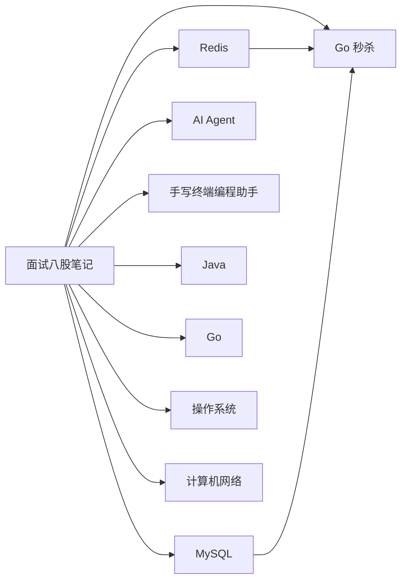

# 面试八股笔记

面向 Go 后端 / AI Agent 开发实习的结构化复习笔记。站点支持全文搜索、页内目录和代码高亮；每份笔记都可以下载 PDF。

-   **Redis**

    ---

    数据结构、持久化、高可用、缓存问题、分布式锁与缓存一致性。

    [阅读笔记](redis.md) · [下载 PDF](pdf/redis.pdf)

-   **MySQL**

    ---

    InnoDB、索引、事务 / MVCC / 锁、日志、SQL 优化与主从复制。

    [阅读笔记](mysql.md) · [下载 PDF](pdf/mysql.pdf)

-   **Go 秒杀**

    ---

    Redis 预扣 + MySQL 兜底的设计文档与对应 Go 代码，知识点链回 Redis / MySQL 笔记。

    [阅读笔记](seckill.md) · [下载 PDF](pdf/seckill.pdf)

-   **AI Agent**

    ---

    大模型基础、Prompt 与推理、Agent 设计、工具调用 / MCP、RAG、记忆与评估。

    [阅读笔记](agent.md) · [下载 PDF](pdf/agent.pdf)

-   **手写终端编程助手**

    ---

    独立实现的项目规格：六个里程碑涵盖工具循环、会话恢复、技能、文件操作、MCP、扩展、RPC 和终端界面；每阶段附行为规格、数据结构与验收。

    [阅读设计](terminal-agent/index.md) · [下载 PDF](pdf/terminal-agent-index.pdf)

-   **Java**

    ---

    Java 基础与集合：面向对象、异常、List / Set / Map 与 ConcurrentHashMap。

    [阅读笔记](java.md) · [下载 PDF](pdf/java.pdf)

-   **Go**

    ---

    slice / map、channel、GMP、内存管理与 GC，以及常见并发模式。

    [阅读笔记](go.md) · [下载 PDF](pdf/go.pdf)

-   **操作系统**

    ---

    CPU 缓存、内存管理、进程线程与调度、文件系统、设备与 Linux 性能排查。

    [阅读笔记](os.md) · [下载 PDF](pdf/os.pdf)

-   **计算机网络**

    ---

    HTTP/HTTPS、TCP、UDP/QUIC、IP、DNS，以及从输入网址到页面显示。

    [阅读笔记](network.md) · [下载 PDF](pdf/network.pdf)

## 图表示例

笔记里的架构图使用等宽代码块（ASCII）。站点同时支持 Mermaid，下面是这些笔记的关系：

秒杀示例的可运行代码在仓库 [`seckill/`](https://github.com/LosAveRoad/interview-prep/tree/main/seckill) 目录，说明见 [Go 秒杀系统](seckill.md)。
