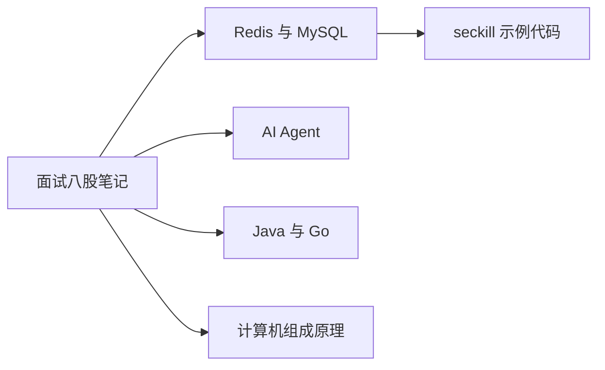

# 面试八股笔记

面向 Go 后端 / AI Agent 开发实习的结构化复习笔记。站点支持全文搜索、页内目录和代码高亮；每份笔记都可以下载 PDF。

-   **Redis & MySQL**

    ---

    数据结构、持久化、缓存与一致性、事务 / MVCC / 锁，以及 Go 秒杀系统设计与代码。

    [阅读笔记](redis-mysql.md) · [下载 PDF](pdf/redis-mysql.pdf)

-   **AI Agent**

    ---

    大模型基础、Prompt 与推理、Agent 设计、工具调用 / MCP、RAG、记忆与评估。

    [阅读笔记](agent.md) · [下载 PDF](pdf/agent.pdf)

-   **Java & Go**

    ---

    Java 基础与集合，以及 Go 的 slice / map、GMP、GC 和常见并发模式。

    [阅读笔记](java-go.md) · [下载 PDF](pdf/java-go.pdf)

-   **计算机组成原理**

    ---

    数据表示、存储与 Cache、指令系统、CPU 与流水线、总线和 I/O。

    [阅读笔记](computer-organization.md) · [下载 PDF](pdf/computer-organization.pdf)

## 图表示例

笔记里的架构图使用等宽代码块（ASCII）。站点同时支持 Mermaid，下面是这四份笔记的关系：

秒杀示例的可运行代码在仓库 [`seckill/`](https://github.com/LosAveRoad/interview-prep/tree/main/seckill) 目录，说明见 Redis & MySQL 笔记的第三部分。
