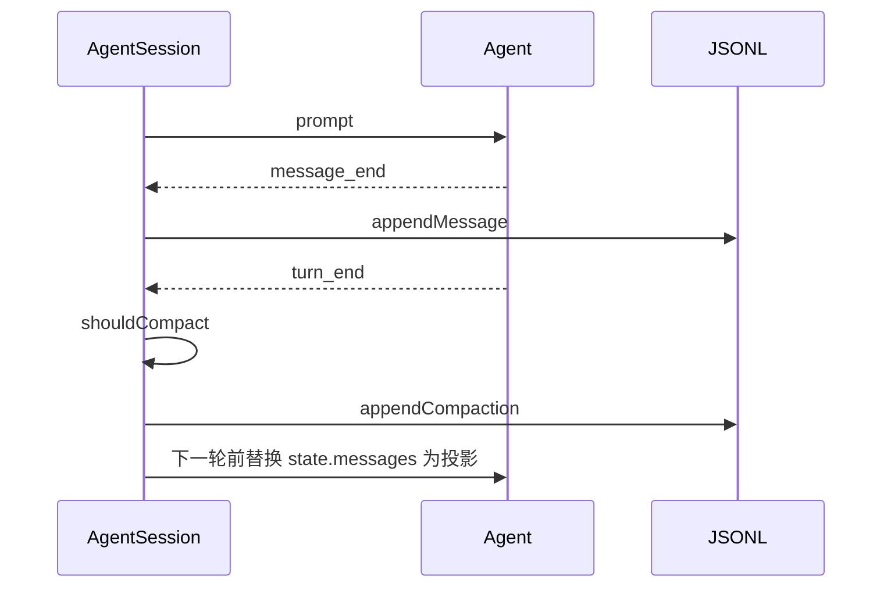

# 上下文压缩与中断恢复

## 背景

`@my/session` 把 `Agent` 的 `message_end` 追加成 JSONL 树，并在上下文超过阈值时写入 `compaction` 条目。上游实现是 `packages/coding-agent/src/core/session-manager.ts` 的 `SessionManager`、`buildSessionContext`，以及 `core/compaction/compaction.ts` 的 `shouldCompact`、`prepareCompaction`、`compact`。把事件接到磁盘的是 `core/agent-session.ts`。

`packages/durable` 要求副作用展示之前先提交。本包不这样做。崩溃一致性停在最后一条完整 JSON 行。这个选择在 M2 完成定义里验收，不要半套实现 durable。

## 目标与非目标

**目标**

- 文件格式稳定到字段名。后续里程碑只追加条目，不改已有字段的含义。
- 打开已有文件能重建 `Agent.state.messages`，并补上悬空 tool call。

**非目标**

- 不生成 `branch_summary`。联合类型里保留这个变体，解析时认它，投影时把它转成一条 user 消息。没有 `appendBranchSummary` 方法。
- 不迁移 v1/v2。`version` 不是 3 的 header 直接抛 `Error("unsupported session version")`。
- 不 `fsync`。

## 本模块在仓库中的位置

```text
packages/session/
  package.json
  tsconfig.json
  src/index.ts
  src/types.ts              # 上游 session-manager.ts 的 SessionHeader / SessionEntry
  src/session-manager.ts    # class SessionManager
  src/projection.ts         # buildSessionProjection、buildSessionContext
  src/tokens.ts             # estimateTokens、calculateContextTokens
  src/compaction.ts         # shouldCompact、prepareCompaction、compact
  src/agent-session.ts      # class AgentSession
  test/session-manager.test.ts
  test/projection.test.ts
  test/compaction.test.ts
  test/resume.test.ts
```

| 文件 | 职责 |
|---|---|
| `types.ts` | 可序列化的条目联合。不含方法 |
| `session-manager.ts` | 追加、叶子、读写文件。不调用模型 |
| `projection.ts` | 从叶子走到根，应用最新 compaction 和 context_edit |
| `tokens.ts` | 计数。`estimateTokens` 用字符数除以 4，再向上取整，最小 1。不要接 tokenizer |
| `compaction.ts` | 纯函数。摘要由调用方传入的 `SummarizeFn` 生成 |
| `agent-session.ts` | 持有 `Agent` 和 `SessionManager`。订阅事件、写盘、abort、触发压缩 |

**依赖**：只 import `@my/agent-core`。路径编码函数在本文件内私有复制一份，算法与总览的 `encodeSessionDir` 一致。不 import `@my/resources`。

**磁盘**

```text
$MY_AGENT_DIR/sessions/--<encoded-cwd>--/<timestamp>_<sessionId>.jsonl
```

`MY_AGENT_DIR` 默认 `~/.my-agent`。`<timestamp>` 是 header 里的 ISO 时间，把 `:` 和 `.` 换成 `-`。文件在第一条 user 或 assistant 消息追加时用 `open(..., "wx")` 创建，先写入已经在内存中的 header 和更早的 system 消息，再写这一条。之后只用 `appendFile`。

## 接入 agent 循环



`AgentSession` 在构造时 `agent.subscribe`。监听器对 `message_end` 调用 `appendMessage`，然后才 resolve，这样上游「监听器是屏障」的语义保留。压缩发生在 `Agent` 的 `prepareRequest` 钩子里：若 `shouldCompact` 为真，先 `compact` 并 `appendCompaction`，再把 `buildSessionContext().messages` 设回 `agent.state.messages`。不要在工具 `execute` 里压缩。

## 核心数据结构

### 文件行

第一行永远是 header，没有 `id` 和 `parentId`。其余每一行都是 `SessionEntry`。

```ts
export const CURRENT_SESSION_VERSION = 3;

export interface SessionHeader {
  type: "session";
  version: 3;
  id: string;
  timestamp: string;       // ISO 8601
  cwd: string;
  parentSession?: string;  // M2 不写这个字段
}

export interface SessionEntryBase {
  id: string;              // 8 hex，或冲突后退回的 UUID
  parentId: string | null;
  timestamp: string;       // ISO 8601
}

export interface SessionMessageEntry extends SessionEntryBase {
  type: "message";
  message: AgentMessage;   // timestamp 仍是毫秒数字
}

export interface ModelChangeEntry extends SessionEntryBase {
  type: "model_change";
  provider: string;
  modelId: string;
}

export interface ThinkingLevelChangeEntry extends SessionEntryBase {
  type: "thinking_level_change";
  thinkingLevel: ThinkingLevel;
}

export interface CompactionEntry extends SessionEntryBase {
  type: "compaction";
  summary: string;
  firstKeptEntryId: string;
  tokensBefore: number;
  details?: { readFiles: string[]; modifiedFiles: string[] };
  usage?: Usage;
  fromHook?: boolean;
  systemMessage?: SystemMessage;
}

export interface ContextEditEntry extends SessionEntryBase {
  type: "context_edit";
  targetId: string;
  replacement: { content: string } | null;
}

export interface BranchSummaryEntry extends SessionEntryBase {
  type: "branch_summary";
  fromId: string;
  summary: string;
}

export interface CustomEntry extends SessionEntryBase {
  type: "custom";
  customType: string;
  data?: unknown;
}

export interface CustomMessageEntry extends SessionEntryBase {
  type: "custom_message";
  customType: string;
  content: string;
  display: boolean;
}

export type SessionEntry =
  | SessionMessageEntry
  | ModelChangeEntry
  | ThinkingLevelChangeEntry
  | CompactionEntry
  | ContextEditEntry
  | BranchSummaryEntry
  | CustomEntry
  | CustomMessageEntry;

export type FileEntry = SessionHeader | SessionEntry;
```

对应上游同名接口。M2 的写入方法只实现 `message`、`compaction`、`context_edit`、`model_change`、`thinking_level_change`。另外三种解析后放进树，但没有 append API。`label`、`usage`、`session_info` 不进联合类型。读到未知 `type` 时跳过该行并记一条 warning，不要抛错，这样以后加条目不会让旧程序拒绝文件。

不变量：

- `parentId` 要么是 `null`（根），要么指向本文件里更早出现的 `id`。追加时父指针就是当前 `leafId`。
- `compaction.firstKeptEntryId` 必须是本文件已有的 `id`，或者等于这条 compaction 自己的 `id`（表示前面都不保留）。
- 禁止通过 `appendMessage` 写入一种自制的 `role: "compactionSummary"`。上游 `appendMessage` 明确拒绝把摘要塞进 message。

### 压缩设置和准备结果

```ts
export interface CompactionSettings {
  enabled: boolean;
  reserveTokens: number;     // 默认 16384
  keepRecentTokens: number;  // 默认 20000
}

export const DEFAULT_COMPACTION_SETTINGS: CompactionSettings = {
  enabled: true,
  reserveTokens: 16384,
  keepRecentTokens: 20000,
};

export interface CompactionPreparation {
  firstKeptEntryId: string;
  messagesToSummarize: AgentMessage[];
  turnPrefixMessages: AgentMessage[];
  isSplitTurn: boolean;
  tokensBefore: number;
}

export interface CompactionResult {
  summary: string;
  firstKeptEntryId: string;
  tokensBefore: number;
}

export type SummarizeFn = (messages: AgentMessage[], signal?: AbortSignal) => Promise<string>;
```

`shouldCompact`：

```ts
export function shouldCompact(contextTokens: number, contextWindow: number, settings: CompactionSettings): boolean {
  if (!settings.enabled) return false;
  return contextTokens > contextWindow - settings.reserveTokens;
}
```

`contextTokens` 的算法：从投影末尾找最后一条 `stopReason` 不是 `error`/`aborted` 且 `usage.totalTokens > 0` 的 assistant。用它的 `totalTokens`，再加上它之后每条消息的 `estimateTokens`。找不到这样的 assistant 时，全部用 `estimateTokens` 相加。

### 投影

```ts
export interface SessionContext {
  messages: AgentMessage[];
  thinkingLevel: ThinkingLevel;
  model: { provider: string; modelId: string } | null;
}

export function buildSessionContext(entries: SessionEntry[], leafId: string | null): SessionContext
```

算法：

1. 从 `leafId` 沿 `parentId` 走到根，再反转成从旧到新。`leafId === null` 时消息为空。
2. 路径上若有 `compaction`，只用最后一条。结果序列等于：这条 compaction 产生的消息，加上 `firstKeptEntryId` 到 compaction 之前的非 system 条目，再加上 compaction 之后的条目。
3. compaction 产生的消息是：可选的 `systemMessage`，然后一条 `UserMessage`，`content` 为摘要文本。不要发明新的 role。上游用 `compactionSummary` 自定义消息；手搓默认把它变成 user 文本，并在正文前加固定前缀 `[compaction]\n`，这样 `convertToLlm` 不用认识新 role。这是写明的偏差。
4. 对路径上的 `context_edit`，同一 `targetId` 以靠近叶子的那条为准。`replacement: null` 则目标不产生消息。非空则只替换 `content`，role 不变。
5. `model_change` 和 `thinking_level_change` 不产生消息。投影的 `model` 和 `thinkingLevel` 取路径上最后一条。
6. `custom` 不产生消息。`custom_message` 产生 user 消息，`content` 用条目的 `content`。
7. `branch_summary` 产生 user 消息，前缀 `[branch]\n`。

### 会话运行状态

```ts
type SessionPhase =
  | { phase: "idle" }
  | { phase: "running" }
  | { phase: "compacting" }
  | { phase: "aborting" };
```

`prompt` 只允许从 `idle` 进入 `running`。压缩期间是 `compacting`，此时 `abort()` 把传给 `SummarizeFn` 的 `AbortSignal` 触发，并回到 `idle`，不写 compaction 行。不要在 `compacting` 时接受新的 `prompt`。

### AgentSession 事件

在 `AgentEvent` 之外再加三种，订阅者仍然看 `type`：

```ts
export type AgentSessionEvent =
  | AgentEvent
  | { type: "compaction_start"; reason: "manual" | "threshold" }
  | { type: "compaction_end"; reason: "manual" | "threshold"; ok: boolean }
  | { type: "queue_update"; steering: string[]; followUp: string[] };
```

上游还有 `overflow` reason 和 `willRetry`。M2 的自动压缩只用 `threshold` 和 `manual`。溢出恢复若做了，复用 `threshold`，不要加第三个字符串，除非测试需要区分。默认：溢出恢复的事件 reason 用 `"threshold"`。

## 方案

### SessionManager

```ts
export class SessionManager {
  static create(cwd: string, options?: { agentDir?: string; sessionFile?: string; persist?: boolean; id?: string }): SessionManager;
  getSessionFile(): string | undefined;
  getLeafId(): string | null;
  getBranch(): SessionEntry[];
  getEntries(): FileEntry[];
  appendMessage(message: AgentMessage): string;
  appendCompaction(summary: string, firstKeptEntryId: string, tokensBefore: number, details?: CompactionEntry["details"], usage?: Usage): string;
  appendContextEdit(targetId: string, replacement: { content: string } | null): string;
  appendModelChange(provider: string, modelId: string): string;
  appendThinkingLevelChange(level: ThinkingLevel): string;
  buildSessionContext(): SessionContext;
}
```

`append*` 生成 `id`，`parentId = leafId`，然后 `leafId = id`，再 `_persist`。`persist: false` 时只改内存，测试用这个模式可以不碰磁盘。`resume.test.ts` 必须用 `persist: true`。

`loadEntriesFromFile`：按行解析，空行跳过，`JSON.parse` 失败的行跳过。header 缺失或 `version !== 3` 则抛错。

### 切点

`prepareCompaction(branch, settings)` 只看 `buildSessionContext` 之前的原始 branch（叶子到根的条目），但 token 用投影后的消息估算。规则：

1. 路径最后一条已经是 `compaction` 时返回 `undefined`。
2. 从尾部向前累加 `estimateTokens`，直到和 ≥ `keepRecentTokens`。切点是仍要保留的第一条。
3. 合法切点的条目类型：`message` 且 role 是 `user`、`assistant` 或 `system` 不算切点；system 永远留在检查点里，不单独当切点。切在 user 或 assistant 的 message 上。不要切在 toolResult 上。若计算出的下标落在 toolResult，向更早的方向移到它所属的 assistant。
4. 若从切点到尾部没有一条 user，说明一个 user 回合超了预算。这是 split turn：`turnPrefixMessages` 是该 user 到切点之前的消息，`messagesToSummarize` 是更早的消息。两次调用 `SummarizeFn`，用 `\n---\n` 拼成一条摘要。
5. 没有任何可摘要消息时返回 `undefined`。

`compact()` 调用 `SummarizeFn`，signal abort 时抛出或返回拒绝。`AgentSession` 捕获后发 `compaction_end` 且 `ok: false`，不调用 `appendCompaction`。

`appendCompaction` 时 `systemMessage` 取当前投影里的首条 system 消息的深拷贝。`firstKeptEntryId` 由 `prepareCompaction` 给出，不要在 append 时重新计算。

### 悬空 tool call

`AgentSession` 在 `SessionManager.create` 打开已有文件之后立刻跑一次 `repairDanglingToolCalls()`：

```ts
function repairDanglingToolCalls(session: SessionManager): void {
  const messages = session.buildSessionContext().messages;
  const answered = new Set(messages.filter((m) => m.role === "toolResult").map((m) => m.toolCallId));
  for (const message of messages) {
    if (message.role !== "assistant") continue;
    for (const block of message.content) {
      if (block.type !== "toolCall" || answered.has(block.id)) continue;
      session.appendMessage({
        role: "toolResult",
        toolCallId: block.id,
        toolName: block.name,
        content: [{ type: "text", text: "Tool result missing because the process exited before it was recorded." }],
        isError: true,
        timestamp: Date.now(),
      });
    }
  }
}
```

不读取 `AgentTool.replay`。M2 一律补错误结果，不重放工具。`replay: "safe"` 留给以后，现在即使工具标了 `safe` 也不重跑。

### abort

```ts
async abort(): Promise<void> {
  this.phase = "aborting";
  this.compactAbort?.abort();
  this.agent.abort();
  await this.agent.waitForIdle();
  this.phase = "idle";
}
clearQueue(): { steering: string[]; followUp: string[] }
```

`clearQueue` 把 `Agent` 队列里还没变成 `message_end` 的用户文本取出来并清空。这些字符串不调用 `appendMessage`。交互层以后把它们放回编辑器。

## 备选方案

| 方案 | 放弃原因 |
|---|---|
| 压缩时截断文件 | 叶子切回旧节点时原文要还在。`context_edit` 也依赖这一点 |
| 每次重写整个文件 | 崩溃会损坏全部历史。追加把损坏限制在最后一行 |
| 自定义 `role: "compactionSummary"` | `convertToLlm` 和假模型都要认识它。M2 用带前缀的 user 消息，投影测试锁住前缀 |

## 横切关注点

- **错误**：摘要失败保留原树。`compaction_end.ok === false`。
- **并发**：`phase !== "idle"` 时 `prompt` 抛 `Error("session is busy")`。
- **持久化**：`wx` 创建，之后 append。两个进程写同一文件不在 M2 解决。CLI 不支持同时开两个会话写同一路径。
- **用量**：`tokensBefore` 是压缩前的估算值，写入后不要再改。

## 手搓实现笔记

按总览 M2 的 7 步。投影测试先于 `prepareCompaction`。修悬空 tool call 的测试用一个手写的 JSONL 字符串，不要靠杀掉进程。`agent-session.ts` 的订阅器是写盘的唯一位置，`SessionManager` 不要 import `Agent`。
