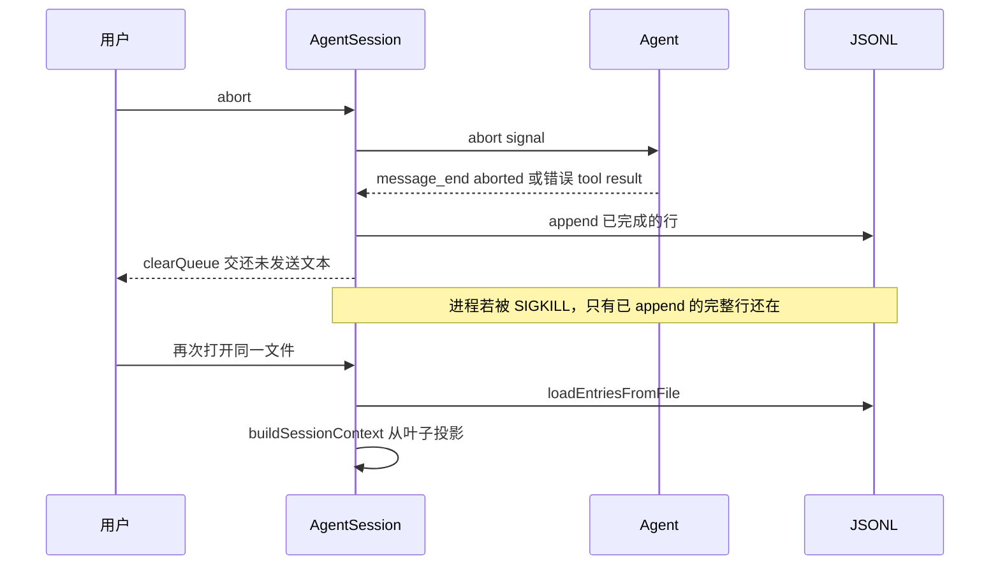

# 上下文压缩与中断恢复

## 背景

agent-core 的 `Agent.state.messages` 只活在内存里。coding-agent 用两套机制把对话变成可恢复、可裁剪的上下文：

- **会话树**：`packages/coding-agent/src/core/session-manager.ts` 的 `SessionManager` 把每条记录追加到 JSONL。`id` / `parentId` 组成树，当前叶子决定 active branch。
- **压缩**：`packages/coding-agent/src/core/compaction/compaction.ts` 在上下文接近窗口时，把旧消息换成摘要，原文仍留在文件里。`/tree` 切分支时另有 `branch-summarization.ts`，给离开的那条分支写 `BranchSummaryEntry`。

`AgentSession`（`core/agent-session.ts`）把两者接到 `Agent` 上：`message_end` 写盘，`prepareNextTurnWithContext` 在下一轮 assistant 之前调用 `_compactBeforeNextAssistantResponse`。

`packages/durable` 是对照，不是这条路径的实现。它要求可见进度都先提交到存储，进程死在 turn 中间也能从 storage 接着做。coding-agent 没有这个事务，崩溃一致性停在「最后一条完整 JSON 行」。

## 目标与非目标

**目标**

- 已完成的 user、assistant、toolResult 在 `message_end` 时追加到磁盘，杀进程后能从叶子重建模型上下文。
- 用户 abort 时，当前 run 停干净，已落盘的消息保留，未发出的队列回到输入框。
- 上下文超过阈值时自动压缩，手动 `/compact` 走同一套 `compact()`。

**非目标**

- 不保证工具副作用和 tool result 落盘是同一个事务。进程在 `execute()` 中被杀掉时，文件可能停在「assistant 已发出 tool call、结果还没有」。
- 不在 M2 实现 `pi-durable` 的任务图、文档复制或 Chord 事务。
- 不把压缩做成删历史。`CompactionEntry` 只改变**以后的模型视图**。UI、导出和计费仍能看到原始条目。

## 方案

### 文件与版本

默认路径形如 `~/.pi/agent/sessions/--<cwd>--/<timestamp>_<session-id>.jsonl`。路径里的 `/`、`\`、`:` 换成 `-`。

第一行是 header，不进树：

```json
{"type":"session","version":3,"id":"<uuid>","timestamp":"...","cwd":"/path"}
```

`CURRENT_SESSION_VERSION` 为 3。v1 是线性历史，v2 引入树，v3 把旧的 `hookMessage` role 改名为 `custom`。`migrateSessionEntries` 在加载时迁到 v3。

文件要到出现第一条 user 或 assistant 才创建。只有模型切换、思考档位、system prompt 的会话留在内存里，避免打开又退出留下空文件（`_hasConversation`）。从 user 消息而不是第一条 assistant 开始落盘，这样第一轮没跑完时 prompt 已经在磁盘上。

追加使用 `appendFileSync` 写一行 JSON。`loadEntriesFromFile` 按行解析，坏行跳过。因此最后一行被写到一半时，恢复会丢掉这一行，而不是拒绝整个会话。这里没有 `fsync`。

### 条目

除 header 外，条目都有 `id`、`parentId`、`timestamp`。`append*` 把新条目的 `parentId` 设为当前叶子，然后叶子前进。从较早的条目开分枝不会改旧记录。

| `type` | 是否进入模型上下文 | 作用 |
|---|---|---|
| `message` | 是 | 存一条 `AgentMessage`。system 消息携带 prompt 段和 `toolsAdded` / `toolsRemoved` |
| `model_change` / `thinking_level_change` | 否，但影响下次请求的设置 | 分支上最新的一条生效 |
| `compaction` | 变成 system 检查点 + 摘要 | `firstKeptEntryId` 指向仍保留原文的第一条 |
| `branch_summary` | 变成摘要消息 | `fromId` 是被离开的叶子 |
| `context_edit` | 自身不产生消息 | 把更早某条从模型视图里删掉或替换正文 |
| `custom` | 否 | 扩展自己的状态，例如虚拟模型路由状态 |
| `custom_message` | 是 | 扩展注入的上下文，`display` 控制 UI |
| `label` / `session_info` / `usage` | 否 | 书签、显示名、非 assistant 的用量 |

`message` 条目的时间戳是 ISO 字符串；嵌套消息的 `timestamp` 是毫秒。assistant 消息带 `provider`、`model`、`usage`、`stopReason`，较新的还带 `thinkingLevel`。

`CompactionSummaryMessage` 和 `BranchSummaryMessage` 不能通过 `appendMessage` 写入。它们必须是顶层 `compaction` / `branch_summary`，方便查找。`appendMessage` 的注释写明了这一点。

### 从叶子重建上下文

`buildContextEntries` 从叶子走到根。路径上如果有 `CompactionEntry`，只用**最新**的一条：

1. 放上这条 compaction。
2. 保留 `firstKeptEntryId` 到 compaction 之前的非 system 条目。
3. 保留 compaction 之后的条目。

`buildSessionProjection` 再应用路径上每个目标最新的 `context_edit`。`replacement: null` 表示从模型视图省略；非空则只替换正文。编辑是分支局部的，回到编辑之前的叶子，原文会重新出现。

`buildSessionContext` 在投影上取当前模型和思考档位，并把条目转成消息：compaction 变成完整的 system 检查点加上 `compactionSummary`，`branch_summary` 变成 `branchSummary`，`custom_message` 变成 `CustomMessage`。压缩摘要替换 `firstKeptEntryId` 之前的内容。保留区间里的旧 system 消息不再回放，避免和检查点重复。

`AgentSession._refreshFinalizedContext` 把投影写回 `agent.state.messages`。这是恢复后模型真正看到的数组。


### 压缩何时发生

`shouldCompact`：

```text
settings.enabled && contextTokens > contextWindow - reserveTokens
```

`DEFAULT_COMPACTION_SETTINGS` 是 `enabled: true`、`reserveTokens: 16384`、`keepRecentTokens: 20000`。`reserveTokens` 只决定何时开始，不决定摘要请求的输出长度。摘要请求会按模型输出上限缩小，使输入加输出仍放得进窗口。

token 数优先用最近一条有效 assistant 的 `usage.totalTokens`（或 input + output + cacheRead + cacheWrite）。`stopReason` 为 `aborted` / `error`，或用量全 0 的消息不算。这条用量之后的消息用 `estimateTokens` 估算后相加。若路径上更晚有 `context_edit` 或 `compaction`，旧 usage 作废，改为按投影重估，避免刚压完又被旧的大 usage 立刻再压一次。

触发点在 `AgentSession`，不在 agent-core：

- 多轮 run 里，工具结果追加之后、下一次 assistant 之前，经 `prepareNextTurnWithContext` → `_compactBeforeNextAssistantResponse`。若这批工具 `terminate` 且没有排队消息，则跳过。
- 新的用户 prompt 之前也会查。
- provider 报上下文溢出，或过早的 `stopReason: "length"`，可以做**一次** compact-and-retry。
- 手动 `AgentSession.compact(instructions?)`。

agent-core 的 `runLoop` 在 `prepareNextTurn` 之后、若当时 steering 为空，会再 poll 一次。压缩期间用户打进来的 steering 不会丢，也不会在 `one-at-a-time` 下同一轮送出两条。

### 切点与摘要

`prepareCompaction(pathEntries, settings)` 是纯函数。若路径最后一条已经是 compaction，返回 `undefined`，避免空转。

算法要点：

1. 用 `buildSessionProjection` 得到模型可见条目。上一次 compaction 的摘要作为迭代上下文，摘要区间从它的保留边界开始，而不是从会话开头重算。
2. 从尾部向前累加估算 token，直到覆盖 `keepRecentTokens`。切点落在 user、assistant、bash、custom message 上，**不**切在 tool result 上，否则 tool call 会和结果拆开。
3. 正常情况按 user 消息边界切。若单个 user 回合本身超过预算，切点可以落在该回合内部的 assistant 上，这叫 split turn：历史和回合前缀各摘要一次，再用 `---` 拼成一条。
4. 从被摘要的消息和上一次 compaction 的 `details` 里累计 `readFiles` / `modifiedFiles`（`compaction/utils.ts` 的 `extractFileOpsFromMessage`）。
5. `compact()` 调用模型生成摘要。摘要请求不写 prompt cache，因为这种一次性请求几乎不会被复用。`CompactionResult` 含 `summary`、`firstKeptEntryId`、`tokensBefore`、可选 `usage` 和 `details`。

`SessionManager` 负责补 `id` / `parentId` 并追加 `CompactionEntry`。之后 session 重载上下文：模型先看到检查点 system 消息和摘要，再看到 `firstKeptEntryId` 起的原文。`tokensBefore` 在写入前按重建后的投影重算。

`retain-none` 的压缩把 `firstKeptEntryId` 设成 compaction 自己的 id，表示前面一条原文都不留。下一次压缩从这条之后开始。

扩展可以听 `session_before_compact`（`core/extensions/types.ts`）。它若给出摘要，就写入 `fromHook: true` 的条目，默认 `compact()` 不再跑。失败走 `session_compact_failed`。`fromHook` 是历史字段名，现在表示「来自扩展」。

### 溢出恢复的顺序

溢出或 length 的恢复不改写已经发生的 `turn_end` / `agent_end`。完成后的尝试先被看见，再修模型上下文，然后开一轮新的 run：

```text
持久化最终 assistant
→ turn_end / agent_end
→ 为这次尝试追加 context_edit 省略
→ 成功时跑 session_before_compact 并追加 compaction
→ 作为新 run 重试
```

带 tool call 的 length 响应保留合成的失败 tool result，走普通的工具 / 队列调度，不强制结束 run。恢复压缩失败或被取消时，省略编辑保留，不追加 compaction，也不做内部重试。

### 分支摘要

`/tree` 从旧叶子切到另一条路径时，`branch-summarization.ts` 找新旧路径的最深公共祖先，收集被离开的那一侧，在 token 预算内从新到旧选取消息，生成 `BranchSummaryEntry`。`parentId` 是新分支的起点，`fromId` 是旧叶子。文件读写集合同样累加进 `details`。这不是自动压缩，不要在 M2 里和阈值压缩绑在一起。

### 中断

`AgentSession.abort()`：

1. 若 run 还活着，置 `_agentRunAbortRequested`。
2. 取消重试、压缩和分支摘要。
3. 调用 `agent.abort()`，使 `StreamFn` 和工具的 `AbortSignal` 触发。
4. `await waitForIdle()`。

进程内 abort 时，工具 `execute` 抛错会被 `executePreparedToolCall` 收成 `isError` 的 tool result，随后 `message_end` 落盘。assistant 若停在 `stopReason: "aborted"`，这条消息也会在 `message_end` 写入。`clearQueue()` 把尚未注入的 steering 和 follow-up 交还调用方（交互模式放回编辑器），不写进会话。

恢复会话是 `SessionManager` 打开已有文件，`_loadEntries` 后叶子停在文件顺序的当前头。`AgentSessionRuntime` 在 `/resume` 前先 `abort()` 当前 run，再切换文件，并发 `session_start`，`reason` 为 `"resume"`。



### 和 pi-durable 的差别

`packages/durable/README.md` 的不变量是：对话、模型 turn、工具调用和自有状态在展示之前提交；进程死在 turn 中途，重开 storage 会从停下的地方继续。工具效果不放在存储事务里执行。状态复制用 Chord 的 `replicatedState`。

coding-agent 做不到这一点。它在 `message_end` 追加一行，工具效果发生在追加 tool result 之前。手搓 M2 应明确选择 JSONL 语义，并在恢复时修补悬空 tool call，而不是半套实现 durable。

悬空 tool call 的修补是手搓必须加的，上游加载器不会自动补：若叶子路径上 assistant 含 tool call，且后面没有对应 `toolResult`，恢复时追加一条 `isError: true` 的结果，说明进程在工具执行期间退出。不要重新执行 `replay !== "safe"` 的工具。

## 备选方案

| 方案 | 放弃原因 |
|---|---|
| 只保留滑动窗口、直接丢弃旧消息 | 模型会忘掉已做的文件修改。上游用摘要，并把读写路径放进 `details`。 |
| 压缩时改写或截断 JSONL | 破坏树、导出和「回到压缩前叶子仍能看见原文」的 `context_edit` 语义。 |
| 每次消息都重写整个文件 | `appendFileSync` 把崩溃窗口限制在最后一行。全量重写在崩溃时更容易损坏整份历史。 |
| M2 改用 durable Session | 恢复更强，但要同时引入任务状态机和 Chord。与「先跑通 JSONL」的依赖顺序不符。 |

## 横切关注点

- **错误**：摘要调用失败不删除已有历史。溢出恢复失败时保留 `context_edit` 省略，避免把失败的超长尝试再次送给模型。
- **并发**：压缩发生在 `prepareNextTurn`，此时上一轮工具已经结束。不要在工具 `execute` 里触发压缩。`abortCompaction` 必须让 `compact()` 的 `AbortSignal` 生效，避免 abort 后摘要仍写进树。
- **持久化**：一行一个 JSON 对象。加载端跳过坏行。若要更强的崩溃保证，手搓可以在追加后 `fsync`，上游没有这样做。
- **用量**：摘要的 `usage` 计入会话总计，但摘要消息本身是模型上下文的一部分，不要把它再算进「未压缩的原文 token」。

## 手搓实现笔记

1. 先写 header、`message` 追加、从叶子回放到 `messages[]`。用一个内存数组模拟也行，但验收要落到真实文件并杀掉进程再读。
2. 接上 `Agent.subscribe`：只在 `message_end` 追加。`message_update` 不写盘。
3. 实现 abort：signal 进假模型和工具；idle 之后文件含 aborted assistant；队列文本不在文件里。
4. 写恢复修补：悬空 tool call → 错误 tool result。
5. 再写 `shouldCompact`、`prepareCompaction`、假摘要和 `CompactionEntry` 投影。用固定 token 估算，先不要接真实 tokenizer。
6. 分支摘要和扩展钩子放到这条路径稳定之后。

验收用例至少包括：压缩后原文仍在文件中、模型请求不含切点之前的 user 文本、坏的最后一行被忽略、abort 与 SIGKILL 两种中断的可见行为不同。
