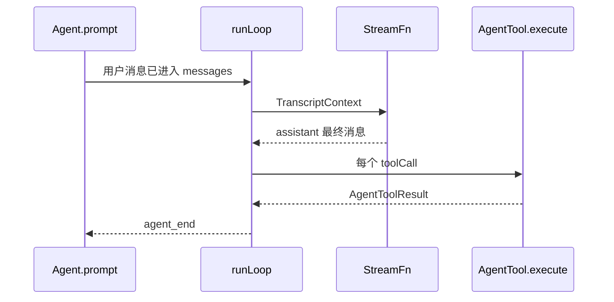

# pi-agent-core 设计

## 背景

`@my/agent-core` 对应上游 `packages/agent`。它持有内存中的 transcript，调用 `StreamFn`，执行工具，发出 `AgentEvent`。它不写磁盘，不知道 skill 和 TUI。上游 `Agent` 类在 `packages/agent/src/agent.ts`，循环在 `agent-loop.ts` 的 `runLoop`，公共类型在 `types.ts`。

LLM 边界只实现上游 `@earendil-works/pi-ai` 里循环真正读取的字段，放在本包 `src/llm.ts`。不要把 `packages/ai` 的供应商实现抄进来。

## 目标与非目标

**目标**

- M1 结束时，本页列出的文件和类型能够编译，并用假 `StreamFn` 跑完工具循环。
- 事件名、`stopReason` 和工具结果字段与上游一致，后面的会话层按这些名字写 JSONL。

**非目标**

- 不实现 `streamProxy`（上游 `packages/agent/src/proxy.ts`）。CLI 不需要浏览器代理。
- 不实现 `thinking` 内容块的展示。类型里保留 `ThinkingContent`，假模型不发出它。
- 不在本包估算 token 或压缩。

## 本模块在仓库中的位置

```text
packages/agent-core/
  package.json                 # @my/agent-core，依赖 typebox
  tsconfig.json
  src/index.ts                 # export * from llm.ts、types.ts、agent.ts、agent-loop.ts
  src/llm.ts                   # 上游 packages/ai/src/types.ts 的最小消息集
  src/types.ts                 # 上游 packages/agent/src/types.ts
  src/agent.ts                 # 上游 packages/agent/src/agent.ts 的 Agent 与队列
  src/agent-loop.ts            # 上游 packages/agent/src/agent-loop.ts 的 runLoop
  src/fake-stream.ts           # scriptedStream。index.ts 不 re-export
  test/fake-stream.ts          # 只 re-export src/fake-stream.ts
  test/agent-loop.test.ts
  test/queues.test.ts
  test/tools.test.ts
```

| 文件 | 职责 |
|---|---|
| `llm.ts` | `Model`、`StreamFn`、四条消息、`Usage`、`StopReason`。不含 HTTP |
| `types.ts` | `AgentEvent`、`AgentTool`、`AgentState`、`AgentLoopConfig`、队列模式 |
| `agent.ts` | 状态、订阅、steering/follow-up、把 `runLoop` 的事件交给监听器并 await |
| `agent-loop.ts` | 纯函数式循环：组请求、流式读完 assistant、执行工具、决定是否继续 |
| `src/fake-stream.ts` | 脚本化的 `StreamFn`。`MY_AGENT_FAKE=1` 时 `apps/cli/src/wire.ts` 直接 import 它 |
| `test/fake-stream.ts` | 只 re-export `scriptedStream`，避免测试和 CLI 各写一份脚本 |

**依赖**：本包只 import `typebox` 和 Node 内置。禁止 import `@my/session` 或其他兄弟包。

**磁盘**：无。`sessionId` 只是一个可选字符串，转给 `StreamFn`，本包不创建 `~/.my-agent`。

## 接入 agent 循环

`Agent.prompt` 是唯一入口。内部调用 `runLoop`。会话层以后只订阅事件，不复制这段控制流。



`runLoop` 的默认控制流（与上游 `agent-loop.ts` 一致，按这个顺序写，不要合并步骤）：

1. 调用 `getSteeringMessages`。没有则是空数组。
2. 若上一轮存在，先 `prepareNextTurn`。若第 1 步没取到 steering，再取一次。然后发 `turn_start`。第一轮没有上一轮，不发第二次 steering 读取，直接进入下一步，第一轮的 `turn_start` 在处理完待注入消息之前发出。
3. `declareToolChanges`，把待注入消息逐条 `message_start` / `message_end` 并推进 `messages`。
4. `prepareRequest`。它返回的 `context` / `model` / `thinkingLevel` 替换后续状态。
5. `streamAssistantResponse`。先 `transformContext`，再 `convertToLlm`，再 `StreamFn`。
6. `stopReason` 是 `error` 或 `aborted`：`finishTurn`，`turn_end`，`agent_end`，返回。
7. 有 tool call 且 `stopReason === "length"`：不执行，每条做成错误 tool result。否则 `executeToolCalls`。
8. `finishTurn`。返回 `{ action: "end" }` 则 `turn_end` 后 `agent_end`。返回 `{ action: "continue" }` 时，若本批没有工具也没有新的 steering，再空转一轮请求。
9. 否则再取 steering。有工具结果或 steering 则回到步骤 2。
10. 都没有则取 follow-up。有则回到步骤 2。没有则 `agent_end`。

## 核心数据结构

### 运行状态

`Agent` 同时只有一个 run。不要用字符串散落判断，用这个状态：

```ts
type AgentRunState =
  | { status: "idle" }
  | { status: "streaming"; abort: AbortController };
```

`prompt` 在 `status !== "idle"` 时抛 `Error("agent is busy")`。`abort()` 在 idle 时是空操作。`isStreaming` 在 `agent_end` 的监听器全部 settle 之后才变回 false。

### 模型与消息

放在 `src/llm.ts`。字段名来自 `packages/ai/src/types.ts` 的 `TextContent`、`ToolCall`、`Usage`、`SystemMessage`、`UserMessage`、`AssistantMessage`、`ToolResultMessage`。

```ts
export interface TextContent { type: "text"; text: string }
export interface ImageContent { type: "image"; data: string; mimeType: string }
export interface ThinkingContent { type: "thinking"; thinking: string }
export interface ToolCall {
  type: "toolCall";
  id: string;
  name: string;
  arguments: Record<string, unknown>;
  /** 模型给出的参数不是 JSON 对象时由 StreamFn 填上，arguments 置为 {} */
  argumentsError?: string;
}

export interface Usage {
  input: number;
  output: number;
  cacheRead: number;
  cacheWrite: number;
  totalTokens: number;
  cost: { input: number; output: number; cacheRead: number; cacheWrite: number; total: number };
}

export type StopReason = "stop" | "length" | "toolUse" | "error" | "aborted";

export interface SystemMessage {
  role: "system";
  content: string;
  sections?: Record<string, string | null>;
  toolsAdded?: ToolDeclaration[];
  toolsRemoved?: Array<{ name: string }>;
  timestamp: number;
}
export interface UserMessage {
  role: "user";
  content: string | Array<TextContent | ImageContent>;
  timestamp: number;
}
export interface AssistantMessage {
  role: "assistant";
  content: Array<TextContent | ThinkingContent | ToolCall>;
  api: string;
  provider: string;
  model: string;
  thinkingLevel?: ThinkingLevel;
  usage: Usage;
  stopReason: StopReason;
  errorMessage?: string;
  timestamp: number;
}
export interface ToolResultMessage {
  role: "toolResult";
  toolCallId: string;
  toolName: string;
  content: Array<TextContent | ImageContent>;
  details?: unknown;
  isError: boolean;
  timestamp: number;
  durationMs?: number;
}
export type Message = SystemMessage | UserMessage | AssistantMessage | ToolResultMessage;

export interface ToolDeclaration {
  name: string;
  description: string;
  parameters: unknown; // TypeBox schema 或 JSON Schema
}

export interface Model {
  id: string;
  provider: string;
  api: string;
  contextWindow: number;
  maxTokens: number;
}

export interface TranscriptContext {
  messages: Message[];
}

export type StreamFn = (
  model: Model,
  context: TranscriptContext,
  options?: { signal?: AbortSignal; sessionId?: string },
) => AsyncIterable<AssistantStreamEvent>;

export type AssistantStreamEvent =
  | { type: "text_delta"; delta: string }
  | { type: "toolcall_end"; toolCall: ToolCall }
  | { type: "done"; message: AssistantMessage };
```

不变量：

- `ToolResultMessage.isError` 必填。成功也写 `false`。
- assistant 的 `usage` 必填。假模型用全 0。
- `timestamp` 是毫秒。不要写成 ISO 字符串，ISO 只用于会话条目。
- `StreamFn` 必须把 `done.message` 发出去，即使中途 abort。abort 时 `stopReason` 为 `"aborted"`。

### Agent 类型

放在 `src/types.ts`。对应上游 `packages/agent/src/types.ts`。

```ts
export type ThinkingLevel = "off" | "minimal" | "low" | "medium" | "high";
export type ToolExecutionMode = "sequential" | "parallel";
export type QueueMode = "all" | "one-at-a-time";

export interface AgentToolResult {
  content: Array<TextContent | ImageContent>;
  details: unknown;
  isError?: boolean;
  terminate?: boolean;
}

export interface AgentTool<TParams = Record<string, unknown>> {
  name: string;
  label: string;
  description: string;
  parameters: unknown;
  executionMode?: ToolExecutionMode;
  replay?: "never" | "safe";
  execute: (
    toolCallId: string,
    params: TParams,
    signal: AbortSignal | undefined,
    onUpdate?: (partial: AgentToolResult) => void,
  ) => Promise<AgentToolResult>;
}

export type AgentMessage = Message;

export interface AgentState {
  readonly systemPrompt: string;
  model: Model;
  thinkingLevel: ThinkingLevel;
  tools: AgentTool[];
  messages: AgentMessage[];
  readonly isStreaming: boolean;
  readonly streamingMessage?: AssistantMessage;
  readonly pendingToolCalls: ReadonlySet<string>;
  readonly errorMessage?: string;
}

export type AgentEvent =
  | { type: "agent_start" }
  | { type: "agent_end"; messages: AgentMessage[] }
  | { type: "turn_start" }
  | { type: "turn_end"; message: AgentMessage; toolResults: ToolResultMessage[] }
  | { type: "message_start"; message: AgentMessage }
  | { type: "message_update"; message: AssistantMessage; assistantMessageEvent: AssistantStreamEvent }
  | { type: "message_end"; message: AgentMessage }
  | { type: "tool_execution_start"; toolCallId: string; toolName: string; args: unknown }
  | { type: "tool_execution_update"; toolCallId: string; toolName: string; args: unknown; partialResult: AgentToolResult }
  | { type: "tool_execution_end"; toolCallId: string; toolName: string; result: AgentToolResult; isError: boolean; durationMs?: number };

export interface BeforeToolCallResult { block?: boolean; reason?: string; terminate?: boolean }
export type FinishTurnResult = { action: "continue" } | { action: "end" } | void;

export interface AgentLoopConfig {
  model: Model;
  thinkingLevel: ThinkingLevel;
  convertToLlm: (messages: AgentMessage[]) => Message[];
  transformContext?: (messages: AgentMessage[], signal?: AbortSignal) => Promise<AgentMessage[]>;
  toolExecution: ToolExecutionMode;
  beforeToolCall?: (ctx: { toolCall: ToolCall; args: unknown }, signal?: AbortSignal) => Promise<BeforeToolCallResult | undefined>;
  afterToolCall?: (ctx: { toolCall: ToolCall; result: AgentToolResult; isError: boolean }, signal?: AbortSignal) => Promise<Partial<AgentToolResult> | undefined>;
  prepareRequest?: (ctx: { messages: AgentMessage[]; model: Model }) => Promise<{ messages?: AgentMessage[]; model?: Model } | void>;
  finishTurn?: (ctx: { message: AssistantMessage; toolResults: ToolResultMessage[] }) => Promise<FinishTurnResult>;
  getSteeringMessages?: () => Promise<AgentMessage[]>;
  getFollowUpMessages?: () => Promise<AgentMessage[]>;
  signal?: AbortSignal;
}
```

`AgentEvent` 用 `type` 做判别字段。订阅者用 `switch (event.type)`，不要用 `in` 去猜。

### 工具批的终止规则

```ts
function shouldTerminate(results: AgentToolResult[]): boolean {
  return results.length > 0 && results.every((result) => result.terminate === true);
}
```

`beforeToolCall` 返回 `{ block: true, terminate: true }` 时，这条结果也算进 `every`。

## 方案

### Agent 类

`src/agent.ts` 对外就是这些成员。内部用两个 `PendingMessageQueue`，默认模式 `"one-at-a-time"`。

```ts
export interface AgentOptions {
  initialState?: { systemPrompt?: string; model?: Model; thinkingLevel?: ThinkingLevel; tools?: AgentTool[]; messages?: AgentMessage[] };
  streamFn: StreamFn;
  convertToLlm?: (messages: AgentMessage[]) => Message[];
  transformContext?: AgentLoopConfig["transformContext"];
  steeringMode?: QueueMode;
  followUpMode?: QueueMode;
  toolExecution?: ToolExecutionMode;
  sessionId?: string;
  beforeToolCall?: AgentLoopConfig["beforeToolCall"];
  afterToolCall?: AgentLoopConfig["afterToolCall"];
  finishTurn?: AgentLoopConfig["finishTurn"];
  prepareRequest?: AgentLoopConfig["prepareRequest"];
}

export class Agent {
  constructor(options: AgentOptions);
  readonly state: AgentState;
  steeringMode: QueueMode;
  followUpMode: QueueMode;
  toolExecution: ToolExecutionMode;
  sessionId?: string;
  prompt(input: string | UserMessage): Promise<void>;
  continue(): Promise<void>;
  steer(message: AgentMessage): void;
  followUp(message: AgentMessage): void;
  clearSteeringQueue(): void;
  clearFollowUpQueue(): void;
  clearAllQueues(): void;
  abort(): void;
  waitForIdle(): Promise<void>;
  subscribe(listener: (event: AgentEvent, signal: AbortSignal) => Promise<void> | void): () => void;
}
```

默认 `convertToLlm` 只保留 `system`、`user`、`assistant`、`toolResult`。

构造时若 `messages[0]` 不是 system，调用与上游 `createInitialSystemMessage` 相同的逻辑：插入一条 `SystemMessage`，`content` 为 `systemPrompt ?? ""`，`toolsAdded` 为当时的工具声明。`state.systemPrompt` 的 getter 把所有 system 消息的 `content` 和 `sections` 按顺序叠成一个字符串。

`declareToolChanges` 放在 `agent-loop.ts`：比较 transcript 里已经声明的工具名和 `state.tools`。多出来的放进 `toolsAdded`，少掉的放进 `toolsRemoved`。没有差异则不插入消息。若待注入消息里已经有 system 消息，把这两个字段写到最后一条 system 上，不要再追加一条空 system。

### 工具执行

`executeToolCalls`：

1. 未知工具名：错误 tool result，文本 `Unknown tool: <name>`，不抛出循环。
2. 参数不符合 schema，或存在 `argumentsError`：错误 tool result，不调用 `execute`。
3. `beforeToolCall` 返回 `block: true`：错误文本用 `reason`，缺省为 `Tool call blocked`。
4. `execute` 抛错：捕获，`isError: true`，`content` 为错误消息。
5. `afterToolCall` 可以替换 `content`、`details`、`isError`、`terminate`。省略的字段保持原值。
6. parallel：步骤 1–3 按源顺序做完，再 `Promise.all` 执行。`tool_execution_end` 谁先完成谁先发。`message_end` 的 toolResult 按 assistant 里 tool call 的顺序发。
7. 批内有一个 `executionMode: "sequential"` 就整批改成 for-await。

`onUpdate` 在 `execute` 的 Promise settle 之后被忽略。

### 假 StreamFn

`src/fake-stream.ts` 导出（`index.ts` 不 re-export；`test/fake-stream.ts` 只 re-export）：

```ts
export function scriptedStream(script: AssistantMessage[]): StreamFn
```

每次调用取脚本的下一条，先发 `text_delta`（若有文本），再发每个 `toolcall_end`，最后发 `done`。`options.signal` 已 abort 时立刻 `done` 一条 `stopReason: "aborted"` 的消息，不消耗下一条脚本也可以消耗，测试里固定为消耗。默认：消耗一条，避免脚本错位。

## 备选方案

| 方案 | 放弃原因 |
|---|---|
| 直接在 `prompt()` 里 `fetch` | 供应商差异会进会话层。M1 只依赖 `StreamFn` |
| 工具按完成顺序写 transcript | 模型要求 tool result 对齐 tool call 源顺序 |
| 用异步生成器当公共 API | 上游 `agentLoop()` 不等待监听器。公共 API 用 `Agent`，监听器 await 之后才执行工具 |

## 横切关注点

- **错误**：`transformContext`、`getSteeringMessages`、`getFollowUpMessages` 抛错时，循环记一条 `stopReason: "error"` 的 assistant 并 `agent_end`。这是相对上游「不许抛」的手搓收紧，M1 完成定义已经写明。
- **并发**：不要在工具里调用 `agent.prompt`。嵌套调用会看到 busy 并抛错。
- **持久化**：无。
- **取消**：`abort()` 只 abort 当前 `AbortController`。队列不清。清队列是 `AgentSession.clearQueue` 的事。

## 手搓实现笔记

按总览 M1 的 6 步写。第一步就提交 `llm.ts` 的类型，让后面的包可以 import，不要等循环写完再导出。`index.ts` 不要导出测试用的 `scriptedStream`，那个文件只在测试和 `apps/cli` 的开发依赖里引用。CLI 若要在没有 key 时跑通，从 `@my/agent-core/test/fake-stream.ts` 这种路径会把测试打进发布包。默认：`scriptedStream` 同时从 `src/fake-stream.ts` 导出，`test/fake-stream.ts` 只 re-export。生产 `wire.ts` 在环境变量 `MY_AGENT_FAKE=1` 时使用它。
