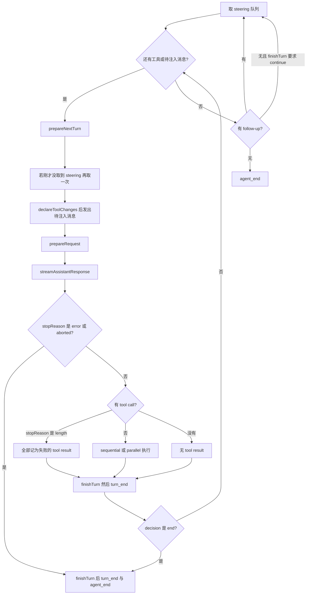

# pi-agent-core 设计

## 背景

`@earendil-works/pi-agent-core`（`packages/agent`）是 Pi 的通用 agent 运行时。它依赖 `@earendil-works/pi-ai` 的消息和流式类型，自己不打开会话文件、不渲染终端、不发现 skill。coding-agent 的 `AgentSession` 持有一个 `Agent`，把生命周期事件翻译成 JSONL 和 UI。

包导出见 `packages/agent/src/index.ts`：`Agent`、`agentLoop` / `agentLoopContinue`、`runAgentLoop`、`runToolCall`、`streamProxy`，以及 `types.ts` 的事件和工具类型。低层 `agentLoop()` 是异步生成器，**不会**等待调用方处理完事件再进入下一阶段。需要「assistant 的 `message_end` 处理完才开始工具 preflight」时，必须用 `Agent` 类：它的订阅者按注册顺序 await。

## 目标与非目标

**目标**

- 定义一条可替换 `StreamFn` 的工具循环。
- 把应用消息和 LLM 消息分开，让 UI 专用消息不会直接送给模型。
- 把插话（steering）和收尾消息（follow-up）从循环里拆成队列。

**非目标**

- 不持久化 `AgentState`。刷新进程即丢失，除非外层在 `message_end` 写盘。
- 不实现压缩、权限、MCP 或多 agent。`transformContext` 只是钩子，默认实现原样返回。
- 不选择供应商。`StreamFn` 的参考实现是 pi-ai 的 `Models.streamSimple`。

## 方案

### LLM 边界

`StreamFn`（`types.ts`）签名是：

```text
(model, context: TranscriptContext, options?) => AssistantMessageEventStream
```

契约：

- 请求失败不能抛异常，也不能返回 rejected promise。
- 失败写成流里的协议事件，最终 assistant 消息的 `stopReason` 为 `"error"` 或 `"aborted"`，并带 `errorMessage`。
- `context` 是规范化 transcript。system prompt 和工具声明在 system 消息里，不在 `context.systemPrompt` / `context.tools` 上。

`Agent` 构造时用 `createInitialSystemMessage(systemPrompt, tools.map(toToolDeclaration))` 把初始 prompt 和工具声明放进第一条 system 消息（`agent.ts` 的 `createMutableAgentState`）。之后 `state.systemPrompt` 只读，值来自 `getCurrentSystemPrompt(messages)` 的回放。要改 prompt，应追加一条带 `content` 或 `sections` 的 system 消息，而不是给 `state.systemPrompt` 赋值。

`state.tools` 是运行时真正会执行的工具表。每次请求前，`declareToolChanges` 把「transcript 里已声明的工具」和「当前 `context.tools`」的差写成 system 消息的 `toolsAdded` / `toolsRemoved`。这样模型看到的声明和运行时能执行的集合一致。

### 消息两层

```text
AgentMessage[] --transformContext--> AgentMessage[] --convertToLlm--> Message[] --> StreamFn
```

- `AgentMessage` 是 pi-ai 的 `Message`，外加声明合并进来的 `CustomAgentMessages`。应用可以加 `notification` 这类 UI 消息。
- `convertToLlm` 必须把每条消息变成 system / user / assistant / toolResult，或直接丢掉。默认实现只保留这四种 role。
- 两个钩子都不许抛异常。抛了会打断低层循环，且没有正常的 `agent_end`。

`AgentToolResult` 里给模型看的是 `content`（文本或图片）。`details` 给日志和 UI。`structuredContent` 给程序调用方，不进模型上下文。`terminate: true` 只是运行时提示，写进 transcript 的 tool result 仍然是普通 LLM 消息。

### 状态

`AgentState` 的稳定字段是 `systemPrompt`、`model`、`thinkingLevel`、`tools`、`messages`。运行中还有 `isStreaming`、`streamingMessage`、`pendingToolCalls`、`errorMessage`。

赋值 `state.tools` 或 `state.messages` 会复制顶层数组再存。`isStreaming` 保持 true，直到本轮 `agent_end` 的订阅者全部 settle。`Agent.abort()` 只 abort 当前 run 的 `AbortController`。

### 循环

`runLoop`（`agent-loop.ts`）的结构：



一次 provider turn 的生命周期是：选出的输入事件 → `prepareRequest` → 模型响应 → 工具结果 → `finishTurn` → `turn_end` → 继续调度或 `agent_end`。

`prepareRequest` 在每一次对话请求前运行，包括第一次。此时待发消息已经进上下文。它不负责排空队列。`finishTurn` 在工具结果都最终化之后、`turn_end` 之前运行，成功、错误和 abort 都会进。返回值：

| 返回 | 行为 |
|---|---|
| `undefined` | 按工具结果和队列决定是否继续 |
| `{ action: "end" }` | `turn_end` 之后立刻结束，不再看队列 |
| `{ action: "continue" }` | 正常响应上保证再有一次 provider 请求。若工具结果或队列已经会触发下一次请求，就不再额外加一轮 |

错误和 aborted 是硬退出，它们的 `finishTurn` 决定被忽略。无条件返回 `continue` 会造成死循环，因为下一轮还会再进 `finishTurn`。

### 工具执行

`ToolExecutionMode` 为 `"parallel"`（默认）或 `"sequential"`。

- parallel：逐个做参数校验和 `beforeToolCall`，然后并发执行允许的工具。`tool_execution_end` 按完成顺序发出。toolResult 消息仍按 assistant 里 tool call 的源顺序追加。
- 批内任一工具的 `executionMode` 为 `"sequential"` 时，整批改成串行。

`beforeToolCall` 发生在参数校验之后。返回 `{ block: true, reason }` 时不调用 `execute`，循环发出一条错误 tool result。`afterToolCall` 可以整段替换 `content`、`details`、`isError`、`usage`、`terminate`，没有深合并。

`stopReason === "length"` 表示输出被 token 上限截断，参数可能不完整。`failToolCallsFromTruncatedMessage` 把这批 tool call 全部做成失败结果，不执行。

一批工具只有在**每一个**最终结果都带 `terminate: true` 时才跳过自动的下一轮模型调用。混合批次照常继续。

工具实现约定：失败要抛错，或返回 `isError: true`。只在 `content` 里写「失败了」会被当成成功结果送给模型。`execute` 的 `onUpdate` 只在本次调用的 Promise settle 前有效。

`AgentTool.replay` 取值 `"never" | "safe"`，注释写的是「durable intent 已存在但结果未知时的恢复策略」。agent-core 只声明这个字段，coding-agent 的 JSONL 恢复不会自动重放工具。手搓 M1 可以忽略；M2 若要处理「副作用已发生、结果未落盘」，再读这个字段。

### 队列

`PendingMessageQueue` 有两种 `QueueMode`：

- `"all"`：到达排空点时取出全部。
- `"one-at-a-time"`（默认）：只取出最老的一条。

`steer()` 的消息在当前 assistant turn 的工具都执行完之后注入，不会取消已经开始的工具。`followUp()` 只在没有工具调用、也没有 steering 时注入。`continue()` 的规则：transcript 末尾不是 assistant 时，从现有上下文继续，启动时 poll steering，follow-up 要等自然停下来；末尾是 assistant 时不能直接再请求，先用一条 steering，再用一条 follow-up。

`Agent.subscribe` 的监听器按注册顺序 await，并收到当前 run 的 `AbortSignal`。`agent_end` 是最后一条循环事件，但 `prompt()` 和 `waitForIdle()` 要等这条事件的监听器结束。

### 事件

| 事件 | 含义 |
|---|---|
| `agent_start` / `agent_end` | 一次 `prompt` 或 `continue` |
| `turn_start` / `turn_end` | 一次 assistant 响应加上它的 tool results |
| `message_start` / `message_end` | system、user、assistant、toolResult 都会发 |
| `message_update` | 仅 assistant 流式增量，带 `assistantMessageEvent` |
| `tool_execution_start` / `update` / `end` | 工具生命周期。`end` 带 `isError` 和 `durationMs` |

### 与 pi-ai 的关系

手搓时 `StreamFn` 可以是假的。接真实模型时对齐这些点即可：

- `packages/ai/src/compat.ts` 的 `streamSimple` 满足 `StreamFn`。
- `packages/ai/src/utils/transcript.ts` 的 `createInitialSystemMessage`、`getCurrentSystemMessage` 负责 prompt 回放。
- `TranscriptContext` 定义在 `packages/ai/src/types.ts`。
- 思考档位 `ThinkingLevel` 为 `off | minimal | low | medium | high | xhigh | max`。`xhigh` 和 `max` 只对部分模型有效，是否支持要看 pi-ai 的模型元数据，agent-core 不猜测。

`streamProxy`（`packages/agent/src/proxy.ts`）把同一个 `StreamFn` 转到后端代理，给浏览器里的 agent 用。手搓 CLI 不需要它。

## 备选方案

| 方案 | 放弃原因 |
|---|---|
| 一个 `while` 循环里直接 `fetch` 供应商 | 供应商差异、流式事件和工具协议会渗进会话层。上游把它们挡在 `StreamFn` 后面。 |
| 工具并发完成就按完成顺序写入 transcript | 模型要求 tool result 对齐 tool call 的源顺序。上游只让 `tool_execution_end` 按完成顺序发，消息仍按源顺序写。 |
| 用 `agentLoop()` 生成器驱动 UI | 生成器不等待监听器。assistant 消息还没落盘，工具 preflight 就已经开始。`Agent` 才提供这个屏障。 |

## 横切关注点

- **错误**：`convertToLlm`、`transformContext`、`getApiKey`、两个队列 getter 都不许抛。工具和 `afterToolCall` 可以失败，失败变成错误 tool result。
- **并发**：一个 `Agent` 同时只有一个 `ActiveRun`。再次 `prompt` 前要 `waitForIdle` 或先 `abort`。parallel 工具共享同一个 `AbortSignal`。
- **持久化**：无。`sessionId` 只是转发给支持缓存的供应商。
- **取消**：`abort()` 后当前流应以 `stopReason: "aborted"` 结束。循环把这当作硬退出。外层要不要把已排队的 steering 交还用户，由 `AgentSession.clearQueue` 决定，不是 `Agent` 的职责。

## 手搓实现笔记

M1 按这个顺序写：

1. 消息类型和 `AgentEvent`。先不要自定义消息，四种 LLM role 够用。
2. `PendingMessageQueue` 和 `Agent` 的 `steer` / `followUp` / `abort` / `subscribe`。
3. `runLoop` 的双层循环。假 `StreamFn` 第一次返回一个 tool call，第二次返回纯文本。
4. 串行工具执行，包括校验失败、抛错、`beforeToolCall` block。
5. 再补 parallel 和 `terminate` 的「全批才停」规则。
6. 最后接一个真实 `streamSimple`。在此之前用事件序列测试锁住行为。

不要在 M1 写 JSONL，也不要在循环里估算 token。压缩放在外层的 `prepareNextTurn`，见 [压缩与中断恢复](compaction-resume.md)。
