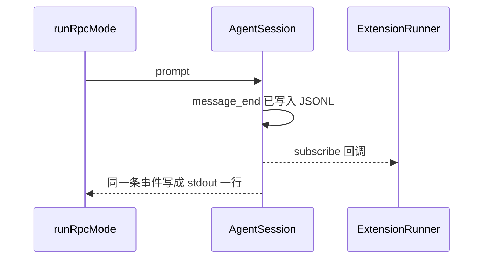

# 网关与适配层

## 背景

上游的通道共用一个会话：交互、print、JSON、RPC 都进 `AgentSession`。进程内插件是 `packages/coding-agent/src/core/extensions/` 的 `ExtensionFactory` 和 `ExtensionRunner`。RPC 是 `modes/rpc/rpc-mode.ts` 的按行 JSON。`packages/chord` 是另一套跨进程宿主，coding-agent 的 `package.json` 不依赖它。本仓库同样不引入 Chord。

`@my/gateway` 不实现第二份循环，也不写 JSONL。写盘仍在 `@my/session` 的 `AgentSession`。

## 目标与非目标

**目标**

- 扩展能 `registerTool` 和订阅已经落盘的事件。
- 另一个进程能用 stdin/stdout 驱动 `prompt`、`steer`、`abort`、`compact`。

**非目标**

- 不实现 Chord、WebSocket、热重载、扩展 UI 对话框。
- 不实现 print 以外的全部 CLI 旗标。`--print` 属于 M1，`--rpc` 属于本模块。
- 不把扩展放到子进程。扩展和工具一样跑在本进程里。

## 本模块在仓库中的位置

```text
packages/gateway/
  package.json
  tsconfig.json
  src/index.ts
  src/extensions/types.ts       # 上游 core/extensions/types.ts 的子集
  src/extensions/runner.ts      # class ExtensionRunner
  src/extensions/loader.ts      # 动态 import 一个文件
  src/rpc/types.ts              # 上游 modes/rpc/rpc-types.ts 的子集
  src/rpc/jsonl.ts              # 一行一个 JSON
  src/rpc/rpc-mode.ts           # runRpcMode
  test/extension-runner.test.ts
  test/rpc.test.ts
apps/cli/src/main.ts            # 增加 --rpc 分支
apps/cli/src/wire.ts            # 信任判断之后调用 loader
```

| 文件 | 职责 |
|---|---|
| `extensions/types.ts` | `ExtensionFactory`、`ExtensionAPI`、扩展事件 |
| `extensions/runner.ts` | 保存工具和监听器，按顺序调用 |
| `extensions/loader.ts` | `import(fileUrl)` 取默认导出并当成工厂。不用 jiti，扩展文件必须是已编译的 `.js` 或 Node 能直接 import 的 `.ts` 不在范围内。默认要求 `.js` |
| `rpc/types.ts` | 命令和响应的联合类型 |
| `rpc/jsonl.ts` | `serializeJsonLine`、按行读取 |
| `rpc/rpc-mode.ts` | 读 stdin、写 stdout、把命令映射到 `AgentSession` |

**依赖**：可以 import `@my/agent-core`、`@my/session`、`@my/mcp`、`@my/resources`。禁止 import `@my/tui`。

**磁盘**

```text
~/.my-agent/extensions/*.js
<cwd>/.my-agent/extensions/*.js     # 仅 projectTrusted
```

扩展源码不写入会话。扩展若需要持久状态，M5 不提供 `custom` 条目 API。不要在扩展里自己 `appendFile` 会话文件。

## 接入 agent 循环



`ExtensionRunner.attach(session)` 调用 `session.subscribe`。回调里先 `await runner.emit(event)`。因为 `AgentSession` 的写盘发生在它自己的内部监听器，而该监听器是构造时注册的，早于 gateway 的订阅，所以 gateway 看到事件时对应消息已经追加。测试用这个顺序做断言：emit 间谍被调用时，文件里已经能读到该 `message` 的 `id`。

不要让 `ExtensionRunner` 自己订阅裸 `Agent`，否则会和写盘监听器抢顺序。

## 核心数据结构

### 扩展

```ts
export interface ExtensionAPI {
  registerTool(tool: AgentTool): void;
  on(type: AgentSessionEvent["type"], handler: (event: AgentSessionEvent) => Promise<void> | void): void;
}

export type ExtensionFactory = (api: ExtensionAPI) => void | Promise<void>;

export interface ExtensionDiagnostic {
  path: string;
  message: string;
}
```

`registerTool` 把工具 push 到一个数组。`attach` 之后 CLI 执行一次 `agent.state.tools = [...existing, ...runner.tools]`。重复 `registerTool` 同一个 `name` 时后一个被忽略，并记 diagnostic。不要覆盖内置 `read` 或 `bash`。

监听器按注册顺序 await。其中一个抛错时，记下 diagnostic，继续下一个。不要让异常冒泡到 `AgentSession` 的订阅器外面，否则会打断后续事件。

工厂抛错时，该文件的工具和监听器全部丢弃，其他文件继续。`loadDirectory` 返回 `{ diagnostics }`。

### RPC

```ts
export type RpcCommand =
  | { id?: string; type: "prompt"; text: string }
  | { id?: string; type: "steer"; text: string }
  | { id?: string; type: "follow_up"; text: string }
  | { id?: string; type: "abort" }
  | { id?: string; type: "get_state" }
  | { id?: string; type: "compact"; instructions?: string };

export interface RpcResponse {
  id?: string;
  type: "response";
  command: string;
  success: boolean;
  data?: unknown;
  error?: string;
}
```

stdout 上还有原样写出的 `AgentSessionEvent`。那些对象的 `type` 不是 `"response"`。客户端必须先看 `type`。

`get_state` 的 `data`：

```ts
export interface RpcState {
  isStreaming: boolean;
  sessionFile?: string;
  steering: number;
  followUp: number;
  model: string;
}
```

一行的编码：`JSON.stringify(value) + "\n"`。解析时忽略空行。`JSON.parse` 失败则写一条 `success: false` 的响应，`command` 为 `"unknown"`，然后继续读下一行。不要退出进程。

### 命令状态机

RPC 循环自身没有与 `Agent` 平行的状态。它只看 `session` 是否正在 `prompt`：

- `prompt`：若 session 忙，响应 `success: false`，`error: "busy"`。不改成 steer。
- `steer` / `follow_up`：忙或不忙都接受。空字符串响应 `"empty"`。
- `abort`：调用 `session.abort()`，`data` 为 `clearQueue()` 的返回值 `{ steering: string[], followUp: string[] }`。
- `compact`：若忙，响应 `"busy"`。空闲时调用 `session.compact(instructions)`。
- 未知 `type`：`success: false`，`error: "unknown command"`。

stdin 关闭时 resolve `runRpcMode`。CLI 随后 `process.exit(0)`。退出前 `session.abort()` 一次，避免还在跑的 bash 被丢掉时不写 aborted 消息。能写多少算多少，不保证杀进程信号。

## 方案

### 加载顺序

`apps/cli/src/wire.ts` 固定为：

1. 解析 cwd 和 `MY_AGENT_DIR`。
2. `projectTrusted = process.env.MY_AGENT_TRUST === "1" || existsSync(cwd + "/.my-agent")`。M5 仍不用交互询问。存在 `.my-agent` 即信任，是手搓默认，方便本地跑。上游会弹确认。偏差写在这里。
3. 加载 `~/.my-agent/extensions/*.js`，字母序。
4. 若信任，再加载 `<cwd>/.my-agent/extensions/*.js`。
5. 读 `mcp.json`，连接 direct 服务器，最多等 10 秒。
6. `createDefaultTools` 与扩展工具、MCP 工具合成 `agent.state.tools`。
7. 按 argv 进入 `--print`、`--rpc` 或以后的 TUI。

### runRpcMode

```ts
export function runRpcMode(session: AgentSession, input: AsyncIterable<string>, write: (line: string) => void): Promise<void>
```

测试传入字符串数组的 async iterable，不打开真 stdin。`apps/cli` 用 `readline` 把 stdin 变成行再调用它。

每条命令先写响应，再让 `prompt` 的事件继续往外流。`prompt` 的响应在调用 `session.prompt` 之前就写出 `success: true`，表示已接受，不表示模型已结束。结束看后面的 `agent_end` 事件。这和上游 RPC「先响应再流事件」一致。

## 备选方案

| 方案 | 放弃原因 |
|---|---|
| 每种通道一个 Agent 子类 | 落盘会分叉。通道只拿 `AgentSession` |
| 用 Chord 做插件 | coding-agent 没有这么做。同进程工具不需要 contract |
| HTTP 作为第一种远程接口 | 行分隔 JSON 用管道就能测。HTTP 以后可以包一层 RPC |
| 忙时把 `prompt` 自动变成 `steer` | 调用方会分不清插话和排队。错误码 `"busy"` 是明确的 |

## 横切关注点

- **错误**：扩展和坏 JSON 都不退出进程。`compact` 失败时响应 `success: false`，`error` 为异常消息，会话文件保持原样。
- **并发**：不并行处理 stdin 命令。一条命令的 `await session.prompt` 期间，后续行留在队列里，读完当前命令再取。`steer` 因此可以在 `prompt` 进行中被处理：实现时 `prompt` 不要独占读循环。默认：`prompt` 不 await 完再读 stdin。它 `void session.prompt(...)` 并立刻回到读循环，事件由订阅器写出。忙检测在调用前做。这样 `steer` 能在运行中进来。
- **持久化**：gateway 不调用 `appendMessage`。
- **子进程**：`runRpcMode` 结束时不负责杀 MCP 子进程。CLI 在 `finally` 里调用每个 `McpClient.close()`。stdio 传输的 `close` 必须 `kill` 子进程。

## 手搓实现笔记

按总览 M5 的后半段。先写 `rpc.test.ts` 的忙时拒绝，再写扩展监听器的抛错隔离。扩展夹具是一个临时 `.js` 文件，内容为 `export default function (api) { api.registerTool(...) }`。不要用 TypeScript 扩展夹具，loader 不编译。
