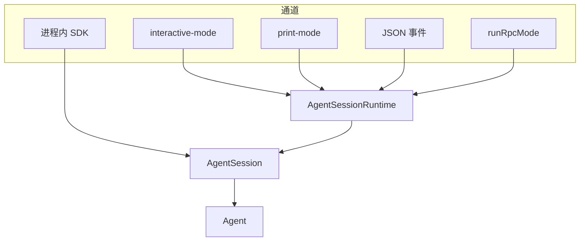
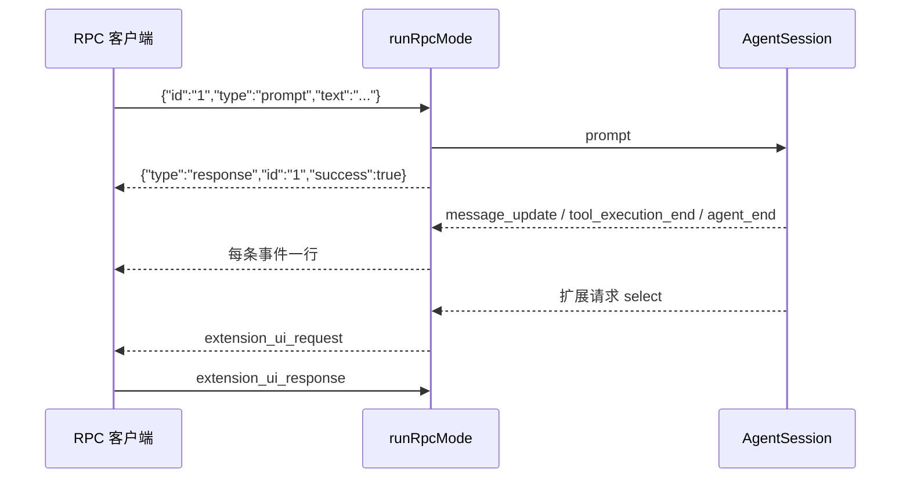

# 网关与适配层

## 背景

这里的「网关」不是一台反向代理。Pi 把**同一份 `AgentSession`** 接到不同的入口，并把进程内插件和跨进程对象分成两个宿主：

| 层 | 位置 | 做什么 |
|---|---|---|
| 通道适配 | `packages/coding-agent/src/modes/` | 交互 TUI、print、JSON 事件、RPC。都调用 `AgentSessionRuntime` |
| 进程内插件宿主 | `core/extensions/loader.ts`、`runner.ts`、`types.ts` | 用 jiti 加载 TypeScript 扩展，`ExtensionAPI` 注册工具、命令、事件和 UI |
| 跨进程宿主 | `packages/chord` | typed contract、对象引用、热重载、JSON 状态复制。**coding-agent 的 package.json 不依赖 chord** |
| 持久化 harness | `packages/durable` | 实验性。用 Chord 做文档状态，用 pi-ai 做模型。不是 CLI 的网关 |

Slack 一类聊天入口不在本仓库。上游 README 指向单独的 `earendil-works/pi-chat`。手搓不要在 coding-agent 源码里找 channel adapter 的 Slack 实现。

MCP 是一种工具适配，协议细节在 [MCP](mcp.md)。它以扩展的形式挂在本页的插件宿主上。

## 目标与非目标

**目标**

- 增加一种入口时不复制 agent 循环和会话写盘。
- 插件能注册工具和监听压缩、会话切换等事件，并在热路径上有明确的失败边界。
- 说清楚 Chord 适合什么时候再引入，避免 M5 同时做两套插件系统。

**非目标**

- 不实现 Chord 的 SQLite、WebSocket 集群和热重载。文档只固定它和进程内扩展的边界。
- 不实现 print 模式的全部 CLI 旗标、主题和包管理器。
- 不把扩展加载进模型进程或 WASM。上游扩展就是 Pi 进程里的 TypeScript，权限与进程相同。

## 方案

### 通道共用会话

`how-pi-works.md` 的 Interfaces：交互模式把会话和 agent 事件画在终端里；print 跑完一条 prompt 写出最终回复；JSON 模式把事件写成 JSONL；RPC 从 stdin 读命令、向 stdout 写响应和事件；SDK 在进程内创建 `AgentSession`。



`AgentSessionRuntime` 负责切换会话文件：`/new`、`/resume`、`/fork` 之前先 `abort()` 当前 run，再拆掉旧会话，然后发出 `session_start`。入口不直接操作 JSONL。

手搓时先固定一个 `Session` 接口，让 RPC 和 TUI 都依赖它：`prompt`、`steer`、`followUp`、`abort`、`subscribe`、`compact`、`getState`。M5 用 RPC 测这组方法，M6 的 TUI 再实现第二个适配器。

### 进程内扩展

`ExtensionFactory` 的类型是 `(pi: ExtensionAPI) => void | Promise<void>`。加载器 `loader.ts` 用 jiti 载入 TypeScript。在打包后的 Node、Bun 或 SEA 二进制里改走静态虚拟模块，避免运行时再找一份 TypeScript 编译器。手搓若只用 JavaScript 插件，一个动态 `import` 就够，不必移植 jiti。

`ExtensionRunner` 持有已加载扩展和 `EventBus`。事件分两类：一部分由通用 `emit` 顺序派发，一部分（工具、命令、MCP 服务器变化）在注册表更新时顺带发出，例如 `mcp_servers_change`。

`ExtensionAPI` 上和手搓相关的能力：

- `registerTool`：得到一个进入 `Agent.state.tools` 的工具，自动参与 `declareToolChanges`。
- 订阅 `session_before_compact` / `session_compact_failed` / `agent_settled` 等。压缩钩子可以替换默认摘要。
- `registerMcpServer`：把服务器交给 MCP 扩展，而不是自己开一个 JSON-RPC 客户端。
- UI：`select`、`confirm`、`input`、`editor`、`notify`、`setStatus`、`setWidget`。交互模式用 TUI 组件实现；RPC 模式把它们变成请求，见下一节。

扩展代码和内置工具跑在同一进程。项目扩展位于 `.pi/extensions/`，只有项目被信任之后才加载（`trust-manager.ts`、`how-pi-works.md` 的 Trust）。用户扩展在 agent 目录，不需要项目信任。`/reload` 会重建扩展、skill 和上下文文件；进行中的 run 应先结束，避免旧工具的 `execute` 还在跑、工具表已经被换掉。

失败约定：扩展工厂抛错时，上游把该扩展记入诊断并继续启动其他扩展。事件监听器抛错不能吞掉 `message_end` 的落盘。手搓应让监听器的异常变成日志，会话写入放在监听器之外，和现在 `AgentSession`「先 emit 扩展，再写盘」的顺序相比，更稳的手搓顺序是：**先写盘，再通知扩展**。上游是先扩展后写盘，扩展可以在写盘前改写事件，这是能力也是风险。手搓第一版不要给扩展修改已生成 assistant 文本的能力。

### RPC

`runRpcMode`（`modes/rpc/rpc-mode.ts`）接管 stdout，按行读写 JSON。协议：

- 命令：带 `type`，可选 `id` 用来对上响应。
- 响应：`type: "response"`，含 `command`、`success`，成功时有 `data`，失败时有 `error`。
- 事件：`AgentSessionEvent` 发生就写出，不攒批。
- 扩展 UI：Pi 写出 `extension_ui_request`，客户端用 `extension_ui_response` 回答。未回答前对应的 `select` / `confirm` / `input` 挂起。

帧就是一行一个 JSON。`serializeJsonLine` 负责转义，避免事件里的换行把流切断。stdout 有背压时 `waitForRawStdoutBackpressure` 让生产方暂停，防止管道塞满之后 agent 继续无限生成。

`docs/rpc-commands.md` 列出的命令覆盖 prompt、steer、follow_up、abort、clear_queue、会话切换、fork、clone、模型、思考档位、压缩、bash。手搓 M5 只实现：

| 命令 | 映射 |
|---|---|
| `prompt` | `session.prompt` |
| `steer` / `follow_up` | 对应队列 |
| `abort` | `session.abort` 然后 `clearQueue` 的结果放进响应 |
| `get_state` | 模型、是否在流式输出、队列长度、会话文件路径 |
| `compact` | `session.compact` |
| `extension_ui_response` | 完成挂起的 UI 请求 |



响应和事件都在 stdout。客户端必须先看 `type` 和 `id`，不能假设下一条就是响应。stdin 关闭时结束进程，并 `killTrackedDetachedChildren` 清理扩展或 bash 留下的子进程。

print 和 JSON 模式是 RPC 的退化：没有命令循环，进程启动时带上唯一一条 prompt，结束时退出。它们仍应走 `Session.prompt`，这样落盘和压缩只有一份实现。

### Chord：另一套宿主

`packages/chord/README.md` 把应用拆成**对象**：状态加代码，住在一个地址上，有人引用才存在。调用方拿到的是引用，本地和跨进程一样，热重载之后引用仍有效。每个对象有 principal，所有者和客人看到的方法可以不同。

和进程内扩展的对应关系：

| 进程内扩展 | Chord |
|---|---|
| `ExtensionFactory(pi)` 闭包 | `host.serve(Contract, factory)` |
| 直接函数调用 | `method` + TypeBox 参数，经 link 传 JSON |
| 进程内对象 | `memoryLinkPair`、`ipcLink`、`webSocketLink` |
| 扩展字段随便放 | `replicatedState`：快照加增量，失败的 `change` 不发布 |
| `/reload` 换模块 | 热重载让在途调用跑完旧代码，状态保留，不兼容变更在安全点迁移 |
| 无 | `createHost`、`defineFacet`、多 host 名字 |

`Context` 携带 `AbortSignal` 和 `TelemetrySpan`，没有隐式的当前 span。`pi-durable` 的每个异步 API 都接收这个 `Context`。取消一次 `wait` 不会取消已经提交的工作。

Chord 适合的手搓时机：有第二个进程要持有会话或工具执行，例如网关进程和沙箱进程分开，并且状态要以快照加增量同步。在那之前，RPC JSONL 已经是一个可用的进程边界，客户端可以是任何语言。不要为了「以后可能多进程」在 M5 引入 contract 和副本。

durable 用 Chord 满足「只有提交后的状态可见」。那条不变量和 JSONL 的 `message_end` 追加不是同一个设计，见 [压缩与中断恢复](compaction-resume.md)。

### 信任与加载顺序

`how-pi-works.md` 给出的顺序是：先决定项目信任，再加载项目设置和项目资源，然后加载上下文文件。工具始终使用进程权限。手搓的启动顺序应保持：

```text
解析 cwd 和会话文件
→ 信任判断
→ 用户扩展与用户 skill
→ 若信任：项目扩展、项目 skill、项目 mcp.json
→ 上下文文件
→ 通道开始读输入
```

上下文文件放在信任之后加载是文档描述的产品顺序；源码里 context file 的发现本身不检查信任。手搓可以采用更严的顺序：未信任时仍显示上下文文件路径，但把内容换成占位说明。若要和上游一致，则未信任也注入 `AGENTS.md` 正文，并在设计里写明这个风险。

## 备选方案

| 方案 | 放弃原因 |
|---|---|
| 每种通道一个 Agent 子类 | 上游把差异留在适配器。复制循环会让压缩和落盘分叉。 |
| 用 Chord 做进程内插件 | coding-agent 没有这么做。TypeBox contract 和 link 对同进程工具注册是额外的一层。 |
| HTTP 网关作为第一种适配器 | RPC 已经是行分隔 JSON，测试时用管道即可，不需要端口、认证和 SSE。HTTP 可以以后包一层 RPC。 |
| 扩展运行在子进程 | 更安全，但 `registerTool` 的 `execute` 就变成了 RPC。那是 Chord 或 MCP 的工作，不是 `ExtensionRunner` 的工作。 |

## 横切关注点

- **错误**：RPC 命令失败返回 `success: false`，进程不退出。扩展监听器的异常不阻止 JSONL 追加。未知命令返回错误响应，不执行。
- **并发**：stdin 上的 `prompt` 在 run 未结束时应变成 `steer` 或显式报错。上游交互模式要求调用方指定 steer 还是 follow-up。RPC 的 `prompt` 在忙碌时的行为要在实现里写死并测试，不能两种都像。
- **持久化**：通道不写会话。它们只调用 session。扩展的 `custom` 条目才是插件自己的持久状态，且不进入模型上下文。
- **背压**：RPC 写 stdout 要处理管道满。TUI 则用渲染合并，见 [TUI](tui.md)。两条路径的合并策略不同，不要共用一个队列实现。
- **子进程**：退出时回收 bash 和 stdio MCP 拉起的进程。否则 RPC 客户端断开后 git 或语言服务器仍会留在后台。

## 手搓实现笔记

1. 定义 `Session` 接口并让 M2 的 `AgentSession` 实现它。测试只依赖接口。
2. 写一个最小 `ExtensionRunner`：加载一个模块，调用工厂，收集 `registerTool` 和事件监听。监听器抛错时 session 文件仍有 `message_end`。
3. 用管道做 RPC：父进程写 `prompt`，读到 `response` 和至少一条 `agent_end`。再测 `abort`。
4. 加一个会 `select` 的扩展，断言客户端不回答时 run 停在 UI 请求上，回答后继续。
5. 项目信任用一个枚举即可。未信任时项目扩展工厂不被调用。
6. 把 Chord 记在后续设计里：触发条件是第二个进程需要共享可变状态，而不是「文档里出现了网关这个词」。
