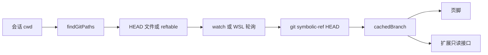

# Git 与仓库工具

## 背景

coding-agent 没有名为 `git` 的内置工具。模型改仓库靠一组文件系统工具和 shell：`read`、`write`、`edit`、`grep`、`find`、`ls`、`bash`，Windows 上还有 `powershell`。实现在 `packages/coding-agent/src/core/tools/`。

Git 在三条边上出现，职责不同：

| 用途 | 代码 | 是否让模型执行 git |
|---|---|---|
| 页脚显示当前分支，扩展也能读到 | `core/footer-data-provider.ts` 的 `FooterDataProvider` | 否。只读 `HEAD` |
| worktree 与主仓的 `AGENTS.md` 去重；`.agents/skills` 向上扫描停在仓库根 | `core/resource-loader.ts`、`core/package-manager.ts` 的 `findGitRepoRoot` | 否 |
| 安装 Pi package（skill、扩展） | `PackageManager.installGit`：`git clone` 再按 ref `checkout` | 否。这是 CLI 装包，不是用户仓库里的提交 |

模型如果要 `git status`、`git diff` 或 `git commit`，走 `bash` 工具，继承当前进程的权限和 cwd。上游 README 写明没有内置的文件系统、进程、网络或凭证沙箱。

`packages/durable` 的示例把 reviewer 放在单独的 checkout，并注释「实践中用 `git worktree add`」。那是 durable 测试里的 cwd 隔离，不是 coding-agent 的工具。手搓不要把它写成已经存在的 git 子系统。

## 目标与非目标

**目标**

- 模型能读、搜、改当前工作区，工具结果有大小上限。
- UI 和 prompt 逻辑能识别普通仓库和 linked worktree，而不解析 git 对象数据库。
- 并行工具不会把同一文件的两次写入交错。

**非目标**

- 不实现 `git add` / `commit` / `rebase` 的专用工具、暂存区模型或冲突解决器。
- 不为每个 agent 自动创建 worktree。隔离是部署问题（容器、独立 cwd），不是 M4 的默认行为。
- 不把 `utils/git.ts` 的 `parseGitUrl` 用作用户仓库的远程操作。它只解析 `git:`、`https://`、`ssh://`、`git@host:path` 这类**包来源**。

## 方案

### 工具面

`core/tools/index.ts` 导出的工厂：

| 工具 | 工厂 | 作用 |
|---|---|---|
| `read` | `createReadTool` | 按路径读文件，可带行范围 |
| `write` | `createWriteTool` | 整文件写入 |
| `edit` | `createEditTool` | 按精确文本替换，失败时不部分写入 |
| `grep` | `createGrepTool` | 内容搜索 |
| `find` | `createFindTool` | 按文件名查找 |
| `ls` | `createLsTool` | 列目录 |
| `bash` | `createBashTool` | 在仓库里跑 shell，包括 git |
| `powershell` | `createPowerShellTool` | Windows 上的对应物 |

每个工具都是 agent-core 的 `AgentTool`：`name`、`label`、`description`、TypeBox `parameters`、`execute`。`details` 留给 UI 渲染器（`core/tools/renderers/`），模型只看 `content`。

`system-prompt.ts` 的 `buildRules` 会看哪些工具被选中。如果只有 bash / powershell，没有 grep、find、ls，规则会要求模型用 shell 做列目录和搜索。工具都在时，优先用专用工具，shell 留给 git 和构建命令。这是 prompt 约定，循环本身不拦截 bash 里的 `ls`。

输出进入模型之前经过 `truncate.ts`：`truncateHead`、`truncateTail`、`truncateLine`，以及 `DEFAULT_MAX_BYTES`、`DEFAULT_MAX_LINES`。大 `git diff` 或测试日志必须截断，否则一次工具结果就会打满 M2 的压缩阈值。截断标记要留在文本里，让模型知道内容不完整。

### 文件变更串行化

`toolExecution` 默认 parallel。两次 `edit` 若同时改一个文件，后写覆盖前写，或基于过期的原文做替换。`withFileMutationQueue`（`tools/file-mutation-queue.ts`）把变更同一工作区的 write/edit 排成队列。读和搜索不必互斥。

bash 不经过这个队列。模型可以一边 `edit`、一边 `git status`。手搓第一版可以把 bash 标成 `executionMode: "sequential"`，让含 bash 的那一批全部串行，换取更少的交错。上游没有对 bash 做这个全局限制，它允许 bash 与其他工具并行，风险由模型自己承担。

### 分支观察

`findGitPaths(cwd)` 从 cwd 向上找 `.git`：

- `.git` 是目录：`headPath = <git>/HEAD`，`commonGitDir` 就是这个目录，`repoDir` 是含 `.git` 的工作树。
- `.git` 是文件且内容以 `gitdir: ` 开头：这是 linked worktree。`gitDir` 相对该文件所在目录解析，`HEAD` 在这个 gitDir 里。若存在 `commondir`，`commonGitDir` 再相对 gitDir 解析，指向主仓的 git 目录。
- 找不到 `HEAD`，或 stat 失败：返回 `null`，调用方把仓库当成不存在。

分支名不读 `HEAD` 文件的内容来猜。`resolveBranchWithGitSync` / `Async` 执行：

```text
git --no-optional-locks symbolic-ref --quiet --short HEAD
```

`--no-optional-locks` 避免和模型正在跑的 git 命令抢锁。退出码非 0 或输出为空则视为 detached，`getGitBranch()` 的约定是：不在仓库中返回 `null`，detached 返回字符串 `"detached"`。页脚（`modes/interactive/components/footer.ts`）只展示这个缓存值。

`FooterDataProvider` 监视 `HEAD` 和 reftable。变更后 500ms 去抖再异步刷新。刷新进行中又有事件则记 `refreshPending`，避免重叠的 git 进程。WSL 访问 `/mnt/<盘符>` 时 `fs.watch` 不可靠，`shouldPollGitHead` 改为轮询。`setCwd` 拆掉旧 watcher 再按新路径安装。`dispose` 必须清 timer 和 watcher。

扩展通过 `ReadonlyFooterDataProvider` 读 `getGitBranch()`、`onBranchChange` 和 `getExtensionStatuses()`。上下文用量不在这里，而在 session 的 usage 上。



### Worktree 与上下文

`findShadowedContextFile` 只在一种情况下去掉主仓的上下文文件：当前目录在 linked worktree 里，worktree 根已经有自己的 `AGENTS.md`（或同级候选名），并且 worktree 根是主仓根的子孙目录。典型布局是主仓里的 `worktrees/feat`。`git worktree add ../feat` 这种与主仓并列的路径不是子孙，不去重，祖先遍历也不会把主仓算进来。

比较用的是目录的 realpath，不是文件的。worktree 的 `AGENTS.md` 若是指向主仓文件的符号链接，仍然只加载 worktree 这一份路径，避免同一 inode 出现两次。

`collectAncestorAgentsSkillDirs` 用更粗的 `findGitRepoRoot`：向上看到 `.git`（文件或目录）就停。它不解析 `commondir`。因此 skill 扫描不会爬出仓库去读父仓库的 `.agents/skills`，但也不会像 context file 那样做内容级去重。两套 git 探测不要合成一个函数，它们的停止条件不同。

### 装包用的 git

`parseGitUrl`（`utils/git.ts`）接受带 `git:` 前缀的历史缩写，以及不带前缀的 `http(s)`、`ssh`、`git://`。SCP 形式 `git@host:path` 会被规范化成可 `git clone` 的 URL，ref 后缀和 clone URL 分开。`PackageManager.installGit`：

1. 目标目录已存在：对指定 ref `fetch`，或检查是否有更新。
2. 不存在：`git clone <repo> <targetDir>`，有 ref 再 `git checkout <ref>`。
3. 若克隆结果含 `package.json`，在该目录安装依赖。
4. 任何一步失败就删掉目标目录，避免半截 checkout 被下次当成已安装。

这和用户项目的 worktree 无关。手搓 M4 可以不实现包管理器。若 M3 的 skill 只从本地目录加载，`installGit` 整段都可以推迟。

### 会话 cwd

会话 header 记录 `cwd`。恢复时如果目录没了，`session-cwd.ts` 的 `MissingSessionCwdError` 让交互模式提示用户，而不是在错误的目录里继续改文件。`FooterDataProvider.setCwd` 和工具的 cwd 必须一起换。模型看到的 `cwd` 段（system prompt 最后附近）应使用正斜杠，和 `buildSystemPromptSections` 里 `cwd.replace(/\\/g, "/")` 一致。

## 备选方案

| 方案 | 放弃原因 |
|---|---|
| 用 libgit2 读分支和状态 | 上游用 `git` 可执行文件加 `HEAD` 监视，避免把对象库绑进进程。分支名只是 UI 事实，不值得引入原生依赖。 |
| 专用 `git_status` / `git_commit` 工具 | 上游把这类操作留在 bash。专用工具要复制暂存区、钩子、签名和编辑器，和「手搓最小仓库能力」不符。 |
| 每个任务自动 `git worktree add` | durable 的例子说明这是隔离策略，不是 coding-agent 的循环。自动 worktree 会留下需要打扫的目录，也应单独设计。 |
| 解析 `.git/HEAD` 文本得到分支 | worktree、packed-refs 和 reftable 会让文本解析分叉。`symbolic-ref` 已经处理这些情况，detached 时以非 0 退出，语义清楚。 |

## 横切关注点

- **错误**：git 不在 `PATH` 上时分支是 `null`，工具循环继续。bash 里 git 失败要作为 `isError` 的 tool result 返回，不要抛出进程级异常。
- **并发**：文件变更队列和 bash 的关系要写进测试。至少保证两个 edit 的 `execute` 不会重叠。`refreshGitBranchAsync` 用 `refreshInFlight` 合并并发的文件系统事件。
- **持久化**：分支名不写入会话。它是 cwd 的实时属性。文件修改通过 write/edit 落在工作区，通过 tool result 落在 JSONL。两者不是一个事务：工具已把文件写完、进程在 `message_end` 前死亡时，工作区脏、会话里可能还没有这条结果。恢复修补见压缩文档，不要在 git 层回滚用户文件。
- **锁**：观察分支时使用 `--no-optional-locks`。不要为了显示分支运行会写 `index.lock` 的命令。

## 手搓实现笔记

1. 先做 `read` 和 `bash`，cwd 固定为会话目录。用夹具仓库跑 `git status`，断言输出被截断函数包过。
2. 加 `edit` / `write` 和按绝对路径串行的变更队列。测试两个并行调用的开始时间重叠与否。
3. 实现 `findGitPaths` 的两种 `.git` 形态。夹具不用真的 `git worktree add`：写一个 `.git` 文件，内容为 `gitdir: ...`，并在目标处放 `HEAD` 和可选的 `commondir`。上游 `resource-loader` 测试就是这么做的。
4. `getGitBranch` 可以在测试里注入执行函数，避免断言依赖本机分支名。
5. 把 worktree 去重接到 M3 的 context 加载。没有 M3 时，这一步只断言被抑制的路径集合。
6. `grep` / `find` / `ls` 可以后补。它们减少模型滥用 bash，但不改变架构。

不要在 M4 实现 `installGit`。包来源解析是网关和 skill 分发的问题，和「agent 怎么改当前仓库」无关。
