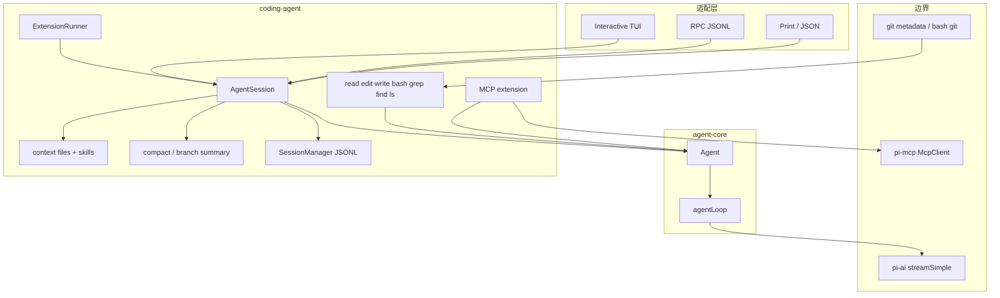
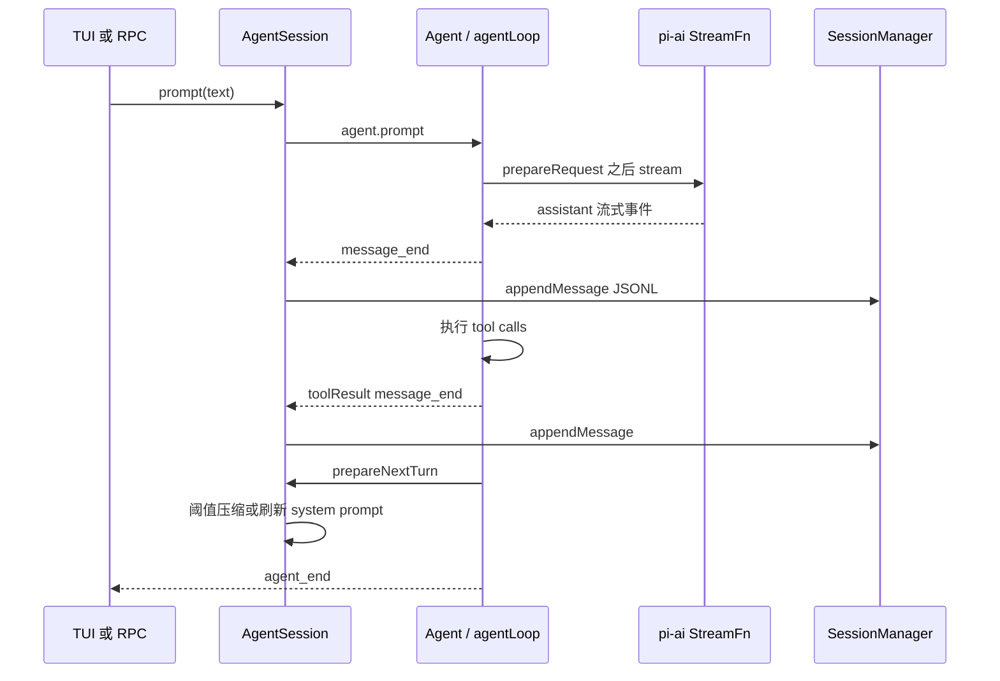

# 手搓 Pi Agent：总览与里程碑

本文是 Lisa 手写自己的 coding agent 时的设计索引。事实来自 [earendil-works/pi](https://github.com/earendil-works/pi) `main` 的源码与包内文档，按模块改写，不照搬上游源文件。范围只覆盖 agent 循环、会话压缩与中断恢复、记忆与 skill、git / 仓库工具、MCP、网关与适配层、TUI。`packages/evals`、`packages/telemetry` 的内部细节不在范围内。

上游定位见仓库 `README.md`：Pi 是一个可扩展的 agent harness，交互、print / JSON、RPC 和 TypeScript SDK 共用同一套 agent 与 session。`AGENTS.md` 只约束上游开发流程，不定义运行时架构。

## 背景

手搓的目标是能解释并实现一条最小但真实的 agent 路径：用户发一句话，模型流式返回，按需调工具，把过程记到磁盘，上下文过长时压缩，进程中断后能从磁盘继续。上游把这条路径拆成多个 npm 包，而不是一个巨石 CLI。

| 上游包 | 目录 | 手搓文档对应的职责 |
|---|---|---|
| `@earendil-works/pi-ai` | `packages/ai` | LLM 边界：`Models`、`streamSimple`、`TranscriptContext`、system message 回放 |
| `@earendil-works/pi-agent-core` | `packages/agent` | 有状态 `Agent`、`agentLoop`、工具执行、事件、steering / follow-up 队列 |
| `@earendil-works/pi-coding-agent` | `packages/coding-agent` | 会话 JSONL、压缩、skill、内置仓库工具、扩展、RPC、MCP 接线 |
| `@earendil-works/pi-mcp` | `packages/mcp` | MCP JSON-RPC 客户端、stdio / streamable HTTP、OAuth |
| `@earendil-works/chord` | `packages/chord` | 跨进程 typed host、contract、热重载、状态复制。coding-agent **不依赖**它 |
| `@earendil-works/pi-tui` | `packages/tui` | 差分渲染的终端 UI |
| `@earendil-works/pi-durable` | `packages/durable` | 实验性「先提交再可见」的 harness，只在中断恢复里作对照 |

`packages/coding-agent/docs/how-pi-works.md` 把运行时概括成四件事：模型请求、工具执行、上下文组装、会话存储。会话是一棵树，从当前叶子回溯到根的那条路径叫 active branch，下一次模型请求只用这条路径。

## 目标与非目标

**目标**

- 给出一条与上游源码对得上的分层，使手写实现可以按依赖顺序交付。
- 每个模块写清数据模型、关键类型和失败时的行为，而不是功能清单。
- 里程碑的验收标准可以在没有真实供应商 key 的情况下用假模型跑通。

**非目标**

- 不复刻 Pi CLI、主题、包管理器、模型目录、OAuth 登录和全部 slash command。
- 不实现 sub-agent 或 plan mode。上游 README 明确跳过这两项。
- 不把 `@earendil-works/chord` 当作 coding-agent 的进程内插件宿主。进程内扩展是 `ExtensionRunner`；Chord 是另一层，供 `pi-durable` 和需要多进程的网关使用。
- 不实现向量记忆库。上游这几个包里没有独立的 embedding memory。

## 方案

### 分层

依赖方向是单向的：`pi-ai` 不知道 agent；`pi-agent-core` 不知道会话文件和 TUI；`pi-coding-agent` 把 `Agent.subscribe` 的 `message_end` 写成 JSONL，并在 `prepareNextTurn` 里决定要不要压缩。TUI、print、JSON、RPC 都调用同一个 `AgentSession`（`how-pi-works.md` 的 Interfaces 一节，实现分落在 `modes/interactive`、`modes/print-mode.ts`、`modes/rpc/rpc-mode.ts`）。

### 一次用户消息的路径

`Agent` 本身不写盘。持久化发生在 `packages/coding-agent/src/core/agent-session.ts` 对 `message_end` 的处理里，调用 `SessionManager.appendMessage`。压缩是纯函数 `prepareCompaction` / `compact`，由 session 把结果写成 `CompactionEntry`，再按叶子重建模型可见上下文。

### 文档地图

| 页面 | 上游锚点 | 手搓时先读的类型 |
|---|---|---|
| [Agent Core](core.md) | `packages/agent/src/agent.ts`、`agent-loop.ts`、`types.ts` | `Agent`、`AgentTool`、`AgentEvent`、`runLoop` |
| [压缩与中断恢复](compaction-resume.md) | `core/session-manager.ts`、`core/compaction/compaction.ts` | `SessionEntry`、`shouldCompact`、`buildSessionContext` |
| [记忆与 Skill](memory-skill.md) | `core/skills.ts`、`core/system-prompt.ts`、`core/resource-loader.ts` | `Skill`、`formatSkillsForPrompt`、`project_context` |
| [Git](git.md) | `core/footer-data-provider.ts`、`core/tools/*`、`core/package-manager.ts` | `findGitPaths`、bash/read/edit、`installGit` |
| [MCP](mcp.md) | `packages/mcp/src/client.ts`、`extensions/mcp/index.ts` | `McpClient.connect`、`createMcpToolName`、exposure |
| [网关与适配层](gateway.md) | `core/extensions/*`、`modes/rpc/rpc-mode.ts`、`packages/chord` | `ExtensionFactory`、`runRpcMode`、`createHost` |
| [TUI](tui.md) | `packages/tui/src/tui.ts`、`tui-main-screen.ts` | `Component.render`、`previousLines`、CSI 2026 |

## 里程碑

顺序按源码依赖排：没有 agent 循环就没有会话可写；没有会话就没有压缩和恢复；skill 与 git 都是挂在循环上的工具和 prompt 段；MCP 与网关建立在工具注册和扩展事件上；TUI 只消费已经存在的事件。

### M1 Agent Core 与最小工具循环

- **目标**：内存里的 `Agent` 能完成「用户消息 → 流式 assistant → 工具 → 再请求模型」直到模型不再调工具。
- **范围内**：`Agent`、`agentLoop`、一个假 `StreamFn`、两个工具（读文件、回显）。LLM 边界只实现 `StreamFn` 的契约，不接真实供应商。
- **验收**：
  - 事件顺序与 `packages/agent/README.md` 的 tool 路径一致：`agent_start`、`turn_start`、user 的 `message_start/end`、assistant 的 `message_update`、`tool_execution_*`、toolResult 的 `message_*`、`turn_end`、下一轮、`agent_end`。
  - 工具抛错时，模型收到 `isError: true` 的 tool result，循环不崩溃。
  - `beforeToolCall` 返回 `block: true` 时工具体不执行。
  - steering 在当前工具批结束后注入；follow-up 在本会停止时注入。`QueueMode` 为 `one-at-a-time` 时一次只取出最老的一条。
  - `stopReason` 为 `error` 或 `aborted` 时循环直接结束，不再排下一轮。
- **规模**：一个包、无磁盘。假模型用脚本化的 tool call 响应即可，不必接网络。

### M2 会话落盘、中断恢复与压缩

- **目标**：M1 的每条完成消息追加进 JSONL 树；进程被杀掉后从叶子恢复；上下文超过阈值时写入 `CompactionEntry` 并让下一次请求只看见摘要加保留尾部。
- **范围内**：`SessionManager` 的 header、message、compaction、`parentId` 树；`shouldCompact` / `prepareCompaction` / `compact`；`abort` 后已落盘内容可重载。
- **验收**：
  - 只有出现 user 或 assistant 消息才创建会话文件（对应 `SessionManager._hasConversation`）。
  - 杀掉进程后再打开同一文件，`buildSessionContext` 的消息序列与崩溃前已 `message_end` 的消息一致。最后一行损坏的 JSON 被跳过，不让整个文件作废（对应 `parseSessionEntryLine`）。
  - assistant 已落盘但 tool result 未落盘时，恢复逻辑补一条错误 tool result，下一次模型请求不因缺结果而失败。
  - `contextTokens > contextWindow - reserveTokens` 时触发压缩。默认 `reserveTokens = 16384`、`keepRecentTokens = 20000`。压缩后模型上下文以摘要开头，并从 `firstKeptEntryId` 保留原文。原始条目仍留在文件里。
  - 手动中断：`abort()` 后 run 变为 idle，已完成的 `message_end` 已在文件中，未发送的队列消息回到输入框而不是写进会话。
- **规模**：在 M1 上加一个文件存储和一次真实或假的摘要调用。这是第一条会碰磁盘和失败恢复的里程碑。

### M3 记忆与 Skill

- **目标**：把项目说明放进 system prompt 的 `project_context`，把 skill 只以名称、描述和路径广告给模型，全文按需用 read 工具加载。
- **范围内**：`AGENTS.md` / `CLAUDE.md` / `AGENTS.override.md` 的向上发现；`SKILL.md` frontmatter；`formatSkillsForPrompt`；显式 `/skill:name` 注入。
- **验收**：
  - cwd 与祖先目录的 context file 出现在 system prompt 的 `<project_context>`，同目录的 `AGENTS.override.md` 替代 `AGENTS.md`，不替代别的目录。
  - skill 目录含 `SKILL.md` 时不再向下递归。无 description 或名字不合法的 skill 不加载，并产生 diagnostic。
  - 重名 skill 保留先发现的那个。
  - `disable-model-invocation: true` 的 skill 不出现在 `<available_skills>`，但仍能被显式命令加载。
  - 模型只看到路径和描述时，必须再读 `SKILL.md` 才能拿到正文。测试用假模型断言第一次请求的 prompt 不含正文。
- **规模**：纯文件扫描加 prompt 拼装，挂到 M2 的 system message 上。不要做向量库。

### M4 Git 与仓库工具

- **目标**：agent 能在当前仓库里读、改、搜索文件，并在状态栏显示分支；worktree 不把主仓的 `AGENTS.md` 加载两遍。
- **范围内**：`read` / `write` / `edit` / `grep` / `find` / `ls` / `bash`；`findGitPaths`；worktree 的 context 去重。不实现上游没有的独立 git 工具。
- **验收**：
  - 并行工具批里，对同一文件的 write/edit 被串行化（对应 `file-mutation-queue`）。
  - 普通仓库（`.git` 是目录）和 linked worktree（`.git` 是 `gitdir:` 文件）都能解析出 `HEAD` 路径，分支名来自 `git symbolic-ref --short HEAD`。detached HEAD 显示为 detached，而不是把 SHA 当成分支名。
  - 嵌套 worktree 自己有 `AGENTS.md` 时，主仓同名文件不进入 `project_context`。
  - bash 工具可以执行 `git status`，输出按字节和行数截断后再进入模型上下文。
- **规模**：一组文件系统工具加一个只读的 git 元数据观察器。用户仓库上的 `git commit` 如果要做，做成 bash 的使用约定，而不是新子系统。

### M5 MCP 与网关 / 适配层

- **目标**：外部 MCP server 的工具能作为 `AgentTool` 跑进 M1 的钩子；同一 `AgentSession` 能被 JSONL RPC 驱动，进程内扩展能注册工具。
- **范围内**：`McpClient` 的 initialize 握手、stdio transport、`tools/list` 与 `tools/call`；exposure 先做 `direct`；`ExtensionFactory` + `ExtensionRunner` 的事件订阅和 `registerTool`；`runRpcMode` 的 `prompt` / `steer` / `abort` / `get_state`。
- **验收**：
  - 用 in-memory transport 起一个假 MCP server，客户端完成 `initialize` 和 `notifications/initialized` 后才能 `tools/list`。
  - 工具名形如 `mcp__<server>__<tool>`，非法字符被替换。调用经过 `beforeToolCall`，被 block 时不发出 `tools/call`。
  - RPC 客户端写一行 `{"type":"prompt",...}`，stdout 先有对应 `response`，再有 agent 事件 JSONL，顺序与进程内订阅一致。
  - 扩展在 `session_before_compact` 返回自己的摘要时，默认 `compact()` 不再被调用。
  - 不要求 Chord、WebSocket 和热重载。那是网关文档里的后续选项。
- **规模**：两条适配边（MCP 与 RPC）加一个进程内插件表。这是里程碑里接口最多的一步，但每条都可以用假对端测完。

### M6 TUI

- **目标**：在 M2 的事件流上做差分渲染的交互界面：对话区、输入框、工具输出、页脚上的分支与 token。
- **范围内**：`Component.render(width) -> string[]`、`TuiMainScreen` 的行 diff、CSI 2026 同步输出、焦点和 overlay。不移植 Kitty 图像和全部主题。
- **验收**：
  - 只改最后一行时，写出的终端序列不重放历史全文（对比 `previousLines`）。
  - 宽度变化触发全量重绘。
  - 流式 `message_update` 合并到一帧里刷新，而不是每个 token 同步刷屏。
  - Ctrl+C 映射到 M2 的 `abort()`，中断后输入框拿回未发送队列。
  - 页脚分支与 M4 的 `getGitBranch()` 一致。
- **规模**：纯展示层。逻辑验收仍以 M1–M5 的测试为准，TUI 用快照测试锁住渲染行。

## 横切关注点

- **错误**：`StreamFn` 不许抛异常，失败编码成 `stopReason: "error" | "aborted"` 的 assistant 消息（`packages/agent/src/types.ts` 的契约）。工具失败用抛错或 `isError: true`，不要把错误伪装成成功文本。
- **并发**：默认 `toolExecution: "parallel"`。一批里只要有一个工具声明 `executionMode: "sequential"`，整批改为串行。监听器按注册顺序 await，`agent_end` 的监听器结束前 `waitForIdle()` 不算空闲。
- **持久化**：coding-agent 是 append-only JSONL，崩溃一致性弱于 `pi-durable`。M2 按 JSONL 做；不要在 M2 引入 Chord 事务。
- **权限**：上游没有内置文件系统 / 网络沙箱，工具继承进程权限（`README.md` Permissions）。手搓文档同样把沙箱留在进程边界之外。

## 备选方案

| 方案 | 放弃原因 |
|---|---|
| 直接依赖 `@earendil-works/pi-coding-agent` | 这是集成，不是手搓。文档要求从源码理解后再自己实现。 |
| 第一版就上 `pi-durable` + Chord | 恢复语义更强，但 API 仍标成实验性，且把存储、任务图和多进程绑在一起。M2 用 JSONL 就能验收中断恢复。 |
| 把全部 Pi 包写成一份文档 | 超出 Lisa 要手写的模块，右侧目录也会不可用。 |

## 手搓时的阅读顺序

1. `packages/agent/src/types.ts` 的 `AgentEvent`、`AgentTool`、`AgentLoopConfig`。
2. `packages/agent/src/agent-loop.ts` 的 `runLoop`。
3. `packages/coding-agent/src/core/session-manager.ts` 的 `SessionEntry` 与 `buildSessionContext`。
4. `packages/coding-agent/src/core/agent-session.ts` 里 `message_end` 落盘和 `prepareNextTurnWithContext`。
5. 之后按里程碑进入 skill、工具、MCP、扩展和 `packages/tui`。

`packages/ai` 只需要守住边界：`StreamFn(model, TranscriptContext, options)` 返回 `AssistantMessageEventStream`，system prompt 和工具声明在 transcript 的 system 消息里，不在 `context.systemPrompt` 上。
