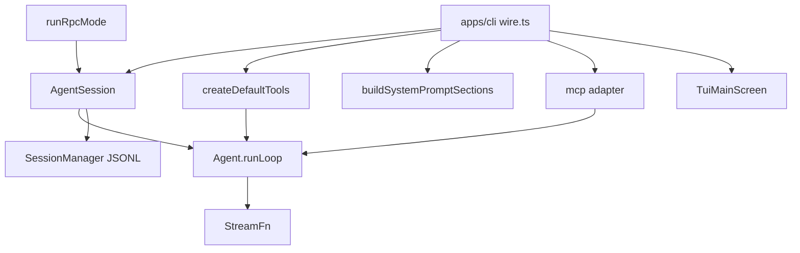

# 手搓 Pi Agent：总览与里程碑

本文是 Lisa 要新建的仓库 `my-pi-agent` 的总设计。行为从 [earendil-works/pi](https://github.com/earendil-works/pi) `main` 反推，类型和文件名按那个仓库里真实存在的结构改写成她自己要实现的版本。不要再发明第二套会话格式或第二套事件名。

现有面试八股页不在本设计范围内。

## 背景

上游把运行时拆成多个包：`packages/agent` 是工具循环，`packages/coding-agent` 写 JSONL、压缩、skill 和扩展，`packages/mcp` 是协议客户端，`packages/tui` 只负责画终端，`packages/chord` 不被 coding-agent 依赖。`packages/coding-agent/docs/how-pi-works.md` 规定：一次用户消息进入 active branch，模型流式返回，工具结果写回，需要时再来一轮。

手搓仓库用 npm workspaces，语言固定为 TypeScript，运行时 Node.js 22。测试用 Vitest。工具参数 schema 用 `typebox`，与上游 `packages/agent/package.json` 一致。不要引入 Go、Python 或第二份状态机。

## 目标与非目标

**目标**

- 给出一份可以直接 `mkdir` 的单仓目录，以及每个文件的职责和依赖方向。
- 每个模块有可编译的 TypeScript 类型，字段名与上游对应类型一致。
- M1 到 M6 的完成定义可以由假模型和假 MCP 传输测完，不需要供应商 API key。

**非目标**

- 不克隆 Pi CLI、主题、模型目录、OAuth 登录和全部 slash command。
- 不实现 sub-agent、plan mode、向量记忆、Chord 热重载。
- 不迁移上游 session v1/v2。新文件直接写 version 3。

## 目标仓库

完整树。某一里程碑未到时，对应目录不要提前创建，避免空包被误当成已完成。

```text
my-pi-agent/
  package.json                      # private, workspaces: packages/*, apps/*
  tsconfig.base.json                # strict, NodeNext, noEmit false per package
  packages/agent-core/
    package.json                    # name @my/agent-core
    tsconfig.json
    src/index.ts                    # 只做 re-export
    src/llm.ts                      # StreamFn、Model、消息类型。上游 pi-ai 的最小子集
    src/types.ts                    # AgentEvent、AgentTool、AgentState、AgentLoopConfig
    src/agent.ts                    # class Agent、PendingMessageQueue
    src/agent-loop.ts               # runLoop、executeToolCalls、runToolCall
    src/fake-stream.ts              # scriptedStream。index.ts 不 re-export
    test/fake-stream.ts             # 只 re-export src/fake-stream.ts
    test/agent-loop.test.ts
    test/queues.test.ts
    test/tools.test.ts
  packages/session/
    package.json                    # depends @my/agent-core
    tsconfig.json
    src/index.ts
    src/types.ts                    # SessionHeader、SessionEntry 联合
    src/session-manager.ts          # class SessionManager
    src/projection.ts               # buildSessionProjection、buildSessionContext
    src/tokens.ts                   # estimateTokens、shouldCompact 用的计数
    src/compaction.ts               # prepareCompaction、compact
    src/agent-session.ts            # class AgentSession，订阅 Agent 并写盘
    test/session-manager.test.ts
    test/projection.test.ts
    test/compaction.test.ts
    test/resume.test.ts
  packages/resources/
    package.json                    # 不依赖其他 @my/* 包
    tsconfig.json
    src/index.ts
    src/paths.ts                    # agent 目录、会话目录编码
    src/skills.ts                   # loadSkills、formatSkillsForPrompt
    src/context-files.ts            # loadProjectContextFiles
    src/system-prompt.ts            # buildSystemPromptSections
    test/skills.test.ts
    test/context-files.test.ts
    test/system-prompt.test.ts
  packages/tools/
    package.json                    # depends @my/agent-core
    tsconfig.json
    src/index.ts                    # createDefaultTools(cwd)
    src/truncate.ts
    src/file-mutation-queue.ts
    src/read.ts
    src/write.ts
    src/edit.ts
    src/grep.ts
    src/find.ts
    src/ls.ts
    src/bash.ts
    src/git-paths.ts
    test/truncate.test.ts
    test/mutation-queue.test.ts
    test/git-paths.test.ts
    test/edit.test.ts
  packages/mcp/
    package.json                    # 协议部分零依赖；adapter 依赖 @my/agent-core
    tsconfig.json
    src/index.ts
    src/jsonrpc.ts
    src/protocol.ts
    src/client.ts                   # class McpClient
    src/names.ts                    # createMcpToolName
    src/adapter.ts                  # MCP tool 变成 AgentTool
    src/transports/transport.ts
    src/transports/in-memory.ts
    src/transports/stdio.ts
    test/client.test.ts
    test/names.test.ts
    test/adapter.test.ts
  packages/gateway/
    package.json                    # depends agent-core、session、mcp、resources
    tsconfig.json
    src/index.ts
    src/extensions/types.ts
    src/extensions/runner.ts        # class ExtensionRunner
    src/extensions/loader.ts
    src/rpc/types.ts
    src/rpc/jsonl.ts
    src/rpc/rpc-mode.ts             # runRpcMode
    test/extension-runner.test.ts
    test/rpc.test.ts
  packages/tui/
    package.json                    # 不依赖其他 @my/* 包
    tsconfig.json
    src/index.ts
    src/types.ts                    # Component、TUI
    src/terminal.ts                 # ProcessTerminal、FakeTerminal
    src/main-screen.ts              # class TuiMainScreen
    src/keys.ts
    src/components/text.ts
    src/components/editor.ts
    test/diff-render.test.ts
    test/editor.test.ts
  apps/cli/
    package.json                    # name @my/cli, bin my-agent
    tsconfig.json
    src/main.ts                     # 解析 --print / --rpc / 默认交互
    src/wire.ts                     # 组装 AgentSession、工具、skill、MCP
    src/interactive.ts              # 把事件画进 TUI
    test/wire.test.ts
    test/abort.test.ts
```

| 包 | 拥有什么 | 对应上游 | 详细设计 |
|---|---|---|---|
| `@my/agent-core` | 内存中的工具循环和事件 | `packages/agent/src/{agent,agent-loop,types}.ts` | [Agent Core](core.md) |
| `@my/session` | JSONL 树、投影、压缩、`AgentSession` | `packages/coding-agent/src/core/session-manager.ts`、`compaction/compaction.ts`、`agent-session.ts` | [压缩与中断恢复](compaction-resume.md) |
| `@my/resources` | 上下文文件、skill 索引、system prompt 段 | `core/skills.ts`、`core/system-prompt.ts`、`core/resource-loader.ts` | [记忆与 Skill](memory-skill.md) |
| `@my/tools` | read/write/edit/grep/find/ls/bash 和 git 元数据 | `core/tools/*`、`core/footer-data-provider.ts` | [Git 与仓库工具](git.md) |
| `@my/mcp` | JSON-RPC 客户端和 `AgentTool` 适配 | `packages/mcp/src/client.ts`、`extensions/mcp/tools.ts` | [MCP](mcp.md) |
| `@my/gateway` | 扩展宿主和 stdin/stdout RPC | `core/extensions/*`、`modes/rpc/rpc-mode.ts` | [网关与适配层](gateway.md) |
| `@my/tui` | 差分渲染 | `packages/tui/src/tui-main-screen.ts` | [TUI](tui.md) |
| `@my/cli` | 进程入口，把上面的包接起来 | `packages/coding-agent/src/main.ts`、`modes/interactive/interactive-mode.ts` | 各里程碑的 `apps/cli` 小节 |

### 依赖规则

只允许下面这些 import。ESLint 的 `no-restricted-imports` 按这张表配，违反即测试失败。

| 从 | 可以 import | 禁止 |
|---|---|---|
| `agent-core` | `typebox`、Node 内置 | 任何 `@my/*` |
| `session` | `@my/agent-core` | tools、mcp、tui、resources、gateway |
| `resources` | Node `fs`/`path` | 任何 `@my/*`。它只产出字符串和 `Skill` |
| `tools` | `@my/agent-core`、Node `child_process` | session、mcp、tui |
| `mcp` 的 `client.ts`、`protocol.ts`、`transports/*` | Node 内置 | `@my/agent-core` |
| `mcp` 的 `adapter.ts`、`names.ts` | `@my/agent-core`、本包 client | session、tui |
| `gateway` | agent-core、session、mcp、resources | tui。通道不画界面 |
| `tui` | Node `tty` | 任何 `@my/*` |
| `apps/cli` | 全部 `@my/*` | 不在 cli 里写第二份循环或第二份 JSONL |

`AgentSession` 放在 `packages/session`，不放在 gateway。gateway 调用它的 `prompt` / `subscribe`，不自己订阅 `Agent` 写盘。这样 M2 不依赖 RPC 就能测落盘。

### 运行时磁盘

环境变量 `MY_AGENT_DIR` 覆盖默认目录。未设置时为 `~/.my-agent`（用 `os.homedir()`，不要写死 `/root`）。上游对应 `PI_CODING_AGENT_DIR`，默认 `~/.pi/agent`，见 `getDefaultSessionDir`。

```text
~/.my-agent/
  settings.json                     # { compaction: { enabled, reserveTokens, keepRecentTokens } }
  mcp.json                          # M5 才读
  skills/                           # 用户 skill
  extensions/                       # 用户扩展，M5 才加载
  sessions/--<encoded-cwd>--/
    <timestamp>_<sessionId>.jsonl

<repo>/.my-agent/                   # 项目目录，未信任时不读 skills/extensions/mcp.json
  skills/
  extensions/
  mcp.json

<repo>/AGENTS.md                    # 以及同目录的 AGENTS.override.md、CLAUDE.md
<repo>/.agents/skills/              # 向上直到 git 根
~/.agents/skills/
```

cwd 编码与上游 `getDefaultSessionDirPath` 相同，只是根目录换成 `~/.my-agent`：

```ts
export function encodeSessionDir(cwd: string): string {
  const resolved = path.resolve(cwd);
  const safe = resolved.replace(/^[/\\]/, "").replace(/[/\\:]/g, "-");
  return `--${safe}--`;
}
```

会话文件名：`timestamp.replace(/[:.]/g, "-") + "_" + sessionId + ".jsonl"`。`sessionId` 用 UUID v7。条目 `id` 用 `crypto.randomUUID().slice(0, 8)`，冲突再取，最多 100 次，然后退回完整 UUID。这是 `session-manager.ts` 的 `generateId`。

在出现第一条 `role: "user" | "assistant"` 的 message 之前，不创建文件。这是 `_hasConversation`。

## 里程碑

顺序不可打乱。后一个里程碑只添加列出的文件，不改前一个里程碑已经锁住的事件名和 JSONL 字段。

### M1 agent-core 与最小工具循环

**交付目录**（做完时仓库里只有这些，外加根 `package.json` 和 `tsconfig.base.json`）

```text
packages/agent-core/          # 上表中的全部 src 与 test
apps/cli/src/main.ts          # 仅 --print：读一行 stdin，跑完 prompt，把最后一条 assistant 文本打到 stdout
apps/cli/src/wire.ts          # new Agent({ streamFn: fake 或真实 })，挂上两个工具
apps/cli/package.json
apps/cli/test/wire.test.ts
```

`packages/session` 及之后的包不存在。

**要实现的 API**

```ts
new Agent(options: AgentOptions)
agent.prompt(text: string): Promise<void>
agent.continue(): Promise<void>
agent.steer(message: AgentMessage): void
agent.followUp(message: AgentMessage): void
agent.abort(): void
agent.waitForIdle(): Promise<void>
agent.subscribe(fn: (event: AgentEvent, signal: AbortSignal) => Promise<void> | void): () => void
agent.state: AgentState

export function runToolCall(toolCall: AgentToolCall, options: RunToolCallOptions): Promise<AgentToolCallOutcome>
```

`StreamFn` 不许抛。失败时返回的最终 assistant 消息 `stopReason` 为 `"error"` 或 `"aborted"`。签名见 [Agent Core](core.md)。

**本里程碑引入的数据结构**

`AgentMessage`、`AgentEvent`、`AgentTool`、`AgentToolResult`、`AgentState`、`QueueMode`、`ToolExecutionMode`。全部定义在 `packages/agent-core/src/types.ts` 和 `llm.ts`，字段见 core 页。M1 不定义 `SessionEntry`。

**测试计划**

| 文件 | 断言 |
|---|---|
| `packages/agent-core/src/fake-stream.ts` | `scriptedStream` 按脚本返回预定的 `AssistantMessage`，可被 `AbortSignal` 打成 `stopReason: "aborted"`。`test/fake-stream.ts` 只 re-export，不另写一份 |
| `test/agent-loop.test.ts` | 假模型第一次返回一个 tool call，第二次返回纯文本。事件序列是 `agent_start`、`turn_start`、user `message_start/end`、assistant `message_*`、`tool_execution_start/end`、toolResult `message_*`、`turn_end`、第二轮、`agent_end` |
| `test/tools.test.ts` | 工具抛错 → tool result `isError: true`，循环不抛。`beforeToolCall` 返回 `{ block: true }` 时 `execute` 调用次数为 0。`stopReason: "length"` 且带 tool call 时 `execute` 次数为 0 |
| `test/queues.test.ts` | `steeringMode: "one-at-a-time"` 时连续 steer 两条，第一轮只注入第一条。follow-up 在没有工具调用时才注入。`finishTurn` 返回 `{ action: "end" }` 后队列不再被取走 |
| `apps/cli/test/wire.test.ts` | 子进程或直接调用 `runPrint("read the fixture")`，stdout 含假模型的最终文本，退出码 0 |

**完成定义**

- [ ] `npm test -w @my/agent-core` 不访问网络。
- [ ] 事件顺序与 `packages/agent/README.md` 的 tool 路径一致，测试把 `event.type` 列成数组比较。
- [ ] 默认 `toolExecution` 是 `"parallel"`。批内任一工具 `executionMode: "sequential"` 时整批串行。测试用时间戳证明 sequential 工具的 `execute` 不重叠。
- [ ] 只有整批每个最终结果都是 `terminate: true` 时才跳过下一轮模型调用。混合批会再请求一次。
- [ ] `stopReason` 为 `"error"` 或 `"aborted"` 时发出 `turn_end` 和 `agent_end`，不再 `getSteeringMessages`。
- [ ] `subscribe` 监听器按注册顺序 await。`agent_end` 监听器未完成时 `waitForIdle()` 不返回。
- [ ] `state.tools` / `state.messages` 赋值会复制顶层数组。
- [ ] 初始 `systemPrompt` 变成第一条 `role: "system"` 消息。之后 `state.systemPrompt` 只读。
- [ ] 工具表变化会在下一次请求前插入 system 消息，带 `toolsAdded` 或 `toolsRemoved`。
- [ ] `convertToLlm` 抛错时循环捕获并当成 `stopReason: "error"` 结束，不把异常抛出 `prompt()`。上游低层循环会炸；手搓默认改成这条，避免 CLI 进程崩溃。
- [ ] `--print` 用假 `StreamFn` 跑通一条 prompt。

**本里程碑不做**

JSONL、压缩、skill、bash、MCP、RPC、TUI、真实供应商 SDK。`apps/cli` 不读 `~/.my-agent`。

**规模**

约 13 个源文件和测试文件（含 `src/fake-stream.ts`，不含根 `package.json`），agent-core 实现约 900–1200 行（不含测试）。一名熟悉 async 的 L3 大约 4 个工作日。

**实现顺序**

1. `llm.ts` 的消息和 `StreamFn`，加上 `src/fake-stream.ts`。`test/fake-stream.ts` 只 re-export。
2. `types.ts` 的 `AgentEvent` 和 `AgentTool`。
3. `PendingMessageQueue` 和 `Agent` 的订阅、abort、队列。先不跑模型。
4. `runLoop` 串行工具路径，锁住事件测试。
5. parallel、`terminate`、`length` 失败、`declareToolChanges`。
6. `apps/cli` 的 `--print` 把假模型接上 `read` 的一个 20 行桩（桩放在 `wire.ts`，不要提前建 `packages/tools`）。

### M2 会话落盘、中断恢复与压缩

**交付目录**

在 M1 之上新增 `packages/session/` 的全部文件（见目标仓库）。`apps/cli/src/wire.ts` 改为创建 `AgentSession`。新增 `packages/session/test/resume.test.ts`。不新增 tools 包。

**要实现的 API**

```ts
SessionManager.create(cwd: string, options?: { sessionFile?: string; persist?: boolean }): SessionManager
session.appendMessage(message: AgentMessage): string
session.appendCompaction(summary: string, firstKeptEntryId: string, tokensBefore: number, details?: CompactionDetails): string
session.appendContextEdit(targetId: string, replacement: { content: string } | null): string
session.getBranch(): SessionEntry[]
session.buildSessionContext(): SessionContext
session.getSessionFile(): string | undefined

new AgentSession(options: { cwd: string; agent: Agent; sessionManager: SessionManager })
session.prompt(text: string): Promise<void>
session.abort(): Promise<void>
session.clearQueue(): { steering: string[]; followUp: string[] }
session.compact(instructions?: string): Promise<CompactionResult>

shouldCompact(tokens: number, contextWindow: number, settings: CompactionSettings): boolean
prepareCompaction(entries: SessionEntry[], settings: CompactionSettings): CompactionPreparation | undefined
compact(preparation: CompactionPreparation, summarize: SummarizeFn): Promise<CompactionResult>
```

`SummarizeFn` 在测试里是假函数，返回固定摘要字符串。不要在 `compact()` 里直接调用供应商。

**本里程碑引入的数据结构**

`SessionHeader`、`SessionEntry` 判别联合、`CompactionEntry`、`ContextEditEntry`、`CompactionSettings`、`AgentSessionEvent`。字段和 JSONL 行形状见 [压缩与中断恢复](compaction-resume.md)。常量：`CURRENT_SESSION_VERSION = 3`，`reserveTokens = 16384`，`keepRecentTokens = 20000`。

**测试计划**

| 文件 | 断言 |
|---|---|
| `session-manager.test.ts` | 只有 user 或 assistant 出现后才存在文件。header 是第一行，`version === 3`。第二条 message 的 `parentId` 等于第一条的 `id`。坏掉的最后一行被跳过，前面的条目仍在 |
| `projection.test.ts` | 写入 compaction 后，`buildSessionContext().messages` 以摘要开头，且包含 `firstKeptEntryId` 的原文，不包含更早的 user 文本。原始 JSONL 行数不减少 |
| `compaction.test.ts` | `contextWindow = 1000`、`reserveTokens = 100` 时，`tokens = 901` 触发，`900` 不触发。切点不落在 tool result 上。`prepareCompaction` 在路径末尾已是 compaction 时返回 `undefined` |
| `resume.test.ts` | 进程内把文件写到一半（assistant 含 toolCall，没有 toolResult），重新 `SessionManager.create` 打开同一路径，`AgentSession` 恢复时追加一条 `isError: true` 的 toolResult，其 `toolCallId` 等于悬空调用。`abort()` 之后文件含 `stopReason: "aborted"` 的 assistant，`clearQueue()` 返回的字符串不在文件里 |

**完成定义**

- [ ] 会话路径等于 `~/.my-agent/sessions/` + `encodeSessionDir(cwd)` + `/<timestamp>_<id>.jsonl`。测试用临时 `MY_AGENT_DIR`。
- [ ] 每行一个 JSON 对象，UTF-8，以 `\n` 结尾。加载用按行 `JSON.parse`，失败的行跳过。
- [ ] `appendMessage` 拒绝 `role` 不是 system/user/assistant/toolResult 的消息。压缩摘要只能走 `appendCompaction`。
- [ ] `message_update` 不写盘。只有 `message_end` 追加。
- [ ] `abort()` 调用 `agent.abort()` 并等待 idle。已完成的 `message_end` 已在文件中。
- [ ] 悬空 tool call 的修补在 `AgentSession` 打开已有文件时做一次，不在每次 `prompt` 时重复追加。
- [ ] `shouldCompact` 使用 `contextTokens > contextWindow - reserveTokens`。
- [ ] 压缩后模型上下文不含切点之前的 user 文本，文件里那些行还在。
- [ ] `context_edit` 的 `replacement: null` 使目标从投影中消失，文件中的目标行还在。
- [ ] 摘要函数被取消时不追加 `compaction` 行。
- [ ] M1 的事件测试仍然通过。`Agent` 的公共字段没有改名。

**本里程碑不做**

分支摘要的生成（类型可以解析，但不写 `appendBranchSummary`）、skill、git、MCP、TUI、`fsync`、session v1 迁移。

**规模**

约 10 个新源文件，session 包约 1000–1400 行。大约 5 个工作日。压缩切点是这里最容易写错的部分，先写投影测试再写 `prepareCompaction`。

**实现顺序**

1. `types.ts` 和只在内存中的 `SessionManager.appendMessage` / `getBranch`。
2. 追加到真实文件，以及「没有 user/assistant 不建文件」。
3. `projection.ts`：无压缩时叶子到根的消息顺序与追加顺序一致。
4. `AgentSession` 把 `message_end` 接到 `appendMessage`，`prompt` 前把投影写回 `agent.state.messages`。
5. abort 和悬空 tool call 修补。
6. `tokens.ts`、`shouldCompact`、`prepareCompaction`、假 `SummarizeFn`、`appendCompaction`。
7. `context_edit` 省略。溢出重试可以只做「省略失败的 assistant 再 compact 一次」这一个测试。

### M3 记忆与 Skill

**交付目录**

新增整个 `packages/resources/`。`apps/cli/src/wire.ts` 在每次 `prompt` 前调用 `buildSystemPromptSections`，把结果写进一条 system 消息。不修改 `Agent` 循环。

**要实现的 API**

```ts
loadProjectContextFiles(options: { cwd: string; agentDir: string }): ContextFile[]
loadSkills(options: LoadSkillsOptions): LoadSkillsResult
formatSkillsForPrompt(skills: Skill[]): string
buildSystemPromptSections(input: BuildSystemPromptInput): SystemPromptSections
parseSkillBlock(text: string): ParsedSkillBlock | null
```

**本里程碑引入的数据结构**

`Skill`、`SkillFrontmatter`、`ContextFile`、`SystemPromptSections`。schema 见 [记忆与 Skill](memory-skill.md)。

**测试计划**

| 文件 | 断言 |
|---|---|
| `context-files.test.ts` | 同目录 `AGENTS.override.md` 胜出，祖先目录的 `AGENTS.md` 仍在。目录名叫 `AGENTS.md` 时跳过 |
| `skills.test.ts` | 含 `SKILL.md` 的目录不再向下递归。缺 description 的 skill 不在 `skills` 数组里，而在 `diagnostics`。同名保留先出现的。`disable-model-invocation: true` 不进 `formatSkillsForPrompt` |
| `system-prompt.test.ts` | 有 skill 时输出含 `<location>` 且不含 `SKILL.md` 正文。无 read 类工具名时调用方不把 skills 段塞进 prompt（函数根据 `hasFileReader: false` 返回空 skills 段） |
| `apps/cli` 的现有 wire 测试扩展 | 假模型第一次请求的 system 文本含 `<available_skills>`，不含正文 |

**完成定义**

- [ ] 发现顺序和文件名优先级与 memory 页的表一致，测试用三层临时目录。
- [ ] 名字校验：长度 ≤ 64，字符集 `^[a-z0-9-]+$`，不能首尾或连续连字符。
- [ ] description 必填且 ≤ 1024。
- [ ] 项目 `.my-agent/skills` 和项目 `.agents/skills` 在 `projectTrusted === false` 时不被扫描。`~/.my-agent/skills` 和 `~/.agents/skills` 始终扫描。
- [ ] 同秩内 `.my-agent/skills` 先于 `.agents/skills`。项目秩先于用户秩，所以项目同名 skill 赢。
- [ ] `parseSkillBlock` 能拆开 `<skill name location>` 块；不匹配时返回 `null`。
- [ ] system 段的键只有 `preamble`、`tools`、`rules`、`project_context`、`skills`、`cwd`。不要自造 `memory` 段。
- [ ] M2 压缩写入的 system 检查点包含当时的 `skills` 段。测试：压缩后的 `systemMessage.sections.skills` 仍含 skill 名。

**本里程碑不做**

向量库、把 `SKILL.md` 全文预装进 prompt、`allowed-tools` 自动授权、worktree 去重（留到 M4，`context-files.ts` 先接受可选的 `shadowedPath?: string` 参数，M3 传 `undefined`）。

**规模**

约 8 个文件，600–900 行。大约 3 个工作日。

**实现顺序**

1. `paths.ts` 的 `agentDir()` 和 `encodeSessionDir`（从 M2 的会话路径函数挪到这里，session 改为 import `@my/resources` 会违反依赖规则）。默认：路径函数在 resources 和 session 各有一份同名实现，测试对同一组 cwd 断言两份输出相等。不要为了共享而让 session 依赖 resources。
2. `context-files.ts`。
3. `skills.ts` 的校验和目录扫描。
4. `formatSkillsForPrompt` 和 `buildSystemPromptSections`。
5. `wire.ts` 把段写进 system 消息。
6. `parseSkillBlock` 放在 `resources/src/skills.ts` 并导出。上游在 `agent-session.ts`，手搓放在 resources，因为 gateway 和 CLI 都要解析它，而 resources 不能被 session 反向依赖。session 不解析 skill 块。

### M4 Git 与仓库工具

**交付目录**

新增整个 `packages/tools/`。`wire.ts` 用 `createDefaultTools(cwd)` 替换 M1 的读文件桩。`resources/src/context-files.ts` 增加可选参数 `gitPaths`，用来跳过被 worktree 挡住的主仓上下文文件。

**要实现的 API**

```ts
createDefaultTools(cwd: string): AgentTool[]
createReadTool(cwd: string): AgentTool
createWriteTool(cwd: string, queue: FileMutationQueue): AgentTool
createEditTool(cwd: string, queue: FileMutationQueue): AgentTool
createBashTool(cwd: string): AgentTool
findGitPaths(cwd: string): GitPaths | null
resolveBranch(repoDir: string): Promise<string | null>
```

没有 `createGitTool`。上游没有这个工具。

**本里程碑引入的数据结构**

`GitPaths`、`TruncationResult`、各工具的参数对象和 `details`。见 [Git](git.md)。

**测试计划**

| 文件 | 断言 |
|---|---|
| `truncate.test.ts` | 超过 2000 行或 50 KiB 的字符串被截断，结果里含明确的截断标记 |
| `mutation-queue.test.ts` | 两个 `edit` 的 `execute` 对同一 cwd 不重叠 |
| `git-paths.test.ts` | `.git` 为目录和 `.git` 为 `gitdir: ` 文件两种夹具都能得到 `headPath`。不调用真实 `git worktree`。detached 时 `resolveBranch` 返回 `null`，调用方显示 `"detached"` |
| `edit.test.ts` | 旧文本不匹配时文件字节不变，tool result `isError: true` |
| `resources` 的 context 测试新增一条 | worktree 根有自己的 `AGENTS.md` 且位于主仓目录之内时，主仓那份不在返回列表里 |

**完成定义**

- [ ] 工具名就是 `read`、`write`、`edit`、`grep`、`find`、`ls`、`bash`。
- [ ] bash 和文件工具的 cwd 是 `AgentSession` 的 cwd，不是 `process.cwd()` 除非两者相同。
- [ ] `git status` 通过 bash 跑，输出经过 `truncate.ts`。
- [ ] 分支探测命令固定为 `git --no-optional-locks symbolic-ref --quiet --short HEAD`。
- [ ] `findGitPaths` 向上走到文件系统根为止。
- [ ] write/edit 经 `FileMutationQueue`。read 和 grep 不进队列。
- [ ] bash 的 `executionMode` 设为 `"sequential"`。这是手搓默认，用来避免和 edit 交错。上游没有这个限制，偏差写在 git 页。
- [ ] 工具失败用抛错或 `isError: true`，不把「命令失败」写成成功文本。
- [ ] 页脚还没有。M4 只导出 `resolveBranch`，M6 再显示。

**本里程碑不做**

`git commit` 专用工具、自动 `git worktree add`、libgit2、`PackageManager.installGit`。

**规模**

约 14 个文件，900–1200 行。大约 4 个工作日。

**实现顺序**

1. `truncate.ts` 和测试。
2. `read.ts`、`bash.ts`。
3. `FileMutationQueue`、`write.ts`、`edit.ts`。
4. `git-paths.ts` 的两种 `.git` 夹具。
5. `grep.ts`、`find.ts`、`ls.ts`。可以后做，但完成定义要求它们存在。
6. 把 worktree 去重接到 `loadProjectContextFiles`。

### M5 MCP 与网关

**交付目录**

新增 `packages/mcp/` 和 `packages/gateway/` 的全部文件。`apps/cli/src/main.ts` 增加 `--rpc`。`wire.ts` 在 `projectTrusted` 时读取 `mcp.json`。

**要实现的 API**

```ts
client.connect(transport: McpTransport): Promise<InitializeResult>
client.listTools(): Promise<McpTool[]>
client.callTool(name: string, args: Record<string, unknown>, signal?: AbortSignal): Promise<CallToolResult>
createMcpToolName(server: string, tool: string, isTaken?: (name: string) => boolean): string
mcpToolsToAgentTools(server: McpServerConnection): AgentTool[]

new ExtensionRunner()
runner.load(factory: ExtensionFactory): Promise<void>
runner.registerTool(tool: AgentTool): void
runner.emit(event: ExtensionEvent): Promise<void>

runRpcMode(session: AgentSession, stdin: Readable, stdout: Writable): Promise<void>
```

**本里程碑引入的数据结构**

`McpClient` 状态机、JSON-RPC 请求、`InitializeResult`、`RpcCommand`、`ExtensionFactory`。见 [MCP](mcp.md) 和 [网关](gateway.md)。

**测试计划**

| 文件 | 断言 |
|---|---|
| `mcp/test/client.test.ts` | in-memory 假服务器。未收到 `notifications/initialized` 之前 `listTools` 被拒绝。`initialize` 的取消信号不中止这次握手 |
| `mcp/test/names.test.ts` | `server a` + `tool b` → `mcp__server_a__tool_b`。长度超过 64 时带 8 位 hash 且总长 ≤ 64 |
| `mcp/test/adapter.test.ts` | `beforeToolCall` block 时假服务器的 call 计数为 0 |
| `gateway/test/extension-runner.test.ts` | 工厂抛错不影响第二个扩展。监听器抛错时 session 文件仍有对应 `message_end` |
| `gateway/test/rpc.test.ts` | 写入一行 `{"id":"1","type":"prompt","text":"hi"}`，stdout 先有 `type:"response"` 且 `success:true`，之后有一行 `type:"agent_end"` |

**完成定义**

- [ ] 协议版本常量是 `"2025-11-25"`，同时接受 `2025-06-18`、`2025-03-26`、`2024-11-05`。其他版本关闭连接。
- [ ] 工具曝光默认 `"direct"`。上游默认是 `codemode`。手搓没有 codemode，所以默认改成 direct，并在 `mcp.json` 里保留 `exposure` 字段。
- [ ] direct 服务器连接超过 10 秒不阻塞 `prompt`。超时后循环照常开始，工具稍后通过 `toolsAdded` 出现。
- [ ] 扩展监听器在 `message_end` 落盘之后调用。落盘不依赖监听器成功。
- [ ] 未信任的项目不加载 `.my-agent/extensions` 和项目 `mcp.json`。
- [ ] RPC 忙时再收到 `prompt` 返回 `success:false`，错误字符串是 `"busy"`。调用方改用 `steer`。不要静默改成 steer。
- [ ] `abort` 命令调用 `session.abort()`，响应 `data` 里带回 `clearQueue()` 的两条数组。
- [ ] 未知 RPC `type` 返回 `success:false`，进程不退出。
- [ ] stdio 传输能启动一个 node 假服务器脚本。验收测试仍以 in-memory 为主，stdio 只留一个集成测试。
- [ ] M2 的 JSONL 字段没有为了 MCP 新增变体。MCP 结果就是普通 `toolResult`。

**本里程碑不做**

OAuth、streamable HTTP、codemode、`tool_search`、Chord、WebSocket、热重载、扩展 UI 的 select/confirm（RPC 类型里可以留注释，不实现请求往返）。

**规模**

约 20 个文件，1500–2000 行。大约 6 个工作日。先做完 in-memory 客户端再写 RPC。

**实现顺序**

1. `jsonrpc.ts` 和 `protocol.ts`。
2. `InMemoryTransport` 和 `McpClient.connect` / `listTools` / `callTool`。
3. `names.ts` 和 `adapter.ts`。
4. `ExtensionRunner` 的 `registerTool` 和事件。
5. `AgentSession` 在工具结果落盘后 `emit`。如果这要求 session 依赖 gateway，就不要这样做。默认：`AgentSession` 已有 `subscribe`。`ExtensionRunner` 在 gateway 里订阅 `AgentSession`，在看到 `message_end` 之后再 emit 给扩展。写盘仍在 session 内部、对订阅者而言已经发生。
6. `runRpcMode` 的 `prompt`、`steer`、`follow_up`、`abort`、`get_state`、`compact`。
7. stdio 传输和 `mcp.json` 加载。

### M6 TUI

**交付目录**

新增整个 `packages/tui/`。`apps/cli/src/interactive.ts` 在没有 `--print` 和 `--rpc` 时启动。`apps/cli/test/abort.test.ts` 用 `FakeTerminal`。

**要实现的 API**

```ts
interface Component { render(width: number): string[] }
new TuiMainScreen(terminal: Terminal)
tui.addChild(component: Component): void
tui.requestRender(): void
tui.setFocus(component: Component): void
class Editor { onSubmit?: (text: string) => void }
class FakeTerminal { writes: string[] }
```

**本里程碑引入的数据结构**

`Component`、`Terminal`、渲染器内部的 `previousLines: string[]`。见 [TUI](tui.md)。

**测试计划**

| 文件 | 断言 |
|---|---|
| `diff-render.test.ts` | 第一帧写出全部行。只改最后一行时，`FakeTerminal.writes` 拼接后的内容不包含第一行的第二次拷贝。宽度从 40 变到 20 时写入含清屏序列 `\x1b[2J` |
| `editor.test.ts` | 粘贴含换行的 bracketed paste 只产生一次 `onSubmit`，不是每行一次 |
| `apps/cli/test/abort.test.ts` | 喂入 M1 的事件回放，十次 `message_update` 只调度一轮 `renderNow`。中断键调用 `session.abort()`，`clearQueue()` 的文本回到 editor 缓冲。会话文件含 `stopReason: "aborted"` 或已写入的错误 tool result |

**完成定义**

- [ ] 组件不调用 `terminal.write`。可见内容只来自 `render()`。
- [ ] 差分输出包在 `\x1b[?2026h` 和 `\x1b[?2026l` 之间。
- [ ] `requestRender` 在同一轮事件循环里多次调用只渲染一次。
- [ ] TUI 的订阅者不负责写 JSONL。写盘监听器里不做 `render`。
- [ ] 中断键在键位表里，默认 `ctrl+c`。业务代码通过键位名 `app.abort` 查询，不散落 `matchesKey(..., "ctrl+c")`。
- [ ] 页脚调用 M4 的 `resolveBranch`。`null` 且 `findGitPaths` 非空时显示 `detached`。`findGitPaths` 为 `null` 时不显示分支。
- [ ] 主屏幕实现。不创建 `TuiAltScreen`。
- [ ] M5 的 RPC 测试不 import `tui`。

**本里程碑不做**

Kitty 图像、OKLCH、备用屏幕、鼠标、主题编辑器。

**规模**

约 12 个文件，800–1100 行。大约 4 个工作日。

**实现顺序**

1. `Component`、`Text`、`FakeTerminal`。
2. `TuiMainScreen` 的第一帧、追加、单行变化、宽度变化。
3. CSI 2026 包裹。
4. `Editor` 和键位表。
5. `interactive.ts` 把 `AgentSession` 事件映射到组件。
6. 页脚分支。

## 方案



一次 `prompt` 的固定调用序，后面的页面不要改这条顺序：

1. `resources` 算出 system 段。若与当前首条 system 消息不同，`AgentSession` 追加一条 system 消息。
2. `session.prompt` 把用户文本交给 `Agent.prompt`。
3. `Agent` 发事件。`AgentSession` 在 `message_end` 上 `appendMessage`。
4. 工具来自 `createDefaultTools` 和 MCP adapter，都是 `AgentTool`。
5. 下一轮之前 `AgentSession` 看 `shouldCompact`。
6. `gateway` 的扩展订阅者在事件已经写入会话之后收到通知。
7. TUI 或 RPC 只订阅 `AgentSession`，不订阅裸 `Agent`。

## 备选方案

| 方案 | 放弃原因 |
|---|---|
| 一个 `src/` 目录装下所有文件 | L3 会把 JSONL 写进循环里。包边界就是上面的依赖表。 |
| 直接依赖 `@earendil-works/pi-coding-agent` | 这是接线，不是手搓。 |
| M2 改用 `pi-durable` | 恢复更强，但要同时引入 Chord。M2 的完成定义按 JSONL 验收。 |

## 横切关注点

- **错误**：`StreamFn` 和工具失败都变成消息，不变成未捕获异常。RPC 用 `success: false`。
- **并发**：一个 `Agent` 一个 `ActiveRun`。RPC 忙时拒绝第二个 `prompt`。
- **持久化**：一行 JSON。崩溃窗口是最后一行。悬空 tool call 在打开会话时补错误结果，不自动重跑 `replay !== "safe"` 的工具。
- **权限**：没有内置沙箱。未信任项目不加载项目 skill、扩展和 `mcp.json`。

## 手搓时先读的上游文件

1. `packages/agent/src/types.ts` 的 `AgentEvent`、`AgentTool`。
2. `packages/agent/src/agent-loop.ts` 的 `runLoop`。
3. `packages/coding-agent/src/core/session-manager.ts` 的 `SessionEntry` 和 `getDefaultSessionDirPath`。
4. `packages/coding-agent/src/core/agent-session.ts` 里对 `message_end` 的落盘。
5. 然后按里程碑打开对应设计页，按该页的类型原样建文件。
