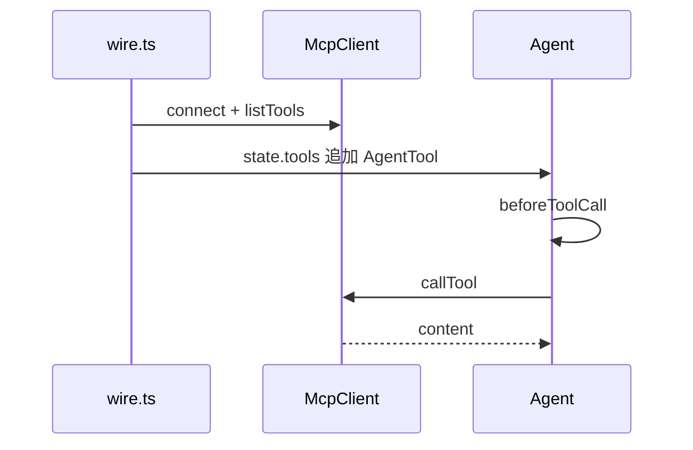

# MCP 接入

## 背景

上游把 MCP 分成两层。`packages/mcp/src/client.ts` 的 `McpClient` 做 JSON-RPC，不知道 `Agent`。`packages/coding-agent/src/extensions/mcp/index.ts` 把远端工具包成 `AgentTool`，名字由 `extensions/mcp/tools.ts` 的 `createMcpToolName` 生成。协议版本常量在 `packages/mcp/src/protocol/types.ts`：`LATEST_PROTOCOL_VERSION = "2025-11-25"`。

`@my/mcp` 保留这两层：`client.ts` 不 import agent-core，`adapter.ts` 才 import。

## 目标与非目标

**目标**

- in-memory 传输上完成握手、`tools/list`、`tools/call`。
- 每个远端工具变成一个 `AgentTool`，并经过 `beforeToolCall`。

**非目标**

- 不实现 MCP server。
- 不实现 OAuth、streamable HTTP、resources 的三个聚合工具、codemode。上游默认曝光是 `codemode`。本仓库没有脚本沙箱，`mcp.json` 缺省 `exposure` 时按 `"direct"` 处理。
- 不把服务器 `instructions` 自动写进 system prompt。direct 模式下忽略 `instructions`。

## 本模块在仓库中的位置

```text
packages/mcp/
  package.json
  tsconfig.json
  src/index.ts
  src/jsonrpc.ts                 # 上游 packages/mcp/src/protocol/jsonrpc.ts 的子集
  src/protocol.ts                # 上游 protocol/types.ts 的子集
  src/client.ts                  # class McpClient
  src/names.ts                   # createMcpToolName
  src/adapter.ts                 # mcpToolsToAgentTools
  src/transports/transport.ts
  src/transports/in-memory.ts
  src/transports/stdio.ts
  test/client.test.ts
  test/names.test.ts
  test/adapter.test.ts
```

| 文件 | 职责 |
|---|---|
| `jsonrpc.ts` | 请求、响应、错误码、按行解析 |
| `protocol.ts` | initialize 和 tools 的类型、版本常量 |
| `client.ts` | 状态机、超时、分页 |
| `transports/in-memory.ts` | 测试用的成对传输 |
| `transports/stdio.ts` | 子进程。一行一条 JSON |
| `names.ts` | 工具名编码，无 I/O |
| `adapter.ts` | `CallToolResult` 变成 `AgentToolResult` |

**依赖**：`adapter.ts` 和 `names.ts` 可以 import `@my/agent-core`。其余文件不可以。

**磁盘**

```text
~/.my-agent/mcp.json
<cwd>/.my-agent/mcp.json          # 仅 projectTrusted 时由 CLI 读取
```

本包不读这些文件。CLI 读完后把配置对象传给 `connectConfiguredServers`。连接对象不写入 JSONL。

## 接入 agent 循环



`wire.ts` 在 `prompt` 前等待 direct 服务器，上限 10 秒。超时后照常 `prompt`。服务器稍后连上时，再次设置 `agent.state.tools`，agent-core 会发 `toolsAdded`。

## 核心数据结构

### 连接状态

```ts
export type McpConnectionState = "idle" | "connecting" | "connected" | "closed";
```

`connect` 只允许 `idle`。失败时先 `close()`，状态变为 `closed`。再次连接需要 `new McpClient`。不要从 `closed` 回到 `idle`。

### 协议

```ts
export const LATEST_PROTOCOL_VERSION = "2025-11-25";
export const SUPPORTED_PROTOCOL_VERSIONS = ["2025-11-25", "2025-06-18", "2025-03-26", "2024-11-05"] as const;

export interface JsonRpcRequest {
  jsonrpc: "2.0";
  id: number;
  method: string;
  params?: Record<string, unknown>;
}
export interface JsonRpcNotification {
  jsonrpc: "2.0";
  method: string;
  params?: Record<string, unknown>;
}
export interface JsonRpcSuccess { jsonrpc: "2.0"; id: number; result: unknown }
export interface JsonRpcFailure { jsonrpc: "2.0"; id: number; error: { code: number; message: string } }

export interface InitializeResult {
  protocolVersion: string;
  capabilities: { tools?: { listChanged?: boolean } };
  serverInfo: { name: string; version: string };
  instructions?: string;
}

export interface McpTool {
  name: string;
  description?: string;
  inputSchema: Record<string, unknown>;
}

export interface CallToolResult {
  content: Array<{ type: "text"; text: string } | { type: "image"; data: string; mimeType: string }>;
  isError?: boolean;
  structuredContent?: unknown;
}
```

`content` 缺失时客户端补 `[]`，与上游 `validateCallToolResult` 相同。`isError: true` 时 adapter 把 `AgentToolResult.isError` 设为 true，不抛错。

### 配置

```ts
export interface McpServerConfig {
  name: string;
  command: string;
  args?: string[];
  env?: Record<string, string>;
  exposure?: "direct" | "hidden";
  enabled?: boolean;
}
```

`enabled === false` 或 `exposure === "hidden"` 时不连接、不注册工具。缺省 `exposure` 是 `"direct"`。不要接受 `"codemode"` 或 `"deferred"`。配置里出现这两个字符串时 CLI 记 warning 并按 `"hidden"` 处理，避免模型以为工具可用。

`mcp.json` 的形状：

```json
{ "servers": [ { "name": "fs", "command": "node", "args": ["server.js"] } ] }
```

项目文件和用户文件都读。同名时项目条目覆盖用户条目。这是手搓默认，上游是 `mcp.json` 里的定义优先于 `registerMcpServer()`。本仓库 M5 没有 `registerMcpServer`，同名只发生在两个文件之间。

### 工具名

```ts
export const MAX_TOOL_NAME_LENGTH = 64;

export function createMcpToolName(server: string, tool: string, isTaken: (name: string) => boolean = () => false): string
```

算法与上游一致：

1. 原始名 `` mcp__${server}__${tool} ``。
2. 每个不是 `[A-Za-z0-9_]` 的字符换成 `_`。
3. 长度 ≤ 64 且 `isTaken` 为 false 时用这个名字。
4. 否则 `hash = sha256(server + "\0" + tool)` 的 hex 前 8 位，结果为 `name.slice(0, 64 - 8 - 1) + "_" + hash`。

### 传输

```ts
export interface McpTransport {
  start(): Promise<void>;
  send(message: unknown): Promise<void>;
  close(): Promise<void>;
  onMessage(cb: (message: unknown) => void): () => void;
  onClose(cb: () => void): () => void;
}

export function createInMemoryPair(): { client: McpTransport; server: McpTransport }
```

stdio：`spawn(command, args, { env: { ...process.env, ...config.env }, stdio: ["pipe", "pipe", "pipe"] })`。stdout 按行 `JSON.parse`，坏行记日志并忽略。stderr 不进模型。

## 方案

### 握手

`McpClient.connect`：

1. 状态改为 `connecting`，`transport.start()`。
2. 发送 `initialize`，`protocolVersion` 为 `LATEST_PROTOCOL_VERSION`，`clientInfo` 为 `{ name: "my-agent", version: "0.1.0" }`，`capabilities` 为 `{}`。
3. 校验结果含 `protocolVersion`、`capabilities`、`serverInfo.name`、`serverInfo.version`。版本不在支持列表中则抛错并 `close()`。
4. 发送通知 `notifications/initialized`。状态改为 `connected`。
5. `initialize` 忽略 `AbortSignal`。其他请求在 abort 或 30 秒超时时以错误拒绝。

`listTools` 发送 `tools/list`。若结果有非空 `nextCursor`，继续请求，最多 1000 页。重复 cursor 抛错。

`callTool(name, args, options)` 发送 `tools/call`，params 为 `{ name, arguments: args }`。

### 适配

```ts
export function mcpToolsToAgentTools(serverName: string, client: McpClient, tools: McpTool[], isTaken: (name: string) => boolean): AgentTool[]
```

每个工具的 `execute` 调用 `client.callTool`。返回值：

```ts
{ content: result.content, details: { server: serverName, tool: tool.name }, isError: result.isError === true }
```

`parameters` 用工具的 `inputSchema`。schema 缺失时用 `{ type: "object", properties: {} }`。

`label` 用远端工具名，`description` 用远端 description，缺省为 `"MCP tool"`。

## 备选方案

| 方案 | 放弃原因 |
|---|---|
| 模型直接输出 JSON-RPC | 超时和握手会漏进模型 |
| 默认把所有工具都声明给模型，且不设超时 | 服务器挂起时第一条 prompt 永不开始。10 秒上限来自上游 `startupWaitMs` |
| M5 做 codemode | 那是另一个运行时，不是 MCP 握手的一部分 |

## 横切关注点

- **错误**：`tools/call` 的协议错误变成该次 `AgentToolResult` 的 `isError`。`adapter` 捕获客户端异常并返回错误文本，不让 `AgentSession` 崩溃。
- **并发**：多个服务器的 `connect` 用 `Promise.all`。同一个 `McpClient` 不并发 `connect`。
- **持久化**：不写会话。恢复进程后 CLI 重新握手。
- **取消**：`agent.abort()` 的 signal 传进 `callTool`。已完成的结果仍由 session 在 `message_end` 落盘。

## 手搓实现笔记

按总览 M5 的前三步先把本包做完，再写 gateway。假服务器放在 `test/client.test.ts` 里，不要新建 `packages/mcp/examples`。它只响应 `initialize`、`notifications/initialized`、`tools/list`、`tools/call`。在 initialized 之前收到 `tools/list` 时回复 JSON-RPC 错误，测试断言客户端抛错。
