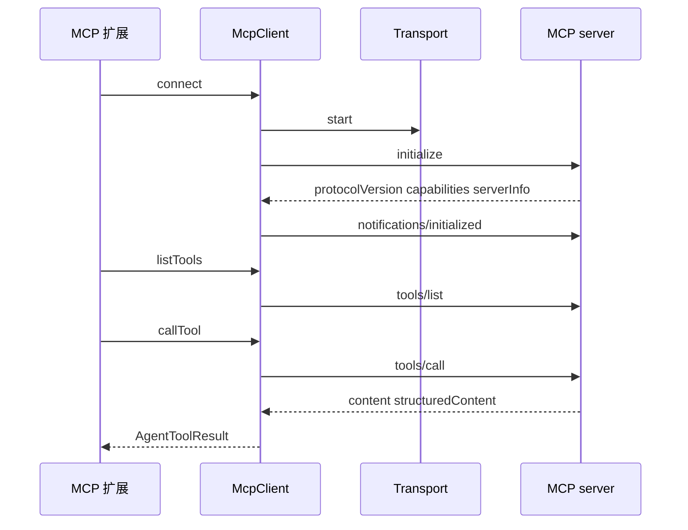

# MCP 接入

## 背景

MCP 在 Pi 里分成两层，不要合成一个类：

- `@earendil-works/pi-mcp`（`packages/mcp`）是协议客户端。`McpClient` 做 JSON-RPC，`StdioTransport` 和 `StreamableHttpTransport` 负责字节流，`oauth/` 负责 HTTP 的授权。它不知道 `Agent`、会话或工具名。
- coding-agent 的内置扩展 `packages/coding-agent/src/extensions/mcp/` 在会话启动时连接 `mcp.json` 和 `pi.registerMcpServer()` 注册的服务器，把远端工具包成 `AgentTool`，名字为 `mcp__<server>__<tool>`。

agent-core 的 README 只要求 MCP 工具最终表现为 `AgentTool`，这样 `beforeToolCall` / `afterToolCall` 同样生效。示例 `packages/agent/examples/mcp-codemode` 是这种包法的缩小版。

## 目标与非目标

**目标**

- 用一条传输完成握手、列出工具、调用工具、把结果变回 tool result。
- 远端工具和本地 read/bash 走同一条执行管线，权限钩子不用为 MCP 再写一遍。
- 服务器数量变多时，不必把每个工具都放进模型的工具声明。

**非目标**

- 不在 M5 实现 MCP server。Pi 的 `packages/mcp` 是客户端。
- 不实现全部服务器特性。prompts、completions、sampling 的完整 UI 不在手搓范围内。资源只保留列表和读取。
- 不把默认曝光做成「全部 direct」。上游默认是 `codemode`，手搓第一版应显式选择 `direct`，见下文备选方案。

## 方案

### 协议客户端

`McpClient` 的连接状态是 `idle | connecting | connected | closed`。`connect(transport)` 只允许从 `idle` 进入。

握手（`client.ts`）：

1. `transport.start()`，并订阅 message、error、close。传输错误只上报，挂起的请求要等传输关闭才失败。
2. 发送 `initialize`。参数含 `protocolVersion`（默认 `LATEST_PROTOCOL_VERSION`，当前源码是 `"2025-11-25"`）、客户端 `capabilities`、`clientInfo`。若配置了 `roots` 且调用方没声明 roots 能力，客户端自动加上 `roots: {}`。
3. 校验 `InitializeResult`：必须有 `protocolVersion`、`capabilities`、`serverInfo.name`、`serverInfo.version`。`instructions` 若存在必须是字符串。
4. 服务器选的版本必须在 `SUPPORTED_PROTOCOL_VERSIONS` 里：`2025-11-25`、`2025-06-18`、`2025-03-26`、`2024-11-05`。不支持则关闭并抛错。
5. `transport.setProtocolVersion` 之后发送通知 `notifications/initialized`。状态变为 `connected`。

`initialize` 不可取消。其他请求可以用 `AbortSignal` 和超时。默认超时 `DEFAULT_REQUEST_TIMEOUT_MS` 为 30 秒。

客户端内置两个入站处理：`ping` 返回空对象；配置了 `roots` 时 `roots/list` 返回当前根列表。根可以是数组或每次现算的函数，这样 cwd 变化不必重连。

`listTools`、`listResources`、`listResourceTemplates` 按 cursor 翻页，最多 `MAX_LIST_PAGES`（1000）页，重复 cursor 视为协议错误。有的服务器用 `null` 或 `""` 表示结束，客户端把它们当成没有下一页。资源缺 `name` 时用 URI 填上。

`callTool(name, args)` 发 `tools/call`。`content` 按规范应存在，但只返回 `structuredContent` 的服务器会被补上 `content: []`。`structuredContent` 可以是任意 JSON。结果仍要经 `toLlmContent`（`protocol/content.ts`）才变成模型能看的文本和图片。

关闭时 `close()` 先摘掉监听、用 `McpConnectionClosedError` 拒绝挂起请求，再关传输。



### 传输

`McpTransport`（`transports/transport.ts`）是 `start`、`send`、`close` 和三个监听器。实现：

| 传输 | 文件 | 何时使用 |
|---|---|---|
| stdio | `transports/stdio.ts` | 本地子进程。配置里是 command + args + env |
| streamable HTTP | `transports/streamable-http.ts` | 远程 URL。可能返回 `McpAuthRequiredError` 或 `McpSessionExpiredError` |
| in-memory | `transports/in-memory.ts` | 测试。手搓验收用这个，不要起子进程 |

HTTP 的 OAuth 在 `oauth/flow.ts` 和 coding-agent 的 `extensions/mcp/oauth.ts`。凭证默认放在 agent 目录的 `mcp-auth.json`。手搓 M5 的验收传输用内存对端，把 OAuth 留到有真实远程服务器再做。不要在设计里发明一套和 `AuthProvider` 平行的 token 存储。

### 配置与连接生命周期

`extensions/mcp/config.ts` 读取 agent 目录和受信任项目的 `mcp.json`。`mcp.json` 里的同名服务器优先于扩展用 `registerMcpServer()` 注册的服务器。禁用的服务器没有连接。

`extensions/mcp/index.ts` 顶部的注释是行为合同，实现要点：

- 连接在后台进行。第一条用户 prompt 只等待 `exposure` 含 `direct` 的服务器，等待上限 `startupWaitMs` 默认 10 秒。连上之后工具才出现。
- codemode 脚本、`tool_search` 和资源工具在真正调用时再等它们需要的服务器。
- 启动期的配置错误、连接失败、需要登录，只报告一次。
- `/mcp` 可以登录、重连、开关服务器、改 exposure。开关和 exposure 写回定义该服务器的 `mcp.json`；扩展注册的服务器只对当前会话有效。
- 替换连接时用 `attempt` 符号让旧的进行中工作失效，并等 `closing` 完成再打开新传输。

服务器日志追加到 agent 目录的 `mcp.log`（`extensions/mcp/log.ts`）。

### 工具曝光

`McpExposure` 为 `codemode`（默认）、`deferred`、`direct`、`hidden`。`toolExposure` 可以覆盖单个工具。

| 值 | 模型何时看见工具 | 谁来调用 |
|---|---|---|
| `direct` | 连接成功后就声明，和内置工具一样 | 模型直接 tool call |
| `deferred` | `tool_search` 把它加载之后才声明 | 模型直接调用。扩展会打开 tool_search，而不是 codemode |
| `codemode` | 不进入模型工具声明，也不写进 codemode 的工具说明 | 脚本里 `searchTools()` 找到后再调用。扩展会打开 codemode，除非 `autoEnableCodemode` 为 false |
| `hidden` | 不可达 | 无 |

`createMcpToolName` 生成 `mcp__<server>__<tool>`，把非字母数字下划线换成 `_`。超过最大长度或重名时，截断并加上服务器名加工具名的 sha256 前 8 位。

每次调用都进 Pi 的工具管线：`tool_execution_*` 事件、`beforeToolCall`、会话里的 tool result 都和 bash 一样。扩展的权限判断因此不用区分工具来自进程内还是 MCP。

有资源的服务器不把每个资源变成一个工具。扩展提供三个聚合工具：`list_mcp_resources`、`list_mcp_resource_templates`、`read_mcp_resource`（`extensions/mcp/resources.ts`）。这是为了避免资源列表把工具声明撑爆。

### 和 agent 循环的衔接

```mermaid
flowchart LR
  cfg[mcp.json 或 registerMcpServer] --> conn[McpServerConnection]
  conn --> list[tools/list]
  list --> wrap[createMcpToolDefinition]
  wrap --> loadout[Agent.state.tools]
  loadout --> loop[agentLoop]
  loop --> hook[beforeToolCall]
  hook -->|允许| call[McpClient.callTool]
  hook -->|block| err[错误 tool result]
  call --> msg[toolResult 写入会话]
```

`declareToolChanges` 会在 direct 工具晚到时，用一条 system 消息宣布 `toolsAdded`。所以服务器在第一条消息之后才连上，模型仍能在下一轮看到新工具，不必重启进程。hidden 和 codemode 工具不应出现在 `toolsAdded` 里。

服务器 `instructions`（initialize 结果里的可选字符串）不是 system prompt 的一段。codemode 路径通过 `describeNamespace()` 按需读取。direct 路径没有这个自动注入。手搓若只用 direct，可以把非空 `instructions` 放进该服务器第一次 `toolsAdded` 时的说明，但要设长度上限，避免把服务器文档整份塞进上下文。

## 备选方案

| 方案 | 放弃原因 |
|---|---|
| 模型直接说 MCP JSON-RPC | 传输、超时、分页和取消会漏进模型。客户端把这些收成一次 `callTool`。 |
| 默认 direct 且永远声明全部工具 | 上游默认 codemode，就是因为远端工具可能有几十个。手搓第一版可以强制 direct，但配置模型要留 exposure 字段，否则以后无法改回按需加载。 |
| M5 先做 codemode | codemode 是另一套脚本运行时（`extensions/codemode`），还带内存限制。它不是 MCP 协议的一部分。验收 MCP 不需要它。 |
| 每个资源一个工具 | 和上游的三个聚合工具相反，工具表会随服务器数据变化，声明不稳定。 |

## 横切关注点

- **错误**：握手失败要 `close()`，状态回到可再次 `connect` 的关闭态，不能停在 `connecting`。`tools/call` 的协议错误变成该次 tool result 的 `isError`，不要 abort 整个 agent run。
- **并发**：多个服务器并行连接。`direct` 的等待有上限，超时后 prompt 继续，工具随后通过 `toolsAdded` 出现。同一服务器的重连必须串行。
- **持久化**：MCP 会话 ID（HTTP 的 `Mcp-Session-Id`）是传输状态，不写入 Pi 的 JSONL。Pi 会话恢复后要重新 `initialize`。不要把远端工具结果之外的连接对象塞进 `custom` 条目。
- **取消**：agent abort 应取消进行中的 `tools/call`（客户端对非 initialize 请求支持 `AbortSignal`）。已经返回的结果仍按 `message_end` 落盘。
- **安全**：stdio 服务器是子进程，权限等于 Pi 进程。项目 `mcp.json` 和项目 skill 一样，要先过项目信任。

## 手搓实现笔记

1. 用 `InMemoryTransport` 写一个假服务器，只实现 `initialize`、`notifications/initialized`、`tools/list`、`tools/call`。断言未 initialized 之前拒绝 list。
2. 把 list 结果映射成 `AgentTool`。`execute` 里调用 `callTool`，再把 `content` 转成 `AgentToolResult`。
3. 名字函数单独测试：特殊字符、超长、两个服务器工具规范化后撞名。
4. 接到 M1 的 `beforeToolCall`。block 时假服务器的 call 计数保持 0。
5. 配置只支持一个 stdio 服务器外加 exposure 默认 `direct`。`startupWaitMs` 用一个永远不 start 的传输断言 prompt 不会无限等待。
6. OAuth、codemode、deferred、`/mcp` 菜单放到这条路径的测试稳定之后。它们不改变「远端工具是 AgentTool」这个核心。
