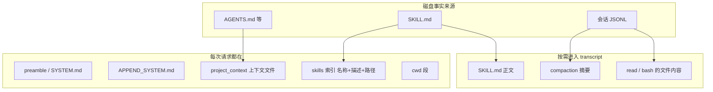

# Agent 记忆与 Skill

## 背景

在 `packages/agent`、`packages/coding-agent`、`packages/mcp` 这几层里，没有独立的向量记忆或「记忆工具」。模型跨轮能记住的东西来自三类持久文本：

1. **会话树**。已经在 [压缩与中断恢复](compaction-resume.md) 里。这是对话记忆，压缩后变成摘要加尾部。
2. **上下文文件**。`AGENTS.md`、`CLAUDE.md` 等，由 `loadProjectContextFiles` 读入，放进 system prompt 的 `project_context`。这是项目记忆，不随压缩被摘要掉，因为压缩会把当时的 system 检查点一起保存。
3. **Skill**。目录加 `SKILL.md`。系统提示只广告名称、描述和路径，正文等模型用 read 工具去读，或由用户用 `/skill:name` 显式注入。

`AgentSession` 在构建 system prompt 时把后两类交给 `buildSystemPromptSections`（`core/system-prompt.ts`）。资源扫描在 `core/resource-loader.ts` 和 `core/package-manager.ts`。

## 目标与非目标

**目标**

- 项目约定每次请求都在，且来源可追溯到文件路径。
- 长流程说明默认不占上下文，只在任务匹配时加载。
- 同名 skill、符号链接和 worktree 重复文件有确定的取舍规则。

**非目标**

- 不做 embedding、记忆打分或跨会话的自动回忆。跨会话要靠用户 `/resume` 或自己把结论写进 `AGENTS.md`。
- 不把 skill 实现成新的可执行插件。需要注册工具时用扩展，见 [网关与适配层](gateway.md)。
- 不在未授予项目信任时加载项目 `.pi/skills` 和项目扩展。`~/.agents/skills` 按用户目录处理，不要求项目信任。

## 方案

### 记忆分层



`buildSystemPromptSections` 的固定段名包括 `preamble`、`tools`、`rules`、`docs`、`addendum`、`project_context`、`skills`、`cwd`。自定义段不能叫 `preamble`，名字还要匹配 `SYSTEM_PROMPT_SECTION_NAME`。有 `customPrompt` 时，`preamble` 整段被它替换，默认的 tools / rules / docs 段不再生成；`project_context` 和 `skills` 仍按输入附加。

段是命名替换，不是把所有说明揉成一个字符串后再无法更新。agent-core 允许后续 system 消息用 `sections` 按名字打补丁，`null` 表示删除该段。会话里的第一条 system 消息会带上当时的全部段和工具声明，之后的变更再追加补丁。回放这些 system 消息就得到当前 prompt。压缩条目上的 `systemMessage` 是边界处的完整检查点，避免保留区间再把旧段放进来。

### 上下文文件

`loadContextFileFromDir` 在同一目录按这个顺序取**一个**文件：

`AGENTS.override.md`、`AGENTS.md`、`AGENTS.MD`、`CLAUDE.md`、`CLAUDE.MD`。

同目录有 override 就不再读该目录的 `AGENTS.md` / `CLAUDE.md`。override 不抑制用户 agent 目录或其他祖先目录的文件。发现不要求项目信任（`packages/coding-agent/docs/configuration.md`）。

`loadProjectContextFiles` 从 cwd 向上走，并包含 agent 目录。目录本身若叫 `AGENTS.md` 则跳过。读入内容会去掉 BOM。

嵌套 git worktree 另有去重，细节在 [Git](git.md)：worktree 根上的上下文文件会挡住主仓里同名的那一份，避免同一仓库约定被拼进 prompt 两次。`findShadowedContextFile` 用 `findGitPaths` 区分 `.git` 目录和 worktree 的 `gitdir:` 文件，并 `realpath`，因为 `git worktree add` 写的 gitdir 是真实路径，而 cwd 在 macOS 上可能经过 `/tmp` → `/private/tmp`。

渲染格式在 `renderProjectContext`：外面是「Project-specific instructions...」，每个文件包一层 `<project_instructions path="...">`。模型能看到路径，用户也能从会话里追到是哪份文件。

`SYSTEM.md` 替换默认 system prompt，`APPEND_SYSTEM.md` 追加。项目 `.pi/` 里的这两份优先于 agent 目录里的同名文件，同名文件不合并。它们和上下文文件不是同一条发现路径。

### Skill 数据模型

`Skill`（`core/skills.ts`）：

| 字段 | 含义 |
|---|---|
| `name` | 小写字母、数字、连字符，最长 64，不能首尾或连续连字符 |
| `description` | 必填，最长 1024。路由依据 |
| `filePath` | `SKILL.md` 或独立 Markdown 的路径 |
| `baseDir` | 解析相对路径用的目录，通常是 `SKILL.md` 的父目录 |
| `sourceInfo` | `user` / `project` / `path` 等来源 |
| `disableModelInvocation` | 为真时不进模型可见索引 |

`loadSkillsFromDir` 的发现规则：

- 目录里有 `SKILL.md` 就把它当作 skill 根，**不再**向下递归。
- 否则，根目录的直接 `.md` 子文件可以当作独立 skill（兼容形式）。
- 没有 `SKILL.md` 的子目录继续递归。
- 扫描时尊重 `.gitignore`、`.ignore`、`.fdignore`。

非法 frontmatter、缺 description、名字不合法：不加载，记入 `diagnostics`。同名时保留**先发现**的 skill，后发现的记 collision。同一真实路径（符号链接展开后）只加载一次。

上游实现 Agent Skills 规范的一个子集。它不强制 `name` 等于父目录名，但别的实现会强制，所以手搓仍建议目录名和 `name` 一致。`license`、`compatibility`、`metadata`、`allowed-tools` 可以出现在 frontmatter 里；Pi 的加载器把未知字段留在 frontmatter 对象上，但运行时不会据此自动授权工具。

### 索引怎么进 prompt

`formatSkillsForPrompt` 先滤掉 `disableModelInvocation`。没有可见 skill 就返回空串，`buildSystemPromptSections` 也就不写 `skills` 段。

有可见 skill 时，文本告诉模型：用 read（或 bash，如果没有 read 但有 bash）在任务匹配时读取 `location`。相对路径要相对 skill 目录解析成绝对路径再传给工具。索引本体是：

```text
<available_skills>
  <skill>
    <name>...</name>
    <description>...</description>
    <location>...</location>
  </skill>
</available_skills>
```

若 read 和 bash 都被隐藏，但其中某个仍在可选工具里，提示改成不点名工具的「Load a skill's file...」。两个都没有时，整段 skills 不注入，因为模型没有办法读文件。

这是记忆和工具的交界：skill 正文不是记忆子系统拉进来的，而是模型调用 M4 的 read 工具后，作为 tool result 进入会话。

### 显式调用

交互模式把每个 skill 登记成 `skill:<name>` 命令。`enableSkillCommands` 只影响命令是否出现在自动补全里，手工输入 `/skill:name` 仍然有效。命令后面的参数变成用户请求，附在指令后面。

用户消息若是下面这种整段文本，`parseSkillBlock`（`agent-session.ts`）把它拆开，UI 用可折叠的 skill 块显示，而不是把全文混在普通用户气泡里：

```text
<skill name="pdf-tools" location="/path/SKILL.md">
...正文...
</skill>

用户附加的要求
```

`ParsedSkillBlock` 含 `name`、`location`、`content`、可选 `userMessage`。匹配失败则当普通用户消息。手搓若要做显式命令，应该把文件内容包成这种块再送进 `prompt`，这样 TUI 和会话导出能认出它，模型看到的仍是普通 user 文本。

### 发现位置

`package-manager.ts` 收集路径，`toResolvedPaths` 按 `resourcePrecedenceRank` 排序后再交给 `ResourceLoader`。`loadSkills` 按这个顺序调用，同名时保留先出现的 skill。秩越小越先加载，因此越先赢：

| 秩 | 来源 | 是否要项目信任 |
|---|---|---|
| 0–1 | 项目 `.pi/skills`，以及从 cwd 向上直到 git 根的 `.agents/skills` | 是。`collectAncestorAgentsSkillDirs` 在仓库根停住 |
| 2–3 | 用户 `<agent-dir>/skills`（默认 `~/.pi/agent/skills`）和 `~/.agents/skills` | 否 |
| 4 | npm / git 安装的 Pi package | 项目作用域的包要信任 |
| 5 | 内置资源 | 否 |

同一秩里保持插入顺序。项目 `.pi/skills` 先于项目 `.agents/skills`，用户 agent 目录先于 `~/.agents/skills`。所以同名时项目 skill 盖过用户 skill，而不是反过来。

`loadSkills({ includeDefaults: true })` 自己会先扫用户目录再扫 `.pi/skills`，那条路径上用户 skill 会赢。`ResourceLoader.updateSkillsFromPaths` 传入 `includeDefaults: false`，因为路径已经展开，避免扫两次。手搓要和产品行为一致时，以 `resourcePrecedenceRank` 为准，不要以 `includeDefaults` 的顺序为准。

项目信任在 `trust-manager.ts`：项目 `.pi` 和 `.agents/skills` 属于需要信任的资源。未信任时不把它们放进工具和 prompt。上下文文件的发现不走这道门，这是有意的差别。skill 可以带脚本，所以比一份说明文件更敏感。

`/reload` 会重新读 keybindings、扩展、skill、prompt 模板、主题和上下文文件。手搓至少要有「重新扫描 skill 目录」的动作，否则改完 `SKILL.md` 索引不会更新。已经读进会话的正文不会自动刷新，模型需要再读一次文件。

### 和压缩的关系

skill 索引在 system prompt 里。压缩写入的 `systemMessage` 检查点包含当时的段，所以摘要之后模型仍然知道有哪些 skill，不必从被丢掉的旧 user 消息里回忆。skill 正文如果是某次 tool result，就和其他消息一样可能被摘要掉。这是预期行为：正文大，索引小，需要时再读。

不要把 `SKILL.md` 全文预先拼进 `project_context`。那会抵消按需加载，也会让 M2 的 `keepRecentTokens` 更早触发。

## 备选方案

| 方案 | 放弃原因 |
|---|---|
| 向量库记忆 | 上游这几个包没有这条路径。会话树加上下文文件已经覆盖「对话记得什么」和「项目要求什么」。 |
| 启动时把所有 `SKILL.md` 读进 prompt | 描述足够做路由。全文进上下文会挤占 `keepRecentTokens`，也让无关 skill 的指令污染每次请求。 |
| skill 等于扩展 | 扩展能注册工具和订阅事件，必须是可执行代码，还受项目信任约束。skill 只是说明和附属文件。 |
| 同名 skill 后来的覆盖先前的 | 上游保留先发现的并报 collision。静默覆盖会让项目 skill 意外盖掉用户 skill，或相反，取决于扫描顺序，难以诊断。 |

## 横切关注点

- **错误**：单个 skill 损坏不影响其他 skill。诊断要带路径。上下文文件读失败时上游打警告并跳过，不阻止启动。
- **并发**：扫描是同步文件系统读取，发生在会话启动和 `/reload`，不在工具执行途中改 `skills` 段。若 reload 发生在 run 期间，应等 idle 再替换 prompt，否则会和 `declareToolChanges` 交错。
- **持久化**：skill 和 `AGENTS.md` 是外部文件，不复制进 JSONL。会话只保存当时生成的 system 消息。文件后来改了，旧会话的检查点仍是旧文本，直到下一次 prompt 重建或压缩写出新检查点。
- **安全**：项目 skill 可以让模型跑脚本。未信任的项目不要加载。`allowed-tools` 不要在手搓第一版里解释成自动放权。

## 手搓实现笔记

M3 依赖 M2 的 system 消息追加：

1. 实现 `loadContextFileFromDir` 的文件名优先级和向上遍历。用三层目录的夹具断言 override 只作用于同目录。
2. 实现 `Skill` 校验和 `loadSkillsFromDir`。夹具要覆盖「有 `SKILL.md` 则不递归」、缺 description、名字碰撞、符号链接。
3. `formatSkillsForPrompt` 的输出用快照测试固定下来。
4. 假模型第一次请求的 system 文本包含 `<location>` 且不包含 skill 正文；第二次在 read 工具结果里才出现正文。
5. 显式命令读文件并包成 `parseSkillBlock` 能识别的 user 消息。
6. 项目信任可以简化成一个布尔值：未信任时不扫描 `.pi/skills` 和项目 `.agents/skills`。

不要在这一步做 git 操作。worktree 去重可以先留接口，到 M4 再接 `findGitPaths`。
