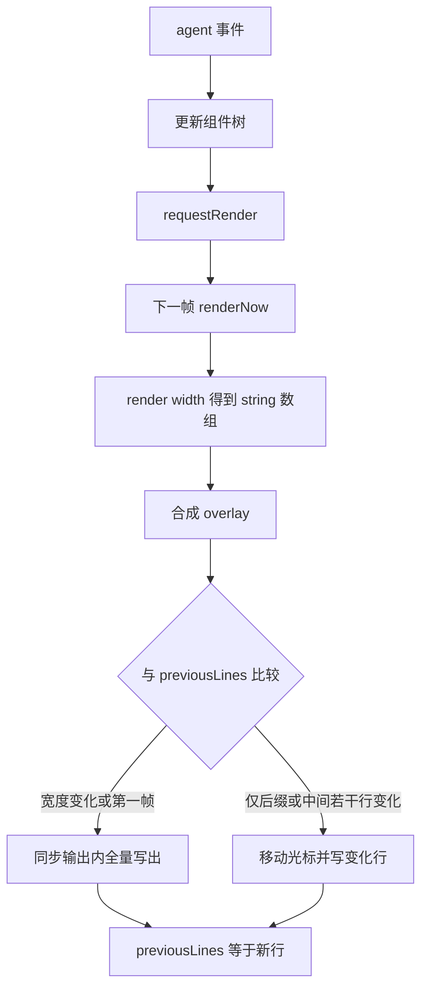

# TUI 设计

## 背景

`@earendil-works/pi-tui`（`packages/tui`）是独立的终端库。它不知道模型、会话和工具。coding-agent 的交互模式（`packages/coding-agent/src/modes/interactive/interactive-mode.ts`）把 `AgentSession` 的事件翻译成组件树，再用这个库画出来。

库的核心承诺写在 `packages/tui/README.md`：差分更新、CSI 2026 同步输出、组件的 `render()` 返回字符串行。主屏幕渲染器保留终端回滚；备用屏幕渲染器自己管视口。Pi 的默认交互界面走主屏幕，这样用户仍能用终端自身的滚动回看上面的输出。

手搓 M6 只消费前面里程碑已经稳定的事件。不要在 TUI 里做压缩判断或 JSONL 写入。

## 目标与非目标

**目标**

- 把会话画成可增长的对话，底部是编辑器和页脚。
- 流式 token 和工具进度只重画变化的行。
- 键盘焦点、overlay 对话框和 abort 有明确的归属。

**非目标**

- 不移植 Kitty / iTerm2 图像、LaTeX、主题编辑器和全部内置组件。
- 不在第一版使用备用屏幕。`TuiAltScreen` 的视口滚动是另一套布局（`VStack`、`ScrollView`），主屏幕没有这些语义。
- 不让组件直接调用 `Agent.prompt`。组件产生「用户提交了这段文本」的意图，由 `InteractiveMode` 调用 session。

## 方案

### 组件模型

`tui.ts` 里的 `Component` 只有一个必须实现的方法：`render(width: number): string[]`。宽度由渲染器传入，组件自己折行。返回值是已经带 ANSI 样式的逻辑行，不含换行符。

组件可以声明 `invalidate()`，在主题变化时丢掉缓存。鼠标区域、焦点和 overlay 由 `TUI` 接口管理，不由组件去写 stdout。

内置组件里，手搓对话界面实际会用到的是：

| 组件 | 文件 | 用途 |
|---|---|---|
| `Text` / `Markdown` | `components/text.ts`、`markdown.ts` | 用户和 assistant 正文 |
| `Editor` | `components/editor.ts` | 底部输入。`onSubmit` 交出字符串 |
| `Loader` | `components/loader.ts` | 等待模型或工具 |
| `SelectList` | `components/select-list.ts` | RPC 文档里的 `select` 在 TUI 侧的对应物 |
| `Box`、`Spacer` | `components/box.ts`、`spacer.ts` | 间距和对齐 |
| `ScrollView`、`VStack` | 仅备用屏幕布局 | M6 不做 |

coding-agent 在 `modes/interactive/components/` 又包了一层：`assistant-message`、`tool-execution`、`compaction-summary-message`、`skill-invocation-message`、`footer`。这些不是 tui 包的一部分。它们把领域事件格式化成 `Text` 或 `Markdown`。手搓可以少做几种，但工具执行和压缩摘要应该有单独的行样式，否则用户分不清模型输出和工具输出。

### 渲染器

`TUI` 是接口。构造时才选择实现：

- `TuiMainScreen`：画在主缓冲区，`previousLines` 保存上一帧的全部逻辑行。
- `TuiAltScreen`：备用缓冲区，固定高度视口，停止时恢复主缓冲区并打印最终文档。
- `ProcessTerminal`：真实的 stdin/stdout。测试可以换成记录 `write` 调用的假终端。

`requestRender()` 只把 `renderRequested` 设为真并安排一次定时器。同一帧里多次请求合并成一次 `renderNow`。流式 `message_update` 必须走这条路径。每个 token 同步 `renderNow` 会让终端解析速度落后于模型。

`TuiMainScreen.renderNow` 的差分（`tui-main-screen.ts`）：

1. `render(width)` 得到新行，先解析伪光标，再把 overlay 合成进这些行。比较发生在合成之后，所以上一帧和下一帧看到的是用户最终看见的画面。
2. 第一帧直接写出，不清屏。
3. 宽度变化必须全量重画，因为折行变了。高度变化通常也全量重画；Termux 在软键盘弹出时高度会变，全量重画会把历史再放一遍，所以那里跳过。
4. 逐行比较 `previousLines` 和新行，找出第一处和最后一处不同。
5. 若只是在末尾追加，从旧长度的位置接着写。
6. 行数变少且打开了 `clearOnShrink`、又没有 overlay 时，全量重画以擦掉残留。
7. 输出包在 `\x1b[?2026h` 和 `\x1b[?2026l` 之间。这是 CSI 2026 同步输出，终端会等结束标记再一次显示，避免半帧闪烁。

全量重画用 `\x1b[2J\x1b[H\x1b[3J` 清屏、光标归位并清回滚。差分路径不能发这个序列，否则用户回看历史的能力没有了。



调试开关 `PI_TUI_DEBUG_REDRAW=1` 会把每次全量重画的原因记到日志。手搓测试不必读这个日志，直接断言假终端收到的写入里没有重复的历史行即可。

### 交互模式怎么接事件

`InteractiveMode` 订阅 `AgentSession`。事件到组件的映射：

| 事件 | 界面 |
|---|---|
| user `message_end` | 追加用户气泡。若 `parseSkillBlock` 成功，用可折叠的 skill 头 |
| assistant `message_update` | 更新当前气泡的未完成文本 |
| assistant `message_end` | 冻结该气泡 |
| `tool_execution_start` / `update` / `end` | 工具块显示名称、参数和结果或错误 |
| `compaction_start` / `compaction_end` | 状态行「正在压缩」，结束后追加摘要块 |
| `queue_update` | 编辑器附近显示尚未注入的 steering / follow-up 条数 |
| `agent_end` | 收起 loader，焦点回到编辑器 |

页脚不订阅 git。它读 `FooterDataProvider.getGitBranch()` 和会话用量。分支 watcher 在交互模式启动时装上，cwd 变化时 `setCwd`。详见 [Git](git.md)。

编辑器 `onSubmit` 时：若 session 空闲，调用 `prompt`；若正在跑，交互模式要求这次输入是 steer 还是 follow-up（上游用不同的提交键，键位来自 `DEFAULT_APP_KEYBINDINGS`，不要在代码里写死某个 ctrl 组合）。`AGENTS.md` 禁止把 `matchesKey(key, "ctrl+x")` 这类检查散落在功能代码里，默认键应进键位表。手搓可以先做两张键位表：提交、中断。

Ctrl+C 在原始模式下不会变成 SIGINT。`TUI` 的输入监听里识别中断键，调用 `session.abort()`，再把 `clearQueue()` 的文本放回编辑器。这是 M2 中断语义在界面上的唯一入口。

overlay 用于 `/resume` 一类的选择器，也用于扩展的 `select` 和 `confirm`。overlay 打开时焦点交给它，底层编辑器不再收到按键。渲染器在差分前把 overlay 画进行数组，所以关闭 overlay 会自然变成一次行变化，不需要单独的「清对话框」系统调用。

### 颜色与宽度

`colors.ts` 把索引色、sRGB 和 OKLCH 都转成 sRGB 再生成 ANSI。索引色 0–15 随终端主题变化，转出来的 sRGB 只是近似。每次 `render` 都做 OKLCH 转换会贵，库的 README 要求常用颜色先转成 sRGB 再复用。手搓第一版可以用固定的 ANSI 颜色，不引入 OKLCH。

宽度必须按终端列而不是 JavaScript 字符串长度计算。中文和 emoji 会让 `previousLines` 的比较仍然正确（比较的是整行字符串），但光标列会错。若 M6 要支持中文输入，列宽函数要单独测试。差分算法本身不需要改。

### 和 RPC 的分工

扩展 UI 在 TUI 里是 overlay，在 RPC 里是 `extension_ui_request`。`InteractiveMode` 实现 `ExtensionUIContext`，`runRpcMode` 实现另一份。两边都不要画对方的输出。手搓可以定义：

```text
interface UiRequest {
  select(items): Promise<string | null>
  confirm(text): Promise<boolean>
  notify(text): void
}
```

TUI 和测试桩各写一个实现。Session 和扩展只依赖这个接口。这样 M5 的 RPC 测试不用启动终端。

## 备选方案

| 方案 | 放弃原因 |
|---|---|
| 每次事件 `console.log` 全文 | 流式输出会刷掉用户正在看的内容，也无法在底部固定编辑器。 |
| 备用屏幕作为第一版 | 要自己实现滚动、鼠标和退出时的全文回放。主屏幕把滚动交给终端，差分只处理变化行。 |
| 用 ncurses | 上游选择自己发 ANSI，是为了同步输出、bracketed paste 和图像协议。手搓引入 ncurses 不会更接近 Pi 的结构。 |
| 组件里直接 `terminal.write` | 差分层会不知道这行变过，下一帧可能把它擦掉或重复。所有可见内容都要出现在 `render()` 的返回值里。 |

## 横切关注点

- **错误**：渲染抛错不能杀掉 agent run。渲染器应捕获组件异常，画一行错误并继续。模型请求仍由 session 推进。
- **并发**：`requestRender` 合并到一帧。事件处理程序里不要等待 `renderNow` 完成后再处理下一条 agent 事件，否则慢终端会堵住 `message_end` 的订阅者。若订阅者负责写盘，堵住它会推迟 JSONL。手搓应让 TUI 订阅不在落盘那条监听器里做重活。
- **持久化**：TUI 不写会话。退出时主屏幕实现把最后一帧留在终端上（`preserveScreen` 一类选项）。备用屏幕才会在停止时打印最终文档。
- **输入**：原始模式要处理 bracketed paste，否则粘贴的多行会被当成多次按键。库支持大粘贴标记。M6 至少要保证粘贴的换行不会逐行提交 prompt。
- **中断**：中断键只调用 `abort()`。不要在 TUI 里杀进程，否则 M2 来不及把 aborted 消息写入文件。

## 手搓实现笔记

1. 写 `Component` 和假终端。一个 `Text` 加一个 `Editor`，断言 `render(40)` 的行数。
2. 移植差分规则的最小子集：第一帧、末尾追加、中间一行变化、宽度变化全量重画。用字符串比较 `previousLines`，先不要接真实 stdin。
3. 给写入包上 CSI 2026 的开始和结束标记。测试只检查成对出现。
4. 把 M1 的事件回放喂给组件树，录下每一帧的行。`message_update` 十次只产生一轮合并后的渲染调度。
5. 接上 `ProcessTerminal` 和中断键。手动或脚本化按键：提交一句、看到工具行、按中断、编辑器里出现未发送文本，会话文件里有 `stopReason: "aborted"` 或已完成的工具错误结果。
6. 页脚最后接 `getGitBranch()`。在此之前用固定字符串，避免 M6 被 git 监视器挡住。

验收失败时先看是事件没到组件，还是差分把行算错。这两种 bug 的修复位置不同，不要在 `InteractiveMode` 里补偿渲染器的错误。
