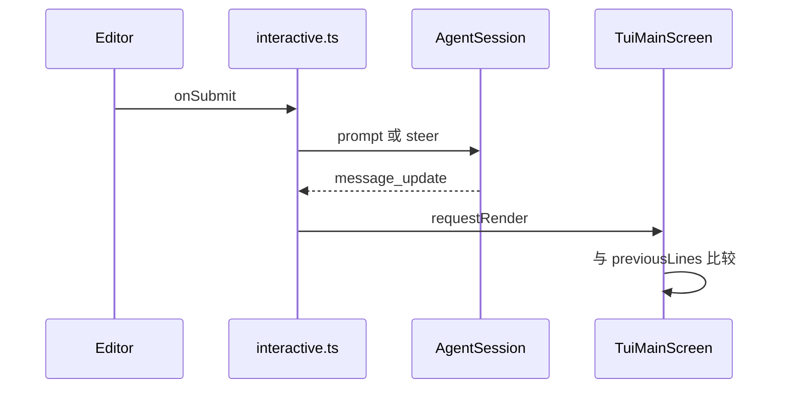

# TUI 设计

## 背景

`@my/tui` 对应 `packages/tui`。上游 `TuiMainScreen` 在 `packages/tui/src/tui-main-screen.ts` 里保存 `previousLines`，只写出变化的行，并用 CSI 2026（`\x1b[?2026h` / `\x1b[?2026l`）把一帧包成一次刷新。`packages/tui/src/tui.ts` 定义 `Component.render(width)`。

coding-agent 的 `modes/interactive/interactive-mode.ts` 把 `AgentSession` 事件翻译成组件。那个文件有数千行。本仓库只实现对话、编辑器、工具行和页脚，放在 `apps/cli/src/interactive.ts`，不放进 tui 包。tui 包不知道 `Agent`。

## 目标与非目标

**目标**

- 假终端上能断言差分行为。
- 交互进程把提交和中断交给已经存在的 `AgentSession`。

**非目标**

- 不实现 `TuiAltScreen`、鼠标、Kitty 图像、OKLCH、主题文件。
- 不在组件里调用 `session.prompt`。`interactive.ts` 做这件事。

## 本模块在仓库中的位置

```text
packages/tui/
  package.json
  tsconfig.json
  src/index.ts
  src/types.ts                 # 上游 tui.ts 的 Component 和 Terminal
  src/terminal.ts              # ProcessTerminal、FakeTerminal
  src/main-screen.ts           # class TuiMainScreen
  src/keys.ts                  # 键位表
  src/components/text.ts
  src/components/editor.ts
  test/diff-render.test.ts
  test/editor.test.ts
apps/cli/src/interactive.ts    # 事件到组件
apps/cli/test/abort.test.ts
```

| 文件 | 职责 |
|---|---|
| `types.ts` | `Component`、`Terminal`、`KeyEvent` |
| `terminal.ts` | 真实 stdout 写入，以及把写入记进数组的假终端 |
| `main-screen.ts` | 请求合并、行比较、CSI 2026 |
| `keys.ts` | 名字到序列的表。默认 `app.submit` 是 `enter`，`app.abort` 是 `ctrl+c` |
| `components/text.ts` | 按宽度折行。中文按占两列算 |
| `components/editor.ts` | 单行缓冲、`onSubmit` |
| `interactive.ts` | 订阅 `AgentSession`，维护对话组件列表和页脚 |

**依赖**：tui 包禁止 import `@my/*`。`interactive.ts` 可以 import tui、session、tools 的 `findGitPaths` 和 `resolveBranch`。

**磁盘**：无。退出时主屏幕把最后一帧留在终端上，不另写文件。

## 接入 agent 循环



`interactive.ts` 的订阅器只改组件树并 `requestRender()`。它不 `await` 渲染完成，也不调用 `appendMessage`。写盘监听器在 `AgentSession` 内部，早于这个订阅。

映射：

| 事件 | 组件 |
|---|---|
| user `message_end` | 追加一个 `Text`，前缀 `you ` |
| assistant `message_update` | 更新最后一个 assistant `Text` |
| assistant `message_end` | 冻结该 `Text` |
| `tool_execution_end` | 追加 `tool <name> ` 加结果的第一行。`isError` 时前缀改成 `tool <name> error ` |
| `compaction_start` | 页脚临时文本 `compacting` |
| `compaction_end` | 页脚去掉该文本 |
| `agent_end` | 焦点回到 `Editor` |

`parseSkillBlock` 成功时，对话行用 `skill <name>`，不把正文展成多行。正文仍在会话里。

## 核心数据结构

```ts
export interface Component {
  render(width: number): string[];
}

export interface Terminal {
  columns: number;
  rows: number;
  write(data: string): void;
  onData(cb: (data: string) => void): () => void;
}

export interface KeyBinding {
  name: "app.submit" | "app.abort";
  sequence: string;
}

export const DEFAULT_KEYS: KeyBinding[] = [
  { name: "app.submit", sequence: "\r" },
  { name: "app.abort", sequence: "\u0003" },
];

export class Text implements Component {
  constructor(content: string);
  setContent(content: string): void;
  render(width: number): string[];
}

export class Editor implements Component {
  onSubmit?: (text: string) => void;
  setValue(text: string): void;
  getValue(): string;
  render(width: number): string[];
  handleKey(sequence: string): void;
}

export class FakeTerminal implements Terminal {
  columns: number;
  rows: number;
  writes: string[];
  write(data: string): void;
  pushInput(data: string): void;
}

export class TuiMainScreen {
  constructor(terminal: Terminal);
  addChild(component: Component): void;
  requestRender(): void;
  renderNow(): void;
  /** 测试读取上一帧。生产代码不要依赖它做逻辑 */
  getPreviousLines(): string[];
}
```

### 渲染器状态

不要把这些字段导出给 `interactive.ts`：

```ts
interface ScreenState {
  previousLines: string[];
  previousWidth: number;
  renderRequested: boolean;
}
```

`requestRender` 若 `renderRequested` 已经是 true，直接返回。否则设为 true，并用 `queueMicrotask` 调用 `renderNow`。一次事件循环里的十次 `message_update` 只产生一次 `renderNow`。测试用微任务把断言排到渲染之后，不要 `setTimeout`。

`renderNow`：

1. `previousWidth` 与当前 `terminal.columns` 不同，且 `previousLines` 非空：写入 `\x1b[?2026h\x1b[2J\x1b[H`，再写全部新行，用 `\r\n` 连接，最后 `\x1b[?2026l`。然后保存 `previousLines`。
2. `previousLines` 为空：同样包上 CSI 2026，但不写 `\x1b[2J`。第一帧不清屏。
3. 否则从 0 扫描到 `max(old, new)`，找到第一处和最后一处不同的行。只把这个闭区间写出去。写之前把光标移到第一处不同的行。手搓用 `\x1b[${row + 1};1H` 绝对定位，不模拟上游那套滚动差分。这是写明的简化，测试断言变化行的文本出现，并且第一行文本在追加场景下没有第二次出现。
4. 新行比旧行少：在差分之后对多出来的行写清空。清空就是该行位置上写一串空格，长度为上一帧该行的可见宽度。不要为了缩短而全量 `\x1b[2J`，否则回滚历史会丢。只有宽度变化才全量清屏。

每一帧，无论哪条路径，输出都以 `\x1b[?2026h` 开始、以 `\x1b[?2026l` 结束。

### 编辑器

`Editor` 持有 `string` 缓冲。`handleKey`：

- 序列等于 `app.submit`：若缓冲非空，调用 `onSubmit(buffer)` 并清空。
- 序列等于 `app.abort`：不在编辑器里处理。`TuiMainScreen` 把未被子组件吃掉的键交给 `onKey`。
- 普通可打印字符追加。退格是 `\u007f`，删掉最后一个码点，不是最后一个 UTF-16 单元。

bracketed paste：以 `\x1b[200~` 开始、以 `\x1b[201~` 结束的输入整段插入缓冲，其中的 `\n` 和 `\r` 换成空格。不在粘贴中间触发 `onSubmit`。粘贴结束后用户仍要按提交键。这是手搓默认，避免多行粘贴变成多次 `prompt`。

### 页脚

`interactive.ts` 里用一个 `Text` 当页脚，不新建 `Footer` 类。内容为：

```text
<branch>  <sessionPhase>
```

`branch` 来自 `resolveBranch(findGitPaths(cwd)?.repoDir ?? "")`。`findGitPaths` 为 `null` 时分支段省略。`resolveBranch` 返回 `null` 且 git 路径存在时，分支段是 `detached`。`sessionPhase` 在 `compaction_start` 到 `compaction_end` 之间是 `compacting`，`agent_start` 到 `agent_end` 之间是 `running`，否则是 `idle`。

页脚不每帧启动 git。`interactive.ts` 在启动时调用一次，之后每 2 秒调用一次 `resolveBranch`。不要监视 `HEAD` 文件。上游有 watcher，M6 用轮询代替，避免 `fs.watch` 在测试里挂住。

## 方案

`interactive.ts` 导出：

```ts
export async function runInteractive(options: {
  session: AgentSession;
  terminal: Terminal;
  cwd: string;
}): Promise<void>
```

提交键：session 的 phase 为 `idle` 时 `session.prompt(text)`。phase 不是 `idle` 时 `session.steer` 一条 user 消息，文本就是编辑器内容。不要弹出菜单询问 steer 还是 follow-up。follow-up 在 M6 不绑定按键。这是默认，写进 `abort.test.ts` 之外的一个小测试：运行中提交会调用 `steer` 而不是 `prompt`。

中断键调用 `session.abort()`，再 `editor.setValue(clearQueue 返回的 steering.concat(followUp).join("\n"))`。多条用换行拼回缓冲。编辑器 M6 仍是单行组件，但缓冲里允许有 `\n`，`render` 时把 `\n` 显示成空格。用户再提交时整段作为一条消息。

`ProcessTerminal` 把 stdin 设为 raw mode。`runInteractive` 的 Promise 在收到中断且 session 已经 idle、并且用户再按一次 `ctrl+c` 时 resolve。第一次 `ctrl+c` 只 abort。第二次在 idle 时退出。不要用 SIGINT，raw mode 下它不会来。

## 备选方案

| 方案 | 放弃原因 |
|---|---|
| 每个 token `console.log` | 没有稳定的编辑器行，也无法差分 |
| 备用屏幕作为第一版 | 要自己做滚动。主屏幕把历史留给终端回滚 |
| 组件直接 `terminal.write` | 下一帧的比较会漏掉这些字节 |
| 复制上游整份光标滚动差分 | `interactive.ts` 用绝对定位已经能满足「不重放第一行」的测试。滚动优化可以以后再加 |

## 横切关注点

- **错误**：`render()` 抛错时 `renderNow` 捕获并写一行 `render error`，然后返回。不要杀掉 agent。
- **并发**：订阅器禁止 `await tui.renderNow()`。`requestRender` 是同步登记。
- **持久化**：无。
- **输入**：粘贴中的换行不变成提交。测试把 `\x1b[200~a\nb\x1b[201~` 推进 `FakeTerminal`，`onSubmit` 调用次数为 0，缓冲为 `a b`。

## 手搓实现笔记

按总览 M6 的 6 步。`diff-render.test.ts` 用两行 `Text`，第二次只改第二行，把 `writes.join("")` 断言为不含第一行字符串的两次出现。宽度测试把 `columns` 从 40 改到 20 再 `renderNow`，断言含 `\x1b[2J`。先让这两个测试失败，再写 `main-screen.ts`。
